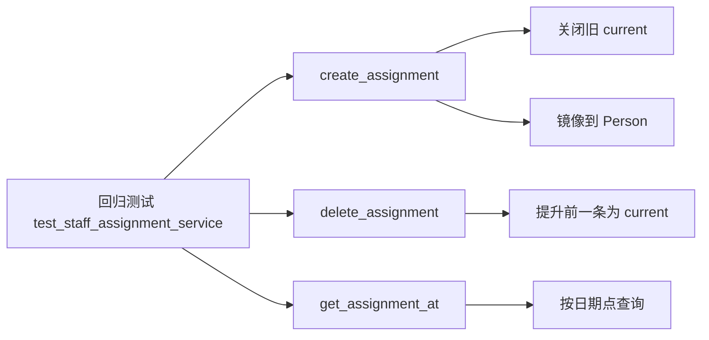

# A-20260901-002-staff-assignment-scd2-service-test

**状态**：LOCKED（v1.0）
**日期**：2026-09-01
**架构师阶段产出**：Architect 架构师 Agent
**审查结论**：<待人工终审>

## 背景

`backend/app/services/staff_assignment_service.py` 维护人员任职历史的 **SCD Type 2 区间**（`staff_assignments` 表），是"按当时任职关联历史业务数据"的核心逻辑（对应 `docs/arch/_pending/staff-assignment-history.md`）。当前**无任何自动化测试**，以下核心不变式易被改动破坏：

1. 每人至多一条 `is_current=true`
2. 新增开区间任职时，自动关闭旧 current（`effective_to = new_from - 1天`）
3. 删除 current 时，提升 `effective_from` 最大前一条为 current
4. `get_assignment_at` 按日期返回当时有效任职

## 一、模块边界图

## 二、测试设计（数据库变更：无，仅新增测试）

| 用例 | 场景 | 断言 | 类型 |
|---|---|---|---|
| T1 | 首条开区间任职 | `is_current=true`，镜像到 Person | 正向 |
| T2 | 第二条开区间任职 | 旧 current 关闭（`effective_to=new_from-1`），新 current=true | 正向 |
| T3 | 补录历史封闭区间 | 不动 current，`is_current=false` | 边界 |
| T4 | 新增日期早于当前 | 抛 `ValueError` | 边界 |
| T5 | 删除 current | 前一条提升为 current + 镜像 | 边界 |
| T6 | 删除唯一 current | 清空 Person 镜像 | 边界 |
| T7 | `get_assignment_at` 区间内命中 | 返回当时任职 | 正向 |
| T8 | `get_assignment_at` 区间外 | 返回 None | 边界 |

## 三、风险清单

1. **依赖 DB 部分唯一索引**（每人一条 current）：测试须用 `db` fixture 事务回滚隔离，避免互相污染。
2. **`Person.display_name` 必填**：构造 Person 时必须提供，否则建表/插入失败。
3. **`delete_assignment` 删除后提升逻辑**：若前一条记录本身是封闭区间，提升时会改 `effective_to=None`——测试需覆盖此分支。

## 人工终审重点

- [ ] T2 是否验证了旧 current 的 `effective_to = new_from - 1天`（而非直接置 null）？
- [ ] T5 删除 current 后，前一条的 `effective_to` 是否被置 None？
- [ ] T8 是否覆盖了"封闭区间结束日之后"的查询？
