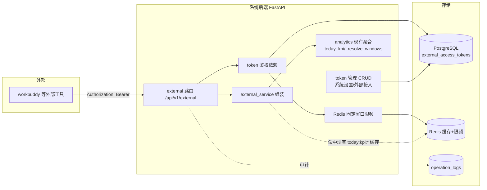

# A-20260902-021 外部工具只读开放平台

**状态**：LOCKED（v1.0）
**锁定日期**：20260902
**锁定脚本**：scripts/lock-arch-docs.sh（手动编号 021）
**日期**：2026-09-02
**输入**：`docs/需求派工单-外部工具只读开放平台-草稿.md`
**架构师阶段产出**：Architect 阶段产出（人工终审锁定）

---

## 〇、与需求派工单的映射

| 派工单决策 | 本文落地位置 |
|---|---|
| 多只读 API + scope | §二 接口契约 |
| token 落库 + migration + Web 管理 | §三 数据库 ER + §四 模块边界 |
| 一期维度 + 一键简报(日/周/月) | §二.2 period |
| period 口径(daily/weekly/monthly) | §二.2（映射 `_resolve_windows`）|
| 审计复用 operation_logs/system_events | §四 + §五.3 |
| Redis 固定窗口限频 | §五.2 |
| 文档分开维护 | §六 文档变更 |

---

## 一、模块边界图



- **只读链路**：外部工具 → `external` 路由 → token 鉴权（查 `external_access_tokens`）→ Redis 限频 → `external_service` 组装（复用 `analytics` 聚合）→ 返回 `{code:0,data,message}`。
- **管理链路**：管理员（登录 JWT）→ `/system` 或独立管理路由 → token CRUD（生成/配 scope/设频次/吊销）。管理接口走现有 `AdminUser` 依赖。
- 全程**无写业务表、无同步触发、无缓存失效写**；仅 `last_used_at` 轻量更新 + 审计落 operation_logs。

---

## 二、接口契约

### 2.1 维度端点（单日，scope 校验）

> 统一复用 `analytics.today_kpi(db, date=date)`，取对应维度字段，**独立 schema 重组**（不整包透传）。`date` 缺省=今天（北京时间，`_resolve_windows` 单日模式已实现：今天→0点起实时、历史→整天）。

#### `GET /api/v1/external/reception` — scope: `reception`

| 字段 | 类型 | 说明 |
|---|---|---|
| `date` | string `YYYY-MM-DD` | 数据日期（北京时间） |
| `generated_at` | string ISO | 生成时间（北京时间） |
| `reception` | object | `{value, yoy_value, yoy_pct, device_count, device_count_yoy}`（接待量=客服处理记录数，设备数=去重 SN） |
| `_spec` | object | 口径注释（接待量定义等） |

请求：`GET /api/v1/external/reception?date=2026-09-01`（date 可选）
成功：`200 {code:0, data:{...}, message:"ok"}`
错误：`401`（token 缺失/无效/吊销）、`403`（无 `reception` scope）、`400`（date 非法格式）、`429`（限频）

> ⚠️ **`reception` 单日端点保持简单**：仅当日接待量 + 服务设备数 + 环比，**不含**专项名单/会话/设备细分（用户确认，接待专项增强只放 `brief`，见 §2.2）。

#### `GET /api/v1/external/refund` — scope: `refund`

| 字段 | 类型 | 说明 |
|---|---|---|
| `date` / `generated_at` | string | 同上 |
| `refund_count` | object | `{value, yoy_value, yoy_pct}`（四路经营合计笔数 A+B+C+D） |
| `refund_amount` | object | 同上，**单位：元，2 位小数**（四路合计金额） |
| `refund_done_today` | object | 当日完成退款（路线A 按更新时间，含金额） |
| `actual_cashflow` | object | 真实现金流 E（merchant_refunds SUCCESS 合计，元） |
| `_spec` | object | 口径注释（明确四路口径与金额单位=元） |

> ⚠️ **`refund` 单日端点保持简单**：仅四路合计金额/笔数 + 当日完成退款 + E，**不含**四路 routes 明细与涉诉率（用户确认，退款增强只放 `brief`，见 §2.2）。

#### `GET /api/v1/external/complaint` — scope: `complaint`

| 字段 | 类型 | 说明 |
|---|---|---|
| `date` / `generated_at` | string | 同上 |
| `complaint` | object | `{value, yoy_value, yoy_pct}`（service_tickets 投诉 + external_complaints + card_complaints 三表并集，落当日） |
| `_spec` | object | 口径注释（三源并集口径） |

> ⚠️ **`complaint` 单日端点保持简单**：仅当日新增投诉总量 + 环比，**不含**三源×登记/处理/积压细分（用户确认，投诉增强只放 `brief`，见 §2.2）。

### 2.2 一键经营简报端点（period，scope: `brief`）

#### `GET /api/v1/external/brief?period=daily|weekly|monthly&date=YYYY-MM-DD`

**period 窗口口径（用户确认，映射 `analytics._resolve_windows` 的 start/end 模式）：**

| period | 窗口定义 | `_resolve_windows` 落点 |
|---|---|---|
| `daily` | 当日 0 点起（实时）；`date` 给定 → 该整天 | `_resolve_windows(date=date)`（单日模式） |
| `weekly` | 按整周核算（周一起）；当前周 → 周一起至 now | `_resolve_windows(start=周一, end=今天或周日)` |
| `monthly` | 整月；未满月 → 1 日至当前 | `_resolve_windows(start=1日, end=今天或月末)` |

> 实现要点：`brief` 后端先把 period+date 换算成 `start/end` 两个日期串，再调 `today_kpi(db, start=start, end=end)`（`_resolve_windows` 已处理：end==今天→实时截止 now，否则整天；环比自动前移等长周期）。**不新写窗口逻辑，纯复用。**
>
> **退款增强维度复用 `refund_decision_overview(db, start, end, grain)`**（6796 行，已支持 start/end 窗口 + grain=day/week，内部含四路/E/涉诉/钱包水位/原因Top）。`grain` 映射：daily→`day`、weekly/monthly→`week`（决策概览按日/周聚合）。
>
> **投诉增强维度复用 `complaints.py` 的 `complaint_summary` / `complaint_backlog` 口径**（三源分类 `_complaint_source_type_case` + 积压归一化判定），`brief` 在其上做 start/end 窗口 + schema 重组，**不另起投诉统计逻辑**。
>
> **接待专项增强复用两套既有数据并按人关联**（用户确认：名单=组织分配，会话/设备=内容分桶）：
> - **专项名单**：`specialties` 表（`list_specialties`/`get_specialty` 现成返回负责人 + `assigned_persons` 当前分配人员，含 `is_primary`/`workload_ratio`）。
> - **会话/设备分桶**：`today_staff_efficiency(db, date/start/end)` 已算好每人×6标准专项的 `sp_*`（会话数）与 `pp_*`（设备数 SN 去重，跨 cs_record∪工单）。
> - **关联键**：`specialties.name`（咨询接待/套餐专项/退款处理/退款挽回/内部投诉/外部投诉）与 `today_staff_efficiency` 的 6 桶名一致（`_hr_map` 归一化到同名），按"人→其分配专项"关联后，把该人落在对应内容桶的量计入该专项。

**返回结构（建议）——含接待专项 + 退款 + 投诉增强维度（用户补充确认）：**

```json
{
  "code": 0, "message": "ok",
  "data": {
    "period": "daily",
    "date_start": "2026-09-01T00:00:00+08:00",
    "date_end": "2026-09-02T18:30:00+08:00",
    "generated_at": "...",
    "reception": {
      "total": {...},            // 当日/周期总接待量 + 服务设备数 + 环比(同单日端点口径)
      "by_specialty": [
        {
          "specialty": "退款挽回",          // 系统正式专项名(consulting/package/refund_processing/refund_recovery/internal_complaint/external_complaint)
          "is_temporary": false,
          "lead": {"name": "朱海洋", "role": "lead"},   // 负责人(可空)
          "members": [                     // 当前分配人员名单(组织口径, is_current)
            {"name": "张三", "is_primary": true, "workload_ratio": 1.0, "position": "...", "group_name": "..."},
            {"name": "李四", "is_primary": false, "workload_ratio": 0.5}
          ],
          "sessions": {...},     // 该专项会话数 = 本专项成员按接待内容归入本专项的会话合计(含 yoy)
          "devices": {...}       // 该专项设备数(SN去重)合计(含 yoy)
        },
        { "specialty": "内部投诉", ... },
        { "specialty": "外部投诉", ... },
        { "specialty": "退款处理", ... },
        { "specialty": "套餐专项", ... },
        { "specialty": "咨询接待", ... }
      ]
    },
    "complaint": {
      "total": {"registered": {...}, "handled": {...}, "backlog": {...}},
      "by_source": [
        {
          "source": "内部投诉",
          "registered": {...},  // 窗口内新登记(按登记时间)
          "handled": {...},     // 窗口内完成/办结(按完成时间)
          "backlog": {...}      // 窗口截止时未闭环存量(积压)
        },
        {"source": "商户号投诉", ...},
        {"source": "外部投诉", ...}
      ]
    },
    "refund": {
      "total_amount": {...},   // 指标总额 = 四路经营合计金额(元,含 yoy_value/yoy_pct 与昨日同区间比较)
      "total_count": {...},    // 四路合计笔数(含环比)
      "routes": {              // 四路分别金额 A/B/C/D(单位:元,2位小数)
        "route_a": {"count":..., "amount":...},
        "route_b": {...}, "route_c": {...}, "route_d": {...}
      },
      "actual_cashflow_e": {...},   // E 商户号SUCCESS(对账基准,元)
      "a_route": {
        "litigation_ratio": {...},   // A路直退涉诉率(%) = 涉诉金额/A路金额×100, 含 yoy_value/yoy_pct
        "litigation_amount": {...}   // 涉诉金额(元, 含明细桶: 外部/商户号/内部/备注涉诉 可选)
      }
    },
    "_spec": {...}   // 口径注释: 投诉三源/登记处理积压 + 退款涉诉定义 + 金额单位=元
  }
}
```

**投诉增强口径（用户确认：新增/完成/存量漏斗 × 三源）：**

| 字段 | 口径 |
|---|---|
| `registered` | **窗口内新登记**投诉数（按登记时间 `register_time`/`complaint_date` 落窗口） |
| `handled` | **窗口内完成/办结**投诉数（按完成时间 `finish_time` 落窗口；真实完成判定同 `_is_real_finish`） |
| `backlog` | **窗口截止时未闭环存量**（积压）；口径复用 `/complaints/backlog`：归一化状态非已完成（处理中/待处理/待跟进），排除"待处理但实际已真实完成(finish 晚于登记 3min)" |
| `by_source` | 三源分类：内部投诉 / 商户号投诉 / 外部投诉（复用 `_complaint_source_type_case`：微信→商户号；商品/服务投诉→内部；外部平台关键词及未标注/其它→外部兜底） |
| 三源补充表 | 315(card_complaints)/卡商(external_complaints) 计数计入"外部投诉"桶（2026-09-01 用户确认） |
| 复用源 | `complaints.py` 的 `complaint_summary`/`complaint_backlog` 已实现三源分类与积压统计，`brief` 复用其口径做 schema 重组 |

> 注："registered/handled 环比"沿用 _resolve_windows 同比前移；backlog 为存量（无同比或给窗口末 vs 上一窗口末对比，Architect 定）。

**接待专项增强口径（用户确认：名单=组织分配，会话/设备=内容分桶）：**

| 字段 | 口径 |
|---|---|
| `by_specialty[].specialty` | 系统正式专项名（`specialties` 表，code：consulting/package/refund_processing/refund_recovery/internal_complaint/external_complaint） |
| `members` | 该专项**当前分配人员名单**（组织口径）：`person_specialty_assignments` WHERE `is_current`；含 `is_primary`/`workload_ratio`（主/辅专项） |
| `lead` | 专项负责人（`specialties.current_lead`/`current_deputy_lead`，可空） |
| `sessions` | 该专项**会话数** = 本专项成员当周期内接待会话中归入该专项内容桶的合计；复用 `today_staff_efficiency` 的 `sp_*`（cs_record 条数 + 对应专项工单完工条数） |
| `devices` | 该专项**设备数** = 同人员范围 SN 去重（`pp_*`：cs_record SN ∪ 工单 SN 跨表去重，排除 sys/system/系统自动） |
| 关联键 | `specialties.name` 与 `today_staff_efficiency` 6 桶同名（`_hr_map` 归一化：咨询接待/套餐专项/退款处理/退款挽回/内部投诉/外部投诉），按"人→分配专项"关联归并 |
| 说明 | 一名成员可能属多个专项（主+辅），其会话/设备按内容桶计入对应专项；无法归入任何正式专项的内容桶（如无分配人的咨询量）可放 `unassigned` 兜底（Architect 定） |

**退款维度口径（已与决策概览对齐，2026-08-24/26 用户固化）：**

| 字段 | 口径 |
|---|---|
| `total_amount` / `total_count` | 四路经营合计 A线上直退+B钱包提现+C闪猫退款+D手动退款（按创建时间），元 |
| `routes` | 四路分别金额（A线上直退/B钱包取现/C闪猫/D手动） |
| `actual_cashflow_e` | E=merchant_refunds SUCCESS 合计（对账基准，独立不累加） |
| `litigation_ratio` | **涉诉率 = 涉诉金额 / A路(线上直退)总金额 ×100**（金额占比，同 `refund_decision_overview.complaint_split.ratio`） |
| 涉诉定义 | SN 关联投诉工单（外部>商户号>内部 优先级）OR 审核备注/备注含投诉标识（涉投诉/客诉/投诉/315/争议/催退）；**清退/计划退款不算涉诉** |
| 环比 | **实时今日→昨日同时段**；周/月→前移等长周期（用户确认，`_resolve_windows` 天然支持） |

> `brief` 支持 `period=daily/weekly/monthly`（周/月口径同前表）。KPI 子集与 `_spec` 由 Architect 终审确认（§九.1）。
> ⚠️ **退款增强只放 `brief`**；三核心 `refund` 单日端点保持简单（仅四路合计金额/笔数，见 2.1），不引入涉诉/四路明细（用户确认）。
> ⚠️ **投诉增强只放 `brief`**；三核心 `complaint` 单日端点保持简单（仅当日新增投诉总量，见 2.1），不引入三源×登记/处理/积压细分（用户确认）。
> ⚠️ **接待专项增强只放 `brief`**；三核心 `reception` 单日端点保持简单（仅当日接待量，见 2.1），不引入专项名单/会话/设备明细（用户确认）。

### 2.3 管理接口（内部，走现有 JWT `AdminUser`）

| 方法/路径 | 说明 |
|---|---|
| `POST /api/v1/external/tokens` | 生成 token（仅此一次返回明文），入参：name/scopes/rate_limit_per_min(可空)/expires_at(可空) |
| `GET /api/v1/external/tokens` | 列表（不含明文，含 token_prefix/status/last_used_at） |
| `PATCH /api/v1/external/tokens/{id}` | 改 name/scopes/rate_limit_per_min/enabled（吊销=置 enabled=false） |
| `POST /api/v1/external/tokens/{id}/revoke` | 吊销（软删） |

> 也可放 `/system` 前缀下，由 Architect 定；tag 建议「外部接入」。

---

## 三、数据库变更（ER 增量）

**新表 `external_access_tokens`（Alembic 新增 migration，单一 head）**

| 字段 | 类型 | 约束/索引 | 说明 |
|---|---|---|---|
| `id` | bigint | PK（IDMixin） | - |
| `name` | String(64) | not null | 调用方标识（workbuddy-简报） |
| `token_hash` | String(64) | unique, not null | SHA-256(token)，不存明文 |
| `token_prefix` | String(12) | not null | 明文前 8 位，管理界面识别 |
| `scopes` | JSONB | not null | `["reception","refund","complaint","brief"]` |
| `rate_limit_per_min` | Integer | nullable | 个性化限频；NULL=全局默认 |
| `enabled` | Boolean | not null default True | 吊销=软删 false |
| `expires_at` | DateTime(tz) | nullable, index | 可选过期 |
| `last_used_at` | DateTime(tz) | nullable | 最后使用时间 |
| `created_by` | String(64) | nullable | 创建人 |
| `revoked_by` | String(64) | nullable | 吊销人 |
| `created_at` / `updated_at` | DateTime(tz) | not null（TimestampMixin） | 审计 |

**设计决策（已评估）**：
- 不套 SCD Type2（吊销用软删，无需历史版本）
- scope 用 JSONB（一期 4 个，无必要关联表；对齐 `SyncSourceConfig.options` 惯例）
- 骨架复刻 `SyncSourceConfig`（IDMixin+TimestampMixin+comment）
- 明文 token **不进任何表/日志**；仅 hash + prefix

**无其他业务表变更。**

---

## 四、模块边界与文件

| 文件 | 说明 |
|---|---|
| `backend/app/models/external_token.py` | `ExternalAccessToken` ORM |
| `backend/alembic/versions/xxx_xxx_external_access_tokens.py` | migration |
| `backend/app/schemas/external_token.py` | 管理接口 Pydantic schema |
| `backend/app/api/v1/external.py` | 外部只读路由（/external）+ 管理 CRUD |
| `backend/app/services/external_service.py` | token 校验/生成/scope 检查/限频计数/响应组装 |
| `backend/app/core/config.py` | 仅加全局默认限频等配置（无 token 硬编码） |
| `backend/app/api/deps.py` 或 `external.py` 内 | `verify_external_token` 依赖（查库+hash 比对+scope） |
| `web/src/views/.../ExternalTokens.vue` + 路由/菜单 | 管理界面（系统设置/外部接入） |
| `docs/...` | 见 §六 |

---

## 五、安全 / 审计 / 限频 / 缓存设计

### 5.1 鉴权
- token 校验：`Authorization: Bearer <token>` → SHA-256 → 查 `token_hash` → `hmac.compare_digest` 常量时间比对 → 查 `enabled`/`expires_at`。
- 状态映射：表空/无任何启用 token → 503（功能未启用）；token 无效/吊销/过期 → 401；scope 不含端点所需 → 403。
- 生成：`secrets.token_urlsafe(32)`；明文仅创建响应返回一次；存 hash+prefix。
- **token 永不进日志**。

### 5.2 限频（Redis 固定窗口）
- key：`rate:ext:{token_hash 前 16 位}:{YYYYMMDDHHmm}`（分钟桶）。
- 算法：`INCR` + 首次 `EXPIRE 60`；计数 > 阈值 → `429 RATE_LIMITED`。
- 阈值：token 有 `rate_limit_per_min` 用它；否则全局默认（Architect 定，建议如 60/min，覆盖"每半小时 1 次"绰绰有余）。
- 仅统计成功鉴权后的请求；鉴权失败不计（避免未授权者消耗配额）。

### 5.3 审计（复用现有，不建独立表）
- **关键事实**：`operation_logs` 由中间件**只自动记录 POST/PUT/DELETE**；GET 默认不落库。
- 因此本只读接口的**读调用不自动审计**（符合"低频外部拉取不污染操作日志"）。
- 若需"谁在何时调了外部接口"，二选一（Architect 定）：
  a) 在 `external_service` 显式调 `log_operation(...)` 写 operation_logs（action 如 `external.read`），低频可接受；
  b) 复用 `system_events`（category 如 `external`），记录每次外部拉取的调用方/端点/结果。
- token **管理操作**（生成/吊销/改 scope）必须审计：管理员动作走中间件自动落 operation_logs（POST/PATCH），天然覆盖；吊销建议 action 含 token 名称便于追溯。

### 5.4 缓存
- 复用 `today_kpi` 现有 `cached_call` + `today:kpi:{date}:{start}:{end}` 键（60s TTL），命中即返回。
- 只读**不主动失效**任何缓存；不加写路径。

---

## 六、文档变更

1. `docs/standards/error-code.md`：已补 429 + RATE_LIMITED（✅ 已完成）。
2. `docs/API接口文档.md`：新增「外部只读开放平台」一节（/external 模块 + 端点 + 鉴权 + scope）。
3. **新建** `docs/外部只读数据接入规范.md`：面向 workbuddy 等拉取方；与 workbuddy 推送规范**分开**；含接口地址/鉴权/scope/date+period/字段口径（金额单位=元）/限频/示例 curl。
4. 本架构文档终审后锁定至 `docs/arch/A-20260903-001-外部工具只读开放平台.md`（标 LOCKED + arch tag）。

---

## 七、风险清单

1. **token 泄漏**：外部凭证若被截获可读经营数据。缓解：仅经 HTTPS 调用、仅存 hash、可吊销、scope 最小化、限频；明文仅管理员创建时见一次。
2. **只读接口被滥用/抓取**：缓解：每 token 限频（固定窗口）+ 可吊销 + 审计；管理界面看 `last_used_at` 发现异常活跃。
3. **外部契约与内部聚合耦合**：若 `today_kpi()` / `refund_decision_overview()` / `today_staff_efficiency()` 口径/键名变更会波及外部响应。缓解：每端点**独立 schema 重组**（不整包透传），聚合层改动时契约层做适配；`_spec` 透出口径便于外部感知；涉诉率/四路/接待专项直接对齐既有已验证口径，不另起炉灶。
4. **接待专项关联歧义**：组织分配名单（person_specialty_assignments）与内容分桶（6 桶）名称若不同步（旧数据/临时专项/无分配人），专项下会话/设备可能对不齐。缓解：按 `specialties.name` 与 `_hr_map` 归一化 6 名对齐；未归入任何正式专项的量放 `unassigned` 兜底；`_spec` 注明。
5. **period 语义边界**（未满月/跨月/实时截止）易与直觉不符。缓解：严格复用 `_resolve_windows` 已验证逻辑 + 测试覆盖月初/周一/实时截止。
6. **审计缺失**：GET 默认不进 operation_logs，若需追溯外部调用需显式埋点。缓解：见 §5.3 决策（倾向 system_events category=external 低频记录）。
7. **管理界面误吊销/误配 scope**：操作留痕（operation_logs）+ 生成明文仅一次弹窗提示"仅显示一次"。

---

## 八、测试要求

- token 状态机：无启用 token→503 / 缺失→401 / 错误→401 / 吊销→401 / 过期→401 / scope 不足→403 / 正常→200。
- 维度端点 date：缺省今天 / 历史整天 / 非法格式→400 / 未来日期边界。
- brief period：daily（今天实时）/ weekly（周一起）/ monthly（整月与未满月=1日到当前）/ 跨月边界；与 `today_kpi(start,end)` 输出一致性。
- **brief 退款增强**：四路 routes 金额与 `refund_decision_overview` 一致；涉诉率 = 涉诉金额/A路金额（与 `complaint_split.ratio` 一致）；实时今日环比=昨日同时段。
- **brief 投诉增强**：三源分类（内部/商户号/外部）计数与 `complaint_summary` 一致；registered/handled 窗口边界正确；backlog 与 `/complaints/backlog` 口径一致（排除"待处理但已真实完成"）。
- **brief 接待专项增强**：by_specialty 名单与 `specialties`/`person_specialty_assignments`(is_current) 一致；会话数与 `today_staff_efficiency` 的 `sp_*` 一致；设备数与 `pp_*`(SN去重) 一致；未分配量进 unassigned。
- 限频：未超→200 / 超限→429 / 每 token 独立 / 全局默认与个性化均生效。
- 只读无副作用：调用后关键表行数不变；不写缓存失效。
- 字段齐全 + 金额单位=元（2 位小数）。
- 文件：`test_external_access.py`、`test_external_brief.py`、`test_external_token_mgmt.py`。

---

## 九、终审确认清单（已按"其他按建议默认值"确认，仅 1 依增强补充更新）

1. **`brief` 返回结构**：含核心 KPI + **接待专项增强（by_specialty 名单/会话/设备）+ 退款增强（四路 routes / 涉诉率 / 环比）+ 投诉增强（三源×登记/处理/积压）+ `_spec`**；金额单位=元。接待/退款/投诉增强均只放 `brief`（三个单日端点保持简单）——用户已确认。涉诉率口径=金额占比（同 `refund_decision_overview.complaint_split.ratio`）；投诉积压口径同 `/complaints/backlog`；接待专项口径=组织分配名单+内容分桶会话/设备。
2. 全局默认限频值：**60/min**（覆盖每半小时 1 次）。✅ 已确认
3. 审计落点：**`system_events`（category=`external`）** 记录每次外部拉取（调用方/端点/结果）。✅ 已确认
4. 管理路由前缀：**`/api/v1/external/tokens`**（tag 外部接入）。✅ 已确认
5. 管理界面菜单：**`系统设置 / 外部接入`**。✅ 已确认
6. 外部只读规范文件名：**`外部只读数据接入规范.md`**。✅ 已确认

---

*（本文档已锁定 v1.0：需求派工单 → Architect 设计 → 人工终审确认第九节 6 项 → LOCKED。可交 Developer 阶段按本文档实现。）*
