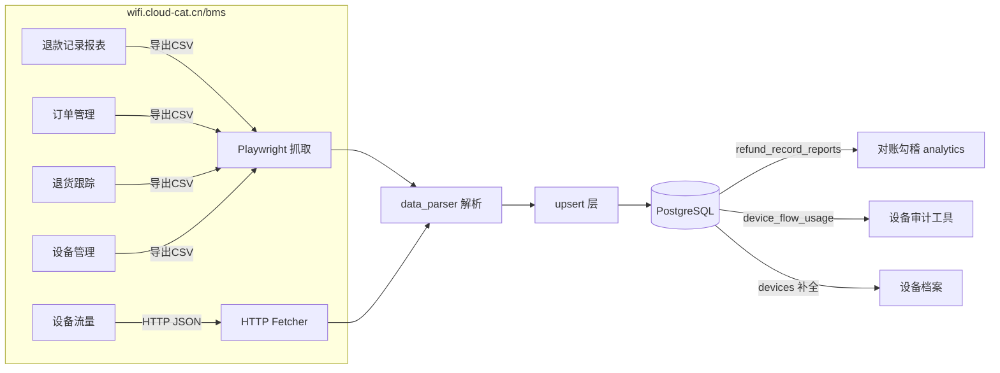

# A-20260905-001 BMS 五源采集扩容（架构设计）

**状态**：LOCKED（v1.0）
**锁定日期**：2026-09-05
**锁定脚本**：scripts/lock-arch-docs.sh（人工审核通过）
**架构师阶段产出**：Copilot Agent（Architect 阶段）
**关联工单**：#14 父工单；#15 P1 三源采集；#16 P3 设备流量
**关联规划**：docs/design/20260905-BMS五源扩容整体规划.md（含用户决策 D1~D6、实测列名、API 契约）

> 已锁定。P1(退款/订单/退货三源采集) 与 P3(设备月流量) 已按本文档实现并通过真实 BMS 验证（见 #15/#16）。

---

## 一、背景与目标

从 BMS(wifi.cloud-cat.cn/bms) 补充 5 类数据，支撑"商户号退款对账闭环"与"设备审计"：
1. **退款记录报表** `/settle/refund-record-report` → E 路线上退款水单（对账）
2. **订单管理** `/pay/pay-manage`
3. **退货跟踪** `/user/returnTracking`
4. **设备流量** `/device/device-flow`（单 SN×月，HTTP JSON API）
5. **设备管理** `/device/device-manage`（激活时间窗 → 补 devices 档案）

### 用户已拍板决策（2026-09-05）
- D1 设备流量仅建月汇总表 `device_flow_usage`(SN×月)
- D2 对账一期 = 采集入库 + D 路 op_time 回填 + E/ABCD 逐笔勾稽视图
- D3 退款/订单/退货先按需手动采集，不纳入定时（default_sync=False）
- D4 设备管理复用 `devices` 主表补字段（评估加列）
- D5 工单以草稿文件落地
- D6 数据源分组凭证 UI 增强（已归组提示 + 单源凭证可同步到组）

### 实测契约（2026-09-05 已确认）
- 退款记录报表 CSV 列：`平台订单号,微信订单号,商户号,商户名,设备号,商品名称,退款时间,申请退款金额,退款金额,退款状态`（10 列）
- 设备管理 CSV 列：`设备号,设备类型,所属商户,主商户,是否激活,激活时间,服务有效期,当前套餐,启动卡ICCID,虚拟卡ICCID,应用版本,区域,创建时间,批次号`（14 列，不含流量）
- 设备流量 HTTP API：`GET /bms-portal/deviceFlow/sn/pageList?page=&rows=&sn=&timeType=2&flowDate=`，flowDate 留空=全量有流量月份；item=`sn/businessId/businessName/flowDate/flowValue(GB)/deviceTypeName/deviceGroupName/deviceComboName`
- 订单 API：`GET /bms-portal/order/findPageList?startDate=&endDate=`（startDate=创建时间窗）
- 退货 API：`POST /api/customer-return-tracking/page`（body.startTime/endTime）
- 三源时间锚点：退款=退款时间；订单=创建时间；退货=创建时间（推断）
- 5 源同属 wifi 域 → 自动归 bms-wifi 组共享凭证

---

## 二、模块边界图

---

## 三、数据库变更（ER 增量）

### 3.1 新表 `refund_record_reports`（退款记录报表，E 路水单）
| 字段 | 类型 | 索引 | 说明 |
|---|---|---|---|
| id | bigint PK | PK | 自增 |
| platform_order_no | varchar(128) | idx | 平台订单号 |
| wx_order_no | varchar(128) | - | 微信订单号 |
| merchant_id | varchar(64) | idx | 商户号(对账锚点) |
| merchant_name | varchar(128) | - | 商户名 |
| device_sn | varchar(64) FK devices.sn | idx | 设备号 |
| product_name | varchar(128) | - | 商品名称 |
| refund_time | timestamptz | idx | 退款时间(秒级) |
| apply_refund_amount | numeric(12,2) | - | 申请退款金额(元) |
| refund_amount | numeric(12,2) | - | 退款金额(元) |
| refund_status | varchar(32) | - | 退款状态 |
| raw_extra | jsonb | - | 原始冗余 |
| synced_at | timestamptz | - | 同步时间 |

唯一键考虑：`(platform_order_no, refund_time, refund_amount)` 唯一索引做幂等（同平台单号+同时间+同金额=同一笔）。

### 3.2 新表 `bms_orders`（订单管理）
对齐订单 API item 字段。`order_no` 主键幂等。
关键列：order_no(PK)/order_type/device_sn(FK)/combo_name/combo_price/payable_price/actual_pay_price/wx_order_no/pay_date/pay_type/order_status/order_result/create_user/create_date/business_name/business_id/device_type_name/refund_status/active_date/last_stored_time/mch_id/merchant_name/before_serve_valid_date/after_serve_valid_date。

### 3.3 新表 `return_trackings`（退货跟踪）
对齐退货 DOM 列。幂等键需实现时依导出样本定（order_no+device_sn+return_type 复合）。
关键列：device_sn/shop/merchant/paid_amount/return_type/refund_amount/return_sign_status/return_express_no/return_reason/order_time/return_time/sign_time/creator/updater/created_at_raw/updated_at_raw/remark。

### 3.4 新表 `device_flow_usage`（设备月流量，D1）
| 字段 | 类型 | 索引 | 说明 |
|---|---|---|---|
| id | bigint PK | PK | |
| device_sn | varchar(64) FK devices.sn | idx | 设备SN |
| merchant_id | varchar(64) | - | 商户ID(businessId) |
| merchant_name | varchar(128) | - | 商户名 |
| device_type_name | varchar(64) | - | 设备类型 |
| device_group_name | varchar(64) | - | 设备组(可空) |
| device_combo_name | varchar(128) | - | 当前套餐(可空) |
| stat_month | varchar(16) | idx | 月份 2026-08 |
| flow_gb | numeric(12,4) | - | 月流量 GB |
| fetched_at | timestamptz | - | 抓取时间 |
| 唯一 | | (device_sn, stat_month) 唯一 | 幂等 upsert |

### 3.5 `devices` 主表补列（D4）
`devices` 现状仅 sn/device_type/device_type_remark/active_time/merchant_name/status。设备管理导出含主商户/服务有效期/ICCID/应用版本/区域/批次号 → **评估加列**：
`main_merchant_name` / `service_valid_until` / `start_iccid` / `virtual_iccid` / `app_version` / `region` / `batch_no` / `active`(是否激活)。最终加哪些列在实现时与 devices 现状/引用核对后定，避免过度加列。

---

## 四、接口契约（新增）

### 4.1 设备流量采集（P3，HTTP）
- 上游：`GET https://wifi.cloud-cat.cn/bms-portal/deviceFlow/sn/pageList`（登录态 cookie）
- 后端新模块 `services/device_flow_sync.py`：`fetch_device_monthly_flow(sn, month=None) -> list[dict]`
- 新 API：
  - `POST /device-flow/fetch`（body: `sn`, `month` 可选）→ 拉取上游并 upsert `device_flow_usage`，返回 upsert 统计
  - `GET /device-flow/usage`（query: `sn`, `month`, `page`, `page_size`, `merchant_name`）→ 本地历史查询
- 幂等：`(device_sn, stat_month)` upsert，重取=覆盖

### 4.2 三源手动同步（P1）
复用现有 `POST /fetch/task/submit`（data_types 加 3 个新源），无需新端点。同步源在 `GET /fetch/data-sources` 自动出现（BMS_DATA_SOURCES + registry 注册后）。

### 4.3 对账（P2，一期）
- D 路 op_time 回填：新函数（matcher 或 analytics 侧）按 (device_sn/order_no, refund_amount, 时间窗) 可信匹配 refund_record_reports.refund_time → manual_refunds.op_time（quality_status=auto_filled）
- 勾稽视图：以 refund_record_reports 为水单，逐笔匹配 A/B/C/D → matched/未登记

---

## 五、采集/凭证复用
- 新增 5 源 base_url=`https://wifi.cloud-cat.cn/bms` → `source_group_service` 自动归 `bms-wifi` 组，复用组凭证 YKM-TZK（D6 UI 增强后续做）。
- 设备流量走 `fetch_mode="http"` 分流（bms_sync.sync_all 已支持 http_tasks）。

---

## 六、风险清单
1. **订单量大**（8月 43万单）→ 手动同步/导出可能慢、BMS 限流；需分批/窗口控制，且 D3 决定先不纳入定时。
2. **退货/订单导出列名需真实样本最终确认**（目前退货仅 DOM 推断、订单 API 已确认）→ 实现用样本校准模板，避免映射错位。
3. **对账回填涉及已 LOCKED v4 口径**（E 不累加 A/B/C/D）→ 勾稽是叠加展示不改变原核算；回填带质量标记可审计、不静默改 D 路。
4. **设备流量 HTTP API 依赖 BMS 登录态/cookie** → 会话失效需重登；错误分级重试沿用现有 ai_acc_fetcher 模式。
5. **devices 加列影响面**：devices 是多表 FK 目标，加列只增不改，需验证无引用破坏。
6. **D6 分组凭证 UI**：改 update_sync_source 影响面（凭证留空语义）需回归。

---

## 七、改动文件清单（实现范围）
见 docs/design/20260905-BMS五源扩容整体规划.md §十 + 工单草稿 P1~P5。
