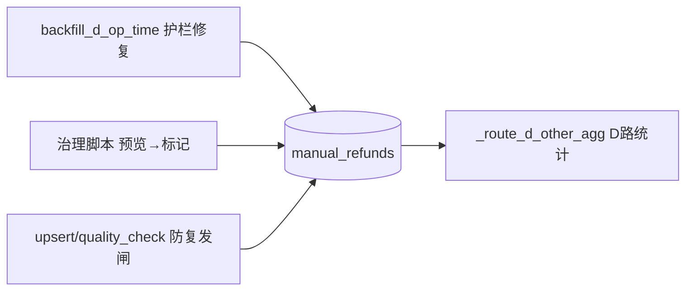

# A-20260906-001 D 路手动退款重复登记治理

**状态**：LOCKED（v1.0）
**锁定日期**：2026-09-06
**锁定脚本**：scripts/lock-arch-docs.sh（人工审核通过）
**架构师阶段产出**：Copilot Agent（Architect 阶段）
**关联工单**：#21（D 路重复登记治理，governance）
**关联方案**：docs/design/20260906-退款对账复核功能与D路重复治理方案.md（方案 A 部分）
**关联**：A-20260905-002（退款记录报表对账回填，LOCKED，本方案在其叠加护栏）

> 已锁定。本方案叠加不推翻 A-20260905-002 / A-20260902-011 已锁定核算语义；
> 仅治理 D 路(manual_refunds)重复登记的数据源缺陷。**D 路统计口径变更部分（§4.2 排除标记）
> 需在实现后单独评审并更新 A-20260902-011 版本**，不随本锁定静默改。

---

## 一、背景与问题（生产实证 2026-09-06）

- `manual_refunds` 全表 **5,829 行 / 仅 2,878 个去重 order_no**（超额 2,951 行 / ¥444,066）。
- 典型脏数据：同一 `order_no` 两行 —— 无SN行（`device_sn` 空、金额恒 100、`register_time` 乱年份 2001~2005/2031 的 09-26、`remark`=余额已清除/押金）+ 有SN真实行。
- `backfill_d_op_time`（reconcile.py）L1(order_no) 把同一 E 水单 report 回填到 2~5 行 manual（1,594 report → 3,201 行 / ¥365,177），无SN残留行被 `COALESCE(op_time,register_time)` 拉进近期窗口 → D 路重复计入经营。
- 量化：8月对账差 +¥203,686 ≈ D 重复 ¥202,970；9/1~9/5 +¥48,219 ≈ ¥49,228（348 行, 97% 无SN）。

## 二、模块边界图

## 三、处理设计

### 3.1 backfill_d_op_time 护栏（reconcile.py，P1）
1. 候选 manual 排除"无SN + register_time 乱年份(非 2025~2026 区间)"的残留行 → 不自动回填，标 `quality_status=pending` 待人工。
2. 唯一候选强制：同一 report（`backfill_manual_refund_id` 已置位）不再回填其它 manual 行（幂等护栏）。
3. 多候选命中 → pending（沿用现逻辑）。
4. 溯源/幂等不变：`quality_status=auto_filled` + `backfill_refund_record_report_id` 双向溯源。

### 3.2 历史脏数据治理（P2，一次性脚本）
- 目标特征：`is_refunded='是'` AND `device_sn` 空 AND `register_time` 年份 ∈ [2001..2024]∪{2031} AND 与同 order_no 有SN真实行成对。
- 处理：**不物理删除**，标 `quality_status=duplicate_residual` + `quality_note`(写 reason + 成对的真实行 id)，可回滚。
- 若后续需统计排除 → 走口径评审更新 LOCKED 文档（不在本次静默改）。

### 3.3 防复发（P3）
- `upsert_manual_refunds` 质量校验：无SN + 乱年份入参 → 标 pending / 拒收。
- 巡检：`manual_refunds` 异常年份行计数（可挂 A-20260904-001 健康告警扩展，二期）。

## 四、数据库变更

`manual_refunds` 不加新列（复用 `quality_status`/`quality_note`）；无新迁移。
回填唯一候选护栏纯代码。

## 五、风险清单

1. 排除"无SN+乱年份"可能漏真实无SN登记 → 转 pending 人工（ManualRefundQuality 已有 confirm/fix）。
2. 治理标记若影响统计口径 → 必须先评审 LOCKED 文档（A-20260902-011），禁止静默改。
3. register_time 2001-2025 部分可能是真实历史台账 → 治理只针对"与同单真实行成对+无SN+金额占位"残留特征，绝不按年份一刀切。

## 六、验收标准

- 生产重跑 backfill 扫描无新增一对多回填。
- 治理后 8月/9月 D 路重复金额归零（或标记隔离可审计）。
- 测试：`test_reconcile.py` 扩展唯一候选护栏用例。
- 提交/PR 关联 #21。

## 七、涉及文件

- `backend/app/services/reconcile.py`（护栏）
- `backend/scripts/`（治理脚本，含预览模式）
- `backend/app/services/upsert.py` / `quality_check.py`（防复发）
- `backend/tests/test_reconcile.py`
