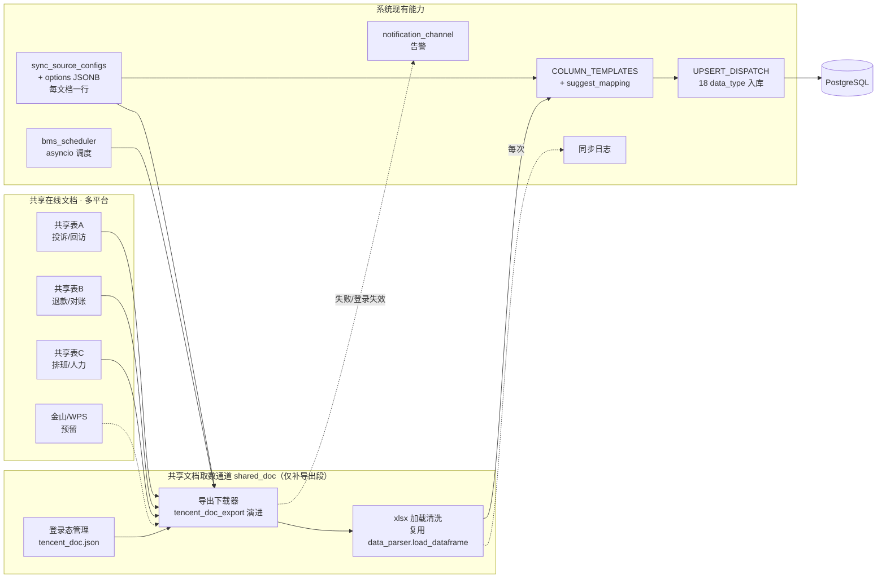

# A-20260907-002 共享在线文档接入框架体系（架构评估与方案）

**状态**：LOCKED（v1.0）
**锁定日期**：20260907
**锁定脚本**：手动锁定（scripts/lock-arch-docs.sh 惯例；编号 002 手动指定，因当日已有 001）
**架构师阶段产出**：Architect 阶段（人工终审锁定）
**审查结论**：人工终审通过（2026-09-07）
**关联既有架构**：A-20260902-021（外部只读开放平台，LOCKED）、A-20260904-002（采集可靠性，LOCKED）、A-20260905-001（BMS 采集扩容，LOCKED）、A-20260907-001（定时采集源读库分频，LOCKED）
**关联既有设计**：`docs/design/共享文档投诉数据接入设计.md`（v1.0，未锁定，仅覆盖投诉场景）
**输入**：`01样本数据/共享文档数据同步系统建设方案.docx` + 用户约束（个人用户、不申请企业 API/SDK、**多份不同业务类型共享文档**批量接入）+ 真实链接实测（2026-09-07）
**范围**：**通用共享文档接入框架体系评估**（可接入多个不同业务目标的文档源）。具体某一业务文档的导入实现 = 后续工单。

---

## 〇、结论摘要（TL;DR）

1. **方向修正**：本框架是**通用共享文档接入体系**，不是"投诉数据专用导入"。共享文档只是新增一类**取数通道（fetch 源类型）**，目标业务表由既有 `data_type` 体系决定——退款/工单/设备/投诉/人力等**任意** `COLUMN_TEMPLATES + UPSERT_DISPATCH` 已注册的业务均可作为落点。
2. **个人免资质路径成立且已实测**：不依赖开放平台企业应用；用「浏览器登录态 + 官方 UI 导出 xlsx」读取腾讯/金山共享表（2026-09-07 真实链接 16 Sheet / 4565 行导出解析成功）。
3. **最大复用**：系统已有成熟「每源一行配置 + 列模板映射 + UPSERT_DISPATCH 入库」多源底座（`sync_source_configs` + `COLUMN_TEMPLATES` + `UPSERT_DISPATCH`，实测注册 18 个 data_type；另有 staff 等走 SCD2/专用路径不在此表）。共享文档框架应**融入**该体系，而非另起炉灶。
4. **关键差异 vs 现有 BMS/SCRM 源**：共享文档源 = 无登录表单（扫码/链接授权）、页面是 canvas 渲染（不能 DOM 抓取，须导出 xlsx）、按"链接"而非"系统账号"寻址。这三点决定需要独立的取数适配器，但配置/入库复用同一套。
5. **分两层落地**：本框架评估只定"通道 + 配置 + 边界"；「文档 → 具体业务表」的映射与实现属后续按文档逐个/分批的工单。

---

## 一、背景与目标

### 1.1 背景

- 用户有多份**不同业务内容的共享在线文档**（腾讯 docs.qq.com 为主，或含金山/WPS），需周期性接入本系统。
- 用户为**个人用户**，明确**不通过企业主体申请 API/SDK**。
- 系统已是**多源多业务架构**：`sync_source_configs` 每源一行（BMS/SCRM/闪猫/HTTP 源），`COLUMN_TEMPLATES` 定义几十种业务列模板，`UPSERT_DISPATCH` 注册 18 个 data_type 的入库函数（staff 等走 SCD2/专用路径）。投诉（external/card）只是其中两类。
- 既往 `共享文档投诉数据接入设计.md` 只覆盖投诉，本次要求**上升到通用框架**。

### 1.2 目标

1. 建立**通用共享文档取数通道**：任意共享链接（多平台）→ 结构化行（中文表头 dict），与业务无关。
2. 接入**任意已注册业务**：通过 data_type + 列映射 + UPSERT_DISPATCH 落库，不限于投诉。
3. 配置驱动：新增一份文档 = 加一条配置（平台/链接/目标业务/轮询），不写代码。
4. 个人可维护、免企业资质、登录态长期稳定可低成本恢复。
5. 明确复用点、边界、演进路径与后续工单切分。

### 1.3 非目标（本期框架评估不含）

- 不实现具体某业务文档的字段映射/入库（后续按文档工单）。
- 不做金山/WPS 完整适配（预留通道，需真实 WPS 链接实测）。
- 不引入独立 Worker 进程/新容器（沿用调度器内嵌，理由见 §五）。
- 不新增"共享文档专用业务表"——落库走既有 UPSERT_DISPATCH 或按业务扩展注册。

---

## 二、现状底座（复用分析）

### 2.1 系统已有「多源接入」三大件

| 组件 | 位置 | 作用 | 是否复用 |
|---|---|---|---|
| `sync_source_configs` | model + `/system` 管理 | 每源一行：data_type/name/base_url/group_key/凭证/options JSONB/default_sync/enabled | ✅ 配置模型底座 |
| `COLUMN_TEMPLATES` | `data_parser.py` | data_type → {目标字段:[中文候选列]}，`suggest_mapping` 自动匹配 | ✅ 通用列映射 |
| `UPSERT_DISPATCH` | `upsert.py:2107` | data_type → 入库函数（实测 18 个：refund/ticket/wallet/device_combo/external_complaint/card_complaint/manual_refund/...；staff 等走 SCD2/专用路径不在此表） | ✅ 通用入库 |

### 2.2 现有取数通道（fetch 源类型，见 bms_sync/bms_fetcher）

| fetch_mode | 代表源 | 取数方式 | 登录 |
|---|---|---|---|
| `openapi` | SCRM | HTTP OpenAPI | clientId/secret |
| `playwright` | BMS/闪猫 | Playwright 页面抓取/导出 | 账号密码/验证码/storage_state |
| `http` | cs_record/device_flow | 页面内 HTTP API | storage_state 会话 |

> **共享文档 = 新增一类取数通道**（如 `fetch_mode: "shared_doc"` 或独立 source_type），复用配置/映射/入库三件套。

### 2.3 共享文档源与现有源的本质差异（决定需新适配器）

| 维度 | 现有 BMS/SCRM 源 | 共享文档源 |
|---|---|---|
| 寻址 | base_url + page_path | 共享链接（doc_url） |
| 登录 | 账号密码/验证码 | 扫码/链接授权，无表单登录 |
| 正文渲染 | 多为可操作 DOM/API | **canvas + 私有压缩协议**（不可 DOM 抓取） |
| 稳定取数 | 页面 API / DOM | **官方导出 xlsx**（唯一稳定通道） |
| 数据结构 | 源内固定列 | 每份文档列可不同（sheet 内中文表头） |
| 数据目标 | 源↔data_type 固定 | **同一文档可映射到任意已注册 data_type** |

---

## 三、总体架构（模块边界图）



**核心设计思想**：
1. **通道与业务解耦**：EXPORT+PARSE 只负责"共享链接 → 中文表头行"，不知道也不关心数据是投诉还是退款。
2. **业务由 data_type 决定**：一份文档 = 一条 `sync_source_configs` 记录，声明 `doc_url` + `target_data_type` + 列映射，落库走对应 `UPSERT_DISPATCH` 函数。
3. **完全融入现有体系**：配置复用 `sync_source_configs`（或按需扩展 options），调度复用 `bms_scheduler`，告警/日志复用既有。

---

## 四、核心设计（框架层）

### 4.1 配置模型（新增"共享文档源"形态）

**方案 A（推荐）**：`sync_source_configs` 加 `fetch_mode: "shared_doc"`，扩展参数放 `options`：

| 字段 | 位置 | 内容 |
|---|---|---|
| data_type | 列 | 目标业务类型（任意已注册，如 `external_complaint`/`manual_refund`/...或未来新注册） |
| base_url / page_path | 列 | 存共享链接 doc_url（复用现有列语义） |
| fetch_mode | options | `shared_doc`（新） |
| doc_url | options | 共享链接（或直接 base_url） |
| sheet_rules | options | 子表选择规则：哪些 Sheet → 哪个 data_type / 映射模板（JSONB） |
| state_file | options | 登录态文件引用（默认 tencent_doc.json） |
| export_menu | options | 导出入口定位（前端若变动可配） |
| default_sync / enabled | 列 | 纳入定时/开关 |

> 平台级（腾讯/金山）登录态、全局导出参数另放一行「平台配置」或在 options 声明，避免每文档重复。

**方案 B**：独立新表 `shared_doc_sources`。仅当"文档级参数远超 sync_source_configs 语义"时选。倾向 A，理由：复用现有管理 UI/调度/缺口语义，符合"共享文档只是新通道"定位。

### 4.2 取数流水线（已实测）

**关键复用**：系统已有 `data_parser.load_dataframe(path, sheet_name)`（xlsx/csv → 清洗后 DataFrame）与 `run_upsert(df, data_type, mapping, db)`（→ UPSERT_DISPATCH 入库）这一现成「文件导入」桥梁。共享文档通道**只需补「导出 xlsx」这一段**，其后直接对接 load_dataframe + run_upsert，无需自研解析器：

```
① 登录态: 扫码 → browser_states/tencent_doc.json(27 cookies)
② 导出:   tencent_doc_export --url <链接> → UI「⋯→导出为→本地Excel」→ xlsx   ← 本框架新增
③ 加载:   data_parser.load_dataframe(xlsx, sheet) → 清洗后 DataFrame(复用既有)
④ 映射:   suggest_mapping(data_type, 列头) → 目标字段映射(自动/人工确认)(复用既有)
⑤ 入库:   run_upsert(df, data_type, mapping, db) → UPSERT_DISPATCH 函数(复用既有)
```

> POC 阶段 `_poc_shared_doc_reader.py` 自写的读取仅用于验证通道；正式实现应改走 `load_dataframe`，保证与既有文件导入同一套清洗/映射/入库语义。

实测参数：右上角 ⋯ 菜单坐标 ≈ (1361,15)；导出保留全部 Sheet；38MB/16Sheet 可解析；openpyxl 对 WPS 样式崩 → 统一 calamine。

### 4.3 目标业务扩展（演示"不限于投诉"）

现有 `UPSERT_DISPATCH` 已注册业务均可作为共享文档落点，例如：

| data_type | 落表 | 场景示例 |
|---|---|---|
| external_complaint / card_complaint | external_complaints / card_complaints | 315/卡商投诉共享表 |
| manual_refund | manual_refunds | 手工退款登记共享表 |
| device_flow_usage | device_flow_usage | 设备流量共享表 |
| staff（SCD2 专用路径，不在 UPSERT_DISPATCH） | persons 任职历史 | 排班/人力共享表 |
| <新业务> | <新表+新注册> | 升级投诉回访等需业务确认 |

> "升级投诉/回访"这类现有模板未覆盖的业务：若需接入，先按系统规范**注册新 data_type（新 COLUMN_TEMPLATES + 新 UPSERT_DISPATCH/专用入库 + 必要时新表 migration）**——这是系统既有扩展路径，非共享文档框架特有。

---

## 五、边界与演进

### 5.1 复用 vs 新增

| 能力 | 归属 | 说明 |
|---|---|---|
| 配置管理 | 复用 sync_source_configs + options | 或扩展少量列 |
| 登录态/续期/检测 | 复用 BMS storage_state 模式 | tencent_doc.json |
| 调度/互斥/熔断/缺口 | 复用 bms_scheduler + A-20260904-002 | 共享文档源挂入调度 |
| xlsx 加载/清洗 | 复用 data_parser.load_dataframe | 与文件导入同源 |
| 列映射 | 复用 COLUMN_TEMPLATES + suggest_mapping | 每 data_type 一套 |
| 入库 | 复用 run_upsert → UPSERT_DISPATCH | 新业务按规范注册 |
| 告警/日志 | 复用 notification_channel / sync_log | - |
| **导出下载器（共享文档特有）** | **新增** | tencent_doc_export 演进 + 入口配置化 |
| 独立 Worker | 不新增 | 沿用调度器内嵌 |

### 5.2 演进路径（分阶段）

1. **P0（已完成验证）**：登录态 + 导出 + 解析脚本跑通真实链接。
2. **P1（下一工单候选）**：导出/解析 service 化 + API 触发 + `fetch_mode: shared_doc` 配置行 + 调度接入 + 告警。
3. **P2（按业务文档分批）**：每份具体共享文档 → 确定 data_type → 注册列模板/入库 → 导入。**一份文档一个子任务**。
4. **P3（可选）**：金山/WPS 适配、二维码上云重授权、多账号。

### 5.3 与本系统其它通道的并列关系

```
数据接入总览
├─ BMS 通道 (playwright/http)   → sync_source_configs → UPSERT_DISPATCH → DB
├─ SCRM 通道 (openapi)          → sync_source_configs → ...
├─ 外部推送通道 (/api/v1/external / complaint push) → ...
├─ 文件导入通道 (上传 xlsx/csv) → data_parser → UPSERT_DISPATCH → DB
└─ 共享文档通道 (shared_doc)    → 导出xlsx→解析 → COLUMN_TEMPLATES → UPSERT_DISPATCH → DB   ← 新增
```

---

## 六、风险清单

1. **腾讯前端布局/菜单变动致导出入口失效**（坐标/选择器非稳定 API）。→ 入口定位配置化 + 失效告警区分"改版类"。
2. **登录态过期/风控**。→ 低频轮询 + 随机延迟 + storage_state 续期 + 到期检测 + 低成本重扫；单账号多源控制总量。
3. **文档结构/列变更**（同事增删列、改表头）。→ 原始 xlsx 留档 + 列映射配置化 + 解析失败可读告警（复用 BMS 经验）。
4. **同一份文档可能含多类业务 Sheet**（如 16 Sheet 中既有回访又有升级投诉）。→ sheet_rules 支持"多 Sheet → 多 data_type 分流"，需在 P1 设计。
5. **金山/WPS 未实测**。→ 预留同构通道，真实链接实测后再定。
6. **本地库 schema 落后**影响验证。→ 独立于框架的环境欠账，P1 前需同步本地库。
7. **新业务 data_type 注册门槛**。→ 需按既有规范（COLUMN_TEMPLATES + UPSERT_DISPATCH + 测试），避免绕过治理。

---

## 七、后续工单切分建议

> 本框架评估定边界，不进入实现。按 issue-workflow（一单一目标）建议拆分：

| 工单 | Label | 内容 | 关闭条件（验收） |
|---|---|---|---|
| **A-1 共享文档取数通道落地** | feature | 导出/解析 service 化、`fetch_mode: shared_doc` 配置、API 手动触发、调度接入、告警、sheet→data_type 分流 | 任意已注册业务共享链接可配置并自动入库；登录失效可告警恢复；配置可 CRUD |
| **A-2 具体文档导入（按需逐个开）** | feature | 某业务文档（如升级投诉/排班/退款...）→ data_type 注册（模板/入库/表）→ 导入 | 该文档数据正确入库 + 幂等 + 页面可查 |
| **A-3（可选）金山/WPS 适配** | feature | 真实 WPS 链接实测适配 | WPS 文档走通导出→入库 |

> 每份业务文档工单独立验收，避免"大而全"单子难闭环。当前已具备 P0 脚本与真实链接证据，A-1 可直接开工。

---

## 八、已实测证据（2026-09-07）

- 真实链接：`https://docs.qq.com/sheet/DWnRPSmpKU29uSk9T`（升级投诉登记表）
- 登录态：`backend/data/browser_states/tencent_doc.json`（27 cookies，扫码一次生成）
- 导出：38MB xlsx / **16 Sheet / 4565 行**完整导出并解析；样本留档 `01样本数据/共享文档导出验证/`
- 通道脚本（P0 级，待 A-1 service 化）：`scripts/tencent_doc_login.py`、`scripts/tencent_doc_export.py`、`scripts/_poc_shared_doc_reader.py`
- 已证明：同一导出文件可解析为中文表头行，且经 `suggest_mapping` 可映射到既有 data_type 模板（早前 315 样本 19/19、卡商 11/11 命中）

---

## 九、文档变更

- 本文件：`docs/arch/_pending/A-20260907-002-共享在线文档接入框架体系.md`（2026-09-07 人工终审通过 → 已锁定 LOCKED v1.0 → 移入 `docs/arch/` → 打 `arch/A-20260907-002` tag）
- 关联 `docs/design/共享文档投诉数据接入设计.md`：其投诉专用实现（腾讯 OpenAPI）可作为共享文档通道的**一种可选子通道**并存；本框架采纳后建议将其并入/对齐（投诉 = 一个 data_type 落点，非独立体系）。
