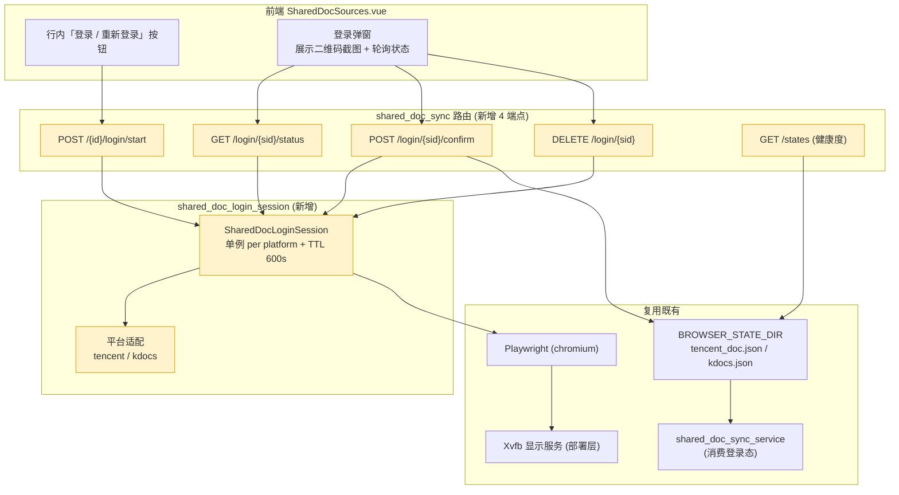

# A-20260910-001 共享文档页面内登录态管理

**状态**：LOCKED（v1.0）
**锁定日期**：2026-09-10
**架构师阶段产出**：Architect 阶段（人工终审锁定）
**审查结论**：人工终审通过（2026-09-10）
**关联工单**：`tanzk/csctalon#45`
**关联既有架构**：A-20260907-002（共享在线文档接入框架体系，LOCKED）、A-20260904-002（采集可靠性治理，LOCKED）
**范围**：把已实现的「扫码登录生成 `storage_state`」能力从 CLI 提升到 Web 层，并补登录态健康度监控。

---

## 〇、结论摘要（TL;DR）

1. **问题本质是能力落位错位，不是能力缺失**：`scripts/tencent_doc_login.py` / `kdocs_login.py` 已能扫码生成登录态，`shared_doc_sync_service` 已能消费它；但**Web 层没有入口**，管理员看到「登录态失效」后只能 SSH 上服务器跑脚本。
2. **复用既有骨架**：`services/captcha_session.py` 已验证「后端起浏览器 → 截图回传前端 → 用户交互 → 后端保存 `storage_state`」这条链路可行（BMS/SCRM 验证码登录）。本单把同一模式换到共享文档平台。
3. **平台差异**：共享文档是**扫码**（不是验证码），且登录完成后判定依据是「页面离开登录域名」而非「提交表单成功」。
4. **必须解决显示服务**：生产后端容器无 X 显示服务，有头浏览器起不来 → 需 Xvfb。**未装 Xvfb 时降级返回 501 + 一键命令**，不允许 500。
5. **无表结构变更**：登录落到文件系统 `BROWSER_STATE_DIR`，与既有实现一致。

---

## 一、模块边界图



---

## 二、接口契约

前缀 `/api/v1/sync/shared-docs`，全部 `AdminUser`。

### 2.1 启动登录会话

```
POST /api/v1/sync/shared-docs/{source_id}/login/start
```

- **请求**：无 body
- **响应 `data`**：
  ```json
  {
    "session_id": "a1b2c3d4",
    "platform": "tencent",
    "screenshot": "data:image/png;base64,...",
    "current_url": "https://docs.qq.com/login",
    "expires_in": 600,
    "hint": "请用微信/QQ 扫码登录，完成后点击「我已扫码完成」"
  }
  ```
- **错误码**：

| 码 | 场景 | detail |
|---|---|---|
| 404 | source_id 不存在 | 采集源不存在 |
| 409 | 同平台已有活跃会话 | 该平台已有正在进行的登录会话，请先完成或取消 |
| 501 | 无 Xvfb / Playwright 不可用 | 服务器未安装虚拟显示服务，请用命令行登录：`...` |
| 502 | 浏览器启动或导航失败 | 打开登录页失败: `<原因>` |

### 2.2 查询会话状态（前端 2 秒轮询）

```
GET /api/v1/sync/shared-docs/login/{session_id}/status
```

- **响应 `data`**：`{ "status": "pending|scanned|authorized|expired|closed", "current_url": "...", "elapsed": 42 }`

| status | 判定依据 |
|---|---|
| `pending` | 仍在登录页域名，未检测到登录态 |
| `scanned` | 出现「确认登录 / 授权」类页面元素（可选强化，检测失败不阻塞） |
| `authorized` | **已离开登录域名**且 cookie 中出现平台会话键 |
| `expired` | 超过 TTL 600s |
| `closed` | 会话已被取消或已完成 |

- 404：会话不存在（已过期被回收）

### 2.3 确认完成并落盘

```
POST /api/v1/sync/shared-docs/login/{session_id}/confirm
```

- **请求**：无 body（**兜底语义**：即便 `status` 未自动判为 `authorized`，用户点确认也强制落盘——用户看得见页面，以用户判断为准）
- **响应 `data`**：
  ```json
  {
    "ok": true,
    "platform": "tencent",
    "state_path": "/app/data/browser_states/tencent_doc.json",
    "cookies": 27,
    "saved_at": "2026-09-10T15:22:31+08:00",
    "backup_created": true
  }
  ```
- **副作用**：覆盖写前先备份旧 state 为 `.json.bak`（与 CLI 脚本行为一致）
- 404：会话不存在 / 会话已过期

### 2.4 取消会话

```
DELETE /api/v1/sync/shared-docs/login/{session_id}
```

- **响应**：`{ "ok": true }`；幂等（会话不存在也返回 200）

### 2.5 登录态健康度

```
GET /api/v1/sync/shared-docs/states
```

- **响应 `data`**：
  ```json
  {
    "items": [
      {
        "platform": "tencent",
        "state_file": "tencent_doc.json",
        "exists": true,
        "size_bytes": 4821,
        "cookies": 27,
        "mtime": "2026-09-08T19:23:00+08:00",
        "age_days": 1.8,
        "stale": false,
        "advice": ""
      }
    ],
    "stale_threshold_days": 7
  }
  ```

- `stale=true` 时 `advice` 给出「建议重新登录」文案
- 文件不存在 → `exists=false`，`advice="未登录，请先扫码登录"`

---

## 三、数据库变更（ER 增量）

**无表结构变更。**

理由：
- 登录会话是**进程内短期状态**（TTL 600s），与 `captcha_session.py` 一致，不落库。
- 登录态产物是**文件系统存储**（`BROWSER_STATE_DIR`），与既有 CLI 脚本产物同路径同格式，保证向后兼容（脚本方式仍可用作降级）。
- 健康度从文件 `stat()` 实时计算，不缓存不入库。

> ⚠️ 若未来需要「登录审计」（谁在何时重登过），可复用既有 `operation_logs`（写操作自动落库），**不新增表**。

---

## 四、部署约束（Xvfb）

| 环境 | 方案 |
|---|---|
| 本地开发（macOS） | 有 GUI，Playwright `headless=False` 直接可用，**无需 Xvfb** |
| 生产 Docker | `backend/Dockerfile` 安装 `xvfb`；容器启动时 `xvfb-run -a` 包裹，或常驻 `Xvfb :99` + `ENV DISPLAY=:99` |

**降级策略（强制）**：启动会话前先探测显示环境可用性，不可用则返回 **501** 并在 detail 中给出可执行的一键命令：

```
cd /path/to/backend && ./.venv/bin/python ../scripts/tencent_doc_login.py --url "<文档地址>"
```

探测方式：`os.environ.get("DISPLAY")` 存在 → 认为有显示服务；否则尝试无头探测（`xvfb-run` 是否在 PATH）。

---

## 五、风险清单

1. **容器内常驻浏览器进程**：Playwright chromium 单实例约 200–400MB 内存，若会话泄漏会拖垮后端（当前 Gunicorn 单 worker，与互斥锁设计绑定）。**缓解**：会话 TTL 硬上限 600s + 每次 `start` 前先回收同平台过期会话 + 会话结束（confirm/cancel/超时）必须 `context.close()`；后端启动时清理孤儿会话。
2. **并发登录互相覆盖**：同平台两个会话并发 `confirm` 会互相覆盖 `storage_state`，导致「刚登录就被顶掉」。**缓解**：**同平台单例锁**——已有活跃会话时 `start` 返回 409，强制先完成或取消。
3. **登录态文件安全**：`storage_state` 含账号 cookie，等同账号凭据。**缓解**：落 `BROWSER_STATE_DIR`（配置已注释「独立于 UPLOAD_DIR，不被 /uploads 静态挂载暴露」）；接口返回**只回 cookie 数量，不回内容**；`state_path` 对外只回文件名不绝对路径。
4. **用户误点「我已扫码完成」**：用户可能在未真正登录时点确认，写入一个无效 state，导致后续同步失败且状态显示「已登录」。**缓解**：`confirm` 落盘后立即做一次**轻量校验**（用新 state 打开目标文档，检测是否仍在登录页）；校验不通过则返回 `ok:false` + 提示「未检测到登录态，请重试」，并**不覆盖**旧 state。
5. **平台登录检测规则漂移**：腾讯/金山改版会导致 `authorized` 判定失效。**缓解**：判定采用「离开登录域名」这一稳定信号 + `confirm` 手工兜底，不依赖具体 DOM 选择器。

---

## 六、测试要求

| 用例 | 覆盖 |
|---|---|
| `test_start_returns_session_and_screenshot` | 正向：返回 session_id + base64 图 |
| `test_start_conflict_when_active_session` | 同平台并发 → 409 |
| `test_confirm_saves_state_and_backs_up` | 落盘 + 旧 state 备份 |
| `test_confirm_rejects_unverified_state` | 轻量校验失败 → 不覆盖旧 state |
| `test_cancel_is_idempotent` | 取消幂等 |
| `test_start_501_when_no_display` | 无 Xvfb → 501 且 detail 含命令 |
| `test_states_health_reports_stale` | mtime 超 7 天 → stale=true |
| `test_session_expires_after_ttl` | TTL 到期 → expired |

（Playwright 调用层用 monkeypatch 打桩，不真起浏览器。）
