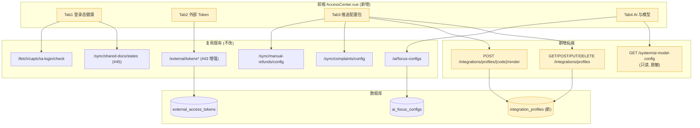

# A-20260910-002 接入中心统一治理

**状态**：LOCKED（v1.0）
**锁定日期**：2026-09-10
**架构师阶段产出**：Architect 阶段（人工终审锁定）
**审查结论**：人工终审通过（2026-09-10）
**关联工单**：`tanzk/csctalon#44`（父）、`#43`（外部 token 体验，本单内嵌）、`#26`（AI Focus 可配置，本单内嵌）
**关联既有架构**：A-20260902-021（外部只读开放平台，LOCKED）、A-20260904-003（本地 AI 分析助手，LOCKED）、A-20260910-001（共享文档登录态，LOCKED）
**范围**：把「对外接入 + AI 与模型」的相关配置从 4 个分散页面收敛到 1 个「接入中心」，并新增管理员可维护的配置包模板表。

---

## 〇、结论摘要（TL;DR）

1. **不动安全底线**：`LLM_API_KEY` **不落库、不展示明文**（守 A-20260904-003）；推断 token **不新增明文回看能力**（守 A-20260902-021）。本单只解决「**看不见全貌 / 凑不齐物料**」这两个问题。
2. **AI 四层提示词分层对待**：模型接入（只读展示）/ System 铁律（只读）/ 口径卡 Glossary（只读）/ 关注点 Focus（可编辑）。前三层是**防幻觉底线**，不可通过 UI 修改。
3. **WorkBuddy 配置包 = 一段可复制的 Markdown**：把「共享文档地址 + 推送接口 + 鉴权头 + 字段规范 + 提示词要求」拼成一整块，一次复制即可粘贴给 WorkBuddy。
4. **模板可维护**：新增 `integration_profiles` 表（1 张新表 + 1 个 migration），管理员可改提示词而不动代码。
5. **旧页面保留**：`/system/external-access`、`/system/ai-focus-configs` 等路径不变，避免破坏书签与深链；接入中心是**聚合视图**，不是替代。

---

## 一、模块边界图



---

## 二、接口契约

### 2.1 AI 模型配置（只读 + 脱敏）

```
GET /api/v1/system/ai-model-config        [AdminUser]
```

**响应 `data`**：
```json
{
  "enabled": false,
  "base_url": "https://api.deepseek.com",
  "model": "deepseek-v4-flash",
  "thinking": "disabled",
  "api_key_configured": true,
  "api_key_hint": "已配置 (长度 35)",
  "timeout_s": 60,
  "max_tokens": 1500,
  "source": "env",
  "notice": "模型接入配置由服务端 .env 提供；API Key 严禁入库/前端明文展示 (A-20260904-003)。修改需运维在服务器更新 .env 并重启后端。",
  "prompt_layers": [
    { "key": "system",   "name": "System 铁律", "editable": false, "char_count": 268, "reason": "防幻觉底线, 代码常量" },
    { "key": "glossary", "name": "业务口径卡",  "editable": false, "char_count": 1842, "reason": "客观统计口径, 代码常量" },
    { "key": "focus",    "name": "关注点/分析视角", "editable": true,  "char_count": 620,  "reason": "运营主观偏好, 见表 ai_focus_configs", "manage_path": "/system/ai-focus-configs" }
  ]
}
```

**约束（强制）**：
- `api_key` 明文字段**不允许出现在响应里**，任何情况下不返回。`api_key_hint` 只回**是否配置 + 长度**（长度用于帮运维核对是否填了正确长度的 key，不含内容）。
- `char_count` 通过读取 `ai_feed._SYSTEM_PROMPT` / `ai_glossary.glossary_all()` 实时计算，**不回正文**（防止绕过 UI 编辑约束）；若要展示正文，需另开 `GET /ai/prompt-layers/{key}` 且 `editable=false` 层明确返回 `readonly` 标记 + 内容**只读展示**。

> **实施选择**：本期 `prompt_layers` **展示正文字符数 + 是否可编辑**，并在 UI 上提供「查看铁律/口径卡全文」按钮走**只读弹窗**（后端新增 `GET /api/v1/ai/prompt-preview?layer=system|glossary`，返回只读文本，**不接受任何写入**）。这样管理员「看得见」但不「改得动」。

### 2.2 配置包模板 CRUD

```
GET    /api/v1/integrations/profiles            [AdminUser]
POST   /api/v1/integrations/profiles            [AdminUser]
PUT    /api/v1/integrations/profiles/{id}       [AdminUser]
DELETE /api/v1/integrations/profiles/{id}       [AdminUser]
```

**`IntegrationProfile` 字段**：

| 字段 | 类型 | 约束 | 说明 |
|---|---|---|---|
| `code` | String(48) | 唯一, 非空 | 如 `workbuddy-complaint-push` |
| `name` | String(64) | 非空 | 显示名「315/卡商投诉推送」 |
| `scene` | String(24) | 非空 | `push` / `pull` / `manual_refund` |
| `content_md` | Text | 非空 | Markdown 模板，含 `{{变量}}` |
| `variables` | JSONB | 可空 | 变量声明：`[{"key":"doc_url","label":"共享文档地址","required":true}]` |
| `enabled` | Boolean | 默认 true | 停用后不在列表出现 |
| `sort_order` | Integer | 默认 0 | 排序 |
| audit | | | `created_by` / `updated_by` |

**变量白名单（硬约束）**：渲染时只允许替换**预定义变量集**，禁止任意变量注入：

| 变量 | 来源 | 说明 |
|---|---|---|
| `{{base_url}}` | 请求推导（`request.base_url`） | 系统对外地址 |
| `{{doc_url}}` | 用户输入 | 共享文档地址 |
| `{{doc_name}}` | 用户输入 | 文档显示名 |
| `{{token}}` | 用户输入（**占位符，不回填真实 token**） | 显示为 `<在此粘贴 token>` |
| `{{target_type}}` | 用户输入（枚举校验） | `complaint` / `manual_refund` |
| `{{sync_interval}}` | 用户输入（数字） | 分钟 |

未在白名单中的变量**原样保留不替换**（不报错，便于写文档示例）。

### 2.3 配置包渲染

```
POST /api/v1/integrations/profiles/{code}/render     [AdminUser]
```

**请求**：
```json
{ "doc_url": "https://docs.qq.com/sheet/xxxx", "doc_name": "315投诉登记表", "target_type": "complaint", "sync_interval": 20 }
```

**响应 `data`**：`{ "markdown": "## 任务：...", "char_count": 1832, "unresolved": [] }`

- `unresolved`：模板中出现但未提供值的白名单变量清单（提示用户补填）
- 渲染是**纯函数**（无副作用、无落库）

### 2.4 复用端点（不改）

`/external/tokens*`、`/sync/shared-docs/states`、`/sync/complaints/config`、`/sync/manual-refunds/config`、`/ai/focus-configs`、`/fetch/captcha-login/check` —— 接入中心全部**只读消费 + 深链跳转**，不复制实现。

---

## 三、数据库变更（ER 增量）

新表 `integration_profiles`：

| 字段 | 类型 | 索引 | 说明 |
|---|---|---|---|
| `id` | Integer PK | PK | |
| `code` | String(48) | **UNIQUE** | 唯一标识 |
| `name` | String(64) | | 显示名 |
| `scene` | String(24) | INDEX | push / pull / manual_refund |
| `content_md` | Text | | Markdown 模板 |
| `variables` | JSONB | | 变量声明数组 |
| `enabled` | Boolean | | 默认 true |
| `sort_order` | Integer | | 默认 0 |
| `created_by` / `updated_by` | String(64) | | 审计 |
| `created_at` / `updated_at` | timestamptz | | `TimestampMixin` |

**Migration**：新增 1 个版本（单一 head），含 3 条种子数据：

| code | name | scene |
|---|---|---|
| `workbuddy-complaint-push` | 315/卡商投诉推送 | push |
| `workbuddy-manual-refund-push` | 商户号手动退款推送 | push |
| `workbuddy-daily-brief-pull` | 经营日报拉取 | pull |

种子内容**内联在 migration 中**（与既有 `ensure_*` 种子模式一致，已存在则跳过不覆盖用户改动——遵循审计项 `C-P2-2`）。

---

## 四、前端结构

`web/src/views/system/AccessCenter.vue`，4 个 Tab：

| Tab | 内容 | 数据源 |
|---|---|---|
| ① 登录态 | 各平台 state 健康度表 + 「重新登录」按钮（跳 #45 弹窗） | `/sync/shared-docs/states` |
| ② 外部 Token | 内嵌 token 列表（含 #43 的启停/配置包复制） | `/external/tokens*` |
| ③ 推送配置包 | 场景下拉 + 表单（文档地址等）→ 预览 Markdown → 「复制」 | `/integrations/profiles*` |
| ④ AI 与模型 | 模型配置卡片（脱敏）+ 四层提示词卡片（3 只读 + 1 可编辑链接） | `/system/ai-model-config` |

**路由**：新增 `/system/access-center`（`meta.admin = true`），在系统管理「数据与接入」分组下（见 A-20260910-004）。

**兼容**：旧路径 `/system/external-access`、`/system/ai-focus-configs` **保留可直达**，页面顶部加一行「已并入接入中心 →」的跳转指引。

---

## 五、风险清单

1. **模板内容被写坏**：管理员误删关键规范段落，导致 WorkBuddy 生成错误配置。**缓解**：`content_md` 提供「恢复默认」按钮（从 migration 种子常量读回）；保存时校验必填变量是否仍在模板中出现（缺失则警告不阻断）。
2. **模板注入 / 越权**：`content_md` 是管理员可写文本，若在别处被渲染为 HTML 会造成 XSS。**缓解**：前端**只做纯文本展示 + 复制**，不 v-html 渲染；后端渲染结果是纯字符串，不落库不回显到他人。
3. **脱敏字段泄漏**：`api_key_hint` 若实现不当可能带上 key 片段。**缓解**：**只允许返回两个数字**（是否配置 + 长度），代码审查时把「响应 schema 中不得出现 api_key 字段」写入测试用例断言。
4. **配置包与实际接口漂移**：系统改了推送接口路径，模板没改 → WorkBuddy 配置失效。**缓解**：`{{base_url}}` 等由后端**运行时推导**而非模板写死；接口路径变化时同步更新种子（并在模板头部注明「接口版本」）。
5. **接入中心成为第二套实现**：长期演进中有人直接改接入中心而忘记底层页面，出现双份逻辑。**缓解**：架构上**强制**接入中心只调既有端点（见 §2.4），不新增业务逻辑；新增逻辑必须落在底层服务并被两端共用。

---

## 六、测试要求

| 用例 | 覆盖 |
|---|---|
| `test_ai_model_config_no_api_key leaked` | **断言响应 JSON 中不含 `api_key` 字段**（安全回归） |
| `test_ai_model_config_reports_key_configured` | 已配置/未配置两种状态 |
| `test_profile_crud` | 增删改查 + code 唯一冲突 400 |
| `test_profile_render_substitutes_whitelist` | 白名单变量替换 |
| `test_profile_render_keeps_unknown_vars` | 非白名单变量原样保留 |
| `test_profile_render_reports_unresolved` | 缺值变量进 `unresolved` |
| `test_profile_seed_not_overwrite_user_edit` | 重复 seed 不覆盖用户改动 |
| `test_access_center_requires_admin` | 非 admin 调管理端点 403 |
| `test_prompt_preview_is_readonly` | 预览端点无写方法（只 GET） |
