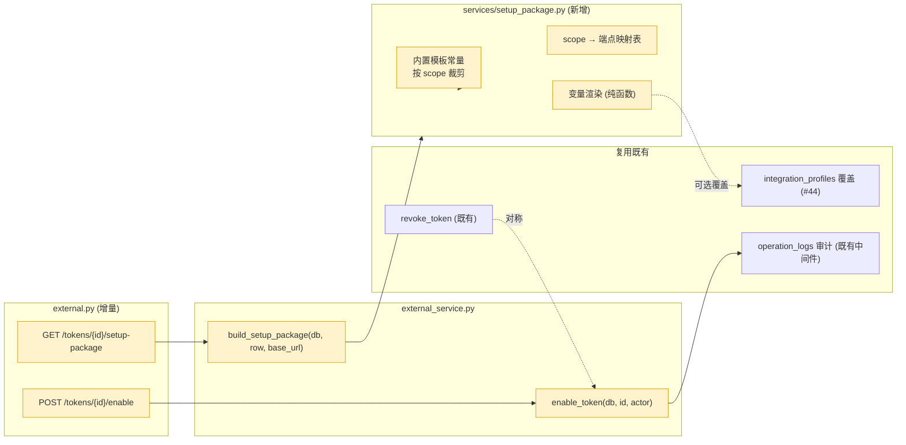

# A-20260910-003 外部接入体验与配置包

**状态**：LOCKED（v1.0）
**锁定日期**：2026-09-10
**架构师阶段产出**：Architect 阶段（人工终审锁定）
**审查结论**：人工终审通过（2026-09-10）
**关联工单**：`tanzk/csctalon#43`
**关联既有架构**：A-20260902-021（外部工具只读开放平台，LOCKED v1.2）——**本单为其 v1.3 增量**
**范围**：token 生命周期补「恢复」中间态；新增面向调用方的接入配置包（一键复制）。

---

## 〇、结论摘要（TL;DR）

1. **明文不可回看是底线，不改**：库中仅存 `SHA-256(token)`，明文**物理上不可恢复**。本单**不新增**任何明文回看能力。
2. **用「恢复」替代「重建」**：新增 `enabled=true` 端点，把吊销从**终态**改为**可逆状态**（复用既有字段，**无表结构变更**）。
3. **用「配置包」替代「回看 token」**：把 token 明文 + 接口地址 + 提示词 + 规范**拼成一整块**，生成时与恢复时都可一键复制——**用户不需要回看，因为物料已经带走了**。
4. **配置包文本是代码常量 + 可覆盖**：内置默认模板（代码常量，保证开箱可用），同时允许 `integration_profiles` 表覆盖（见 A-20260910-002）。
5. **恢复的语义留痕**：`revoked_by` 字段在恢复时**清空**并写入 `operation_logs`，保留「谁在何时吊销过 / 谁恢复过」的完整审计链。

---

## 一、模块边界图



---

## 二、接口契约

### 2.1 恢复 Token

```
POST /api/v1/external/tokens/{token_id}/enable          [AdminUser]
```

**请求**：无 body

**响应 `data`**：
```json
{
  "id": 7,
  "name": "workbuddy-日报简报",
  "enabled": true,
  "token_prefix": "kJ8xN2pQ",
  "restored_by": "admin",
  "restored_at": "2026-09-10T15:30:00+08:00"
}
```

**语义**：
- `enabled` 置 `true`；`revoked_by` **清空**（保留历史在 `operation_logs`）
- **幂等**：已启用的 token 再调返回 200，`enabled` 保持 true
- 404：token 不存在

**校验**：
- `expires_at` 已过期 → **仍允许恢复**，但响应追加 `"warning": "该 token 已过期, 恢复后仍不可用, 请同时更新过期时间"`（不静默失败）

### 2.2 获取接入配置包

```
GET /api/v1/external/tokens/{token_id}/setup-package    [AdminUser]
```

**Query**：`?base_url=`（可选，缺省从请求推导 `request.base_url`）

**响应 `data`**：
```json
{
  "token_id": 7,
  "name": "workbuddy-日报简报",
  "token_prefix": "kJ8xN2pQ",
  "scopes": ["brief", "refund"],
  "base_url": "https://csctalon.example.com",
  "markdown": "## 任务：拉取经营数据生成日报\n\n...",
  "char_count": 2140,
  "endpoints": [
    { "scope": "brief", "method": "GET", "path": "/api/v1/external/brief", "summary": "一键经营简报(日/周/月/任意区间)" },
    { "scope": "refund", "method": "GET", "path": "/api/v1/external/refund", "summary": "当日/指定日退款" }
  ],
  "has_example": true
}
```

> ⚠️ **明文不出现在此响应中**（`markdown` 内为占位符 `<在此粘贴你的 token>`）。原因：调用方**保存了自己那份明文**；若管理员需要在改配置时重新分发，走「生成时复制」或「重新生成明文」（见 §2.3）。这样避免「配置包接口」成为绕过 hash 存储的明文后门。

### 2.3 重新生成明文（覆盖式，不是回看）

```
POST /api/v1/external/tokens/{token_id}/rotate          [AdminUser]
```

**响应 `data`**：`{ "id": 7, "token": "<新明文, 仅此一次>", "token_prefix": "新前缀" }`

**语义**：**覆盖** `token_hash` / `token_prefix` → **旧 token 立即失效**。明文在本响应中返回一次，前端弹窗展示 + 「复制配置包」按钮。

**校验**：token 不存在 → 404；`enabled=false` 的 token 也允许 rotate（相当于「换钥并启用」），但响应追加提示。

> 这是「明文只显示一次」约束下的**唯一**合法补救路径：不是回看历史明文，而是**换一把新锁**。

---

## 三、数据库变更（ER 增量）

**无表结构变更。**

复用 `external_access_tokens.enabled`（已存在）与 `revoked_by`（已存在）。

> ⚠️ **不新增** `token_plain` / `token_encrypted` 列。任何「加密存储明文以便回看」的方案都会把 SHA-256 存储的安全属性降级为「密钥泄漏即全量令牌泄漏」，与 A-20260902-021 LOCKED 冲突，需另行走架构变更流程。

---

## 四、配置包内容规范

`build_setup_package` 输出的 Markdown 结构（按 scope 裁剪章节）：

```markdown
## 任务：<由 scope 推导，如「拉取经营数据生成日报」>

## 接口
- 地址前缀：{{base_url}}/api/v1/external
- 鉴权：请求头 Authorization: Bearer <在此粘贴你的 token>
- 数据格式：application/json，成功返回 {"code":0,"data":...,"message":"ok"}
- 金额单位：元（2 位小数）
- 时间：统一北京时间 Asia/Shanghai

## 可用端点（按该 token 的 scope 裁剪）
| 端点 | scope | 说明 |
|---|---|---|
| GET /brief?period=daily|weekly|monthly | brief | 一键经营简报 |
| GET /brief?start=&end= | brief | 任意区间回看（跨度上限 93 天） |
...

## 调用示例
curl -H "Authorization: Bearer <TOKEN>" "{{base_url}}/api/v1/external/brief?period=daily"

## 输出要求（提示词）
- 数字必须来自接口返回，不得推测
- 结论注明数据窗口（今日/本周/本月 截至时间）
- 金额一律以元为单位
- 结构：结论要点 → 数据明细 → 异常提示
...

## 错误处理
| 状态码 | 含义 | 处理 |
|---|---|---|
| 401 | token 无效/已吊销/已过期 | 联系管理员 |
| 403 | 该 token 无此端点 scope | 联系管理员扩权 |
| 429 | 触发限频 | 退避重试 |
| 503 | 功能未启用 | 联系管理员 |
```

**裁剪规则**（`scope → 章节`）：

| scope | 含端点 | 含示例 | 含提示词段 |
|---|---|---|---|
| `brief` | brief | ✅ | ✅（日报/周报/月报模板） |
| `refund` | refund, brief(只读引用) | ✅ | ✅（退款分析） |
| `complaint` | complaint | ✅ | ✅（投诉分析） |
| `reception` | reception | ✅ | ✅（接待分析） |

---

## 五、风险清单

1. **「恢复」被误用成「绕过吊销」**：安全事件中管理员吊销了 token，随后被他人恢复。**缓解**：`enable` 走 `operation_logs` 自动留痕（写操作经中间件落库），且响应回 `restored_by`；**恢复操作必须写明确 action 标签**（如 `外部接入.恢复Token`），便于审计检索。
2. **rotate 导致下游静默失效**：换钥后旧 token 立即失效，但 WorkBuddy 侧不知道，直到下次调用报 401。**缓解**：rotate 响应明确回「旧 token 已立即失效」；前端弹窗**强制**显示「请立即更新调用方配置」；建议同时提示可用「配置包复制」一键带走。
3. **配置包内容与实际接口漂移**：规范文档更新了但代码常量没同步。**缓解**：配置包模板与 `docs/standards/外部只读数据接入规范.md` **同源维护约定**——代码常量中每条端点描述**注明规范章节号**，审查时对照检查；并在测试中断言「端点清单与 `S.SCOPES` 完全一致」（避免新增 scope 忘记加进配置包）。
4. **`base_url` 推导错误**：反向代理场景下 `request.base_url` 可能是内网地址。**缓解**：允许 query 显式传 `base_url` 覆盖；前端默认用 `window.location.origin`（浏览器视角的真实对外地址），比后端推导更准。
5. **限频说明与实际不符**：token 级限频三值语义复杂，配置包若写死「每分钟 60 次」会误导。**缓解**：配置包中限频信息**从该 token 的实际配置渲染**（`0` → 「不限制」，`NULL` → 「全局默认 N 次/分钟」，`>0` → 「每分钟 N 次」）。

---

## 六、测试要求

| 用例 | 覆盖 |
|---|---|
| `test_enable_restores_revoked_token` | 吊销 → 恢复 → 可正常调用 |
| `test_enable_is_idempotent` | 重复调用状态不变、返回 200 |
| `test_enable_404_for_unknown_id` | 不存在 id → 404 |
| `test_enable_warns_when_expired` | 已过期 token 恢复带 warning |
| `test_setup_package_has_no_plain_token` | **断言响应任何字段不含真实明文 token**（安全回归） |
| `test_setup_package_scoped_endpoints` | scope=brief 只含 brief 端点 |
| `test_setup_package_endpoints_match_scopes_constant` | 端点映射表与 `S.SCOPES` 一致（防漂移） |
| `test_setup_package_rate_limit_rendering` | 三种限频值渲染正确 |
| `test_rotate_invalidates_old_token` | rotate 后旧 token 401、新 token 200 |
| `test_rotate_404_for_unknown_id` | 不存在 id → 404 |
