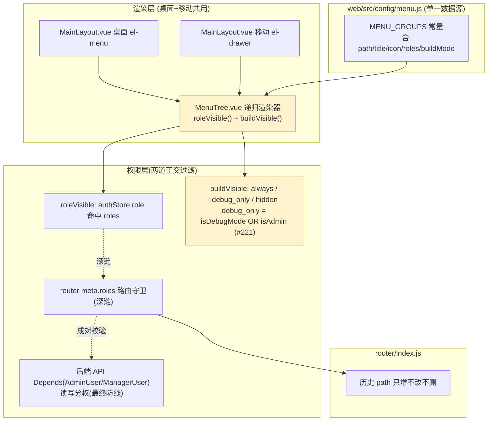

# A-20260910-004 导航信息架构重组

**状态**：LOCKED（v1.1）
**初版锁定日期**：2026-09-10（v1.0，人工终审通过，关联工单 `tanzk/csctalon#46`）
**本次升版**：2026-10-07（v1.1，据 `#218` 人工审核批准；用户 2026-10-07「执行吧」确认落地）
**架构师阶段产出**：Architect 阶段（人工终审锁定）
**关联工单**：`tanzk/csctalon#46`（初版）、`tanzk/csctalon#218`（v1.1 回写）；结构演进背书工单 `#44/#63/#67/#80/#137/#140/#157/#165/#208/#221`
**关联既有架构**：A-20260910-002（接入中心，菜单占位 LOCKED）
**范围**：导航层信息架构。**历史 path 只增、不改、不删**（v1.0「零 path 变更、零页面删除、零 API 破坏」约束在 v1.1 延续为对历史 path 的长期约束；新页面经各自工单增量引入）。

---

## 修订历史

| 版本 | 日期 | 工单 | 变更摘要 |
|---|---|---|---|
| v1.0 | 2026-09-10 | #46 | 初版：两份硬编码菜单 → `web/src/config/menu.js` 单一源；一级 13→7；系统管理三层分组；分析能力放宽 manager（API 权限成对调整）。 |
| v1.1 | 2026-10-07 | #218（+ #221） | **文档回写已批准的代码现状，不改任何代码/path**：① 删「工作台」一级组（`/dashboard`、`/agenda` 路由保留可达，仅不挂菜单）；② #80 命名「今日值班看板/运营分析看板」、组名「看板」；③ 新增一级组「AI 与分析」（扁平 6 项，原 #137/#141 Tab 容器 2026-09-29/30 解散）；④ 系统管理 3→**4** 子分组（新增「数据质量」，#140/#67/#208/#165）；⑤ 消解 v1.0 两处自相矛盾——设备流量审计、分析视图/视图构建器**唯一归「数据分析」组**；⑥ 角色术语明确 manager=`supervisor`∪`specialty_lead`；⑦ 新增 R7 发布构建菜单可见性（#221）。差异盘点 15 条见 `#218` 评论与 v1.1 升版 commit。 |

> v1.1 性质说明：2026-09-10 后菜单代码已在多张已批准工单下演进并稳定（`menu.spec.js` 12 测试、`MenuTree.spec.js` 6 测试锁定），v1.0 文档未及时回写。本次为**文档追平代码**，非新一轮导航整改，**不回滚任何代码**。

---

## 〇、结论摘要（TL;DR）

1. **纯导航层治理**：只动「菜单怎么摆、谁看得见」，**历史 `path` 只增不改不删**，历史书签与深链 100% 保留（含已不挂菜单的 `/dashboard`、`/agenda`、`/report/center`、`/system/ai-admin`，均路由可达）。
2. **单一配置源**：桌面侧边栏与移动抽屉共用 `web/src/config/menu.js` 的 `MENU_GROUPS`，由同一渲染器 `web/src/components/MenuTree.vue` 两端渲染。
3. **一级菜单现状 7 组**：看板 · 专项分析 · 运营工具 · 管理闭环 · 数据分析 · AI 与分析 · 系统管理。
4. **系统管理四层分组**：组织与权限 / 数据与接入 / 数据质量 / 审计与配置。
5. **分析能力对管理层开放（API 权限配对）**：分析视图读权限对 `supervisor`+`specialty_lead`（统称 manager）开放，写操作仍锁 admin——菜单可见性与 API 权限成对。
6. **发布期可见性（#221，临时策略）**：release 构建下 `debug_only` 菜单默认隐藏，但 **admin 可见全部**；其他角色可见集与历史一致；debug 构建全量。

---

## 一、模块边界图



---

## 二、菜单结构契约（v1.1 现状）

### 2.1 一级菜单（7 组）

| # | key | 分组 | 子项（path） | 可见角色 | build 档 |
|---|---|---|---|---|---|
| 1 | `dashboard` | 看板 | 今日值班看板 `/dashboards/today`、运营分析看板 `/dashboards/operation` | 全员 | always |
| 2 | `analysis` | 专项分析 | 退款分析 `/dashboards/refund`、挽回分析 `…/refund-recovery`、投诉分析 `…/complaint-analysis`（前 3 项 always）；投诉核查 `…/complaint-audit`、纯工信部投诉 `…/pure-card-complaint`(#63)、接待分析 `…/reception`、绩效分析 `…/performance`、专项跟进 `…/special`（后 5 项 debug_only） | admin / supervisor / specialty_lead | always（前 3 项） |
| 3 | `tools` | 运营工具 | 事项跟进 `/todos`、专项任务 `/tasks`、设备专项标签 `/management/device-tags`、发票登记 `/management/invoices`、知识库 `/management/kb-articles`、策略发布 `/strategy/publish`（另 altChildren：策略管理 `/strategy/manage` 仅 admin/supervisor） | 全员（部分按角色） | debug_only |
| 4 | `management` | 管理闭环 | 报告索引 `/management/reports`、周报看板 `…/weekly`、管理措施 `…/measures`、政策措施 `…/policies`、影响事件 `…/incidents`、排班管理 `…/schedule`、预警中心 `…/alerts`、跨部门协作 `…/upstream-tickets`、看板模板 `…/templates`（模板仅 admin/supervisor） | admin / supervisor / specialty_lead | debug_only |
| 5 | `data-analysis` | 数据分析 | 分析视图 `/analytics/views`、视图构建器 `/analytics/builder`（仅 admin）、设备流量审计 `/data/device-flow-audit` | admin / supervisor / specialty_lead（构建器仅 admin） | debug_only |
| 6 | `ai-analysis` | AI 与分析 | 见 §2.3（扁平 6 项） | admin | always |
| 7 | `system` | 系统管理 | 见 §2.2（**四**层子分组） | admin | always（分组本身） |

**命名（#80，用户 2026-09-13 拍板，取代 v1.0 U1）**：`/dashboards/today` 为「今日值班看板」（值班台：实时 KPI/值班组长/影响事件/待办/政策，非归因分析），`/dashboards/operation` 为「运营分析看板」（周/月/季/年 + 全量人效 + 原因 Top10）；组名「看板」。改名须 4 处同步：`menu.js` · `router/index.js` meta.title · 两页 pageTitle · 快捷入口文案。

**工作台处置（D2）**：v1.0 的「工作台」组已移除，但其路由 `/dashboard`（工作台，根 `/` 与 404 兜底仍重定向到此链路上的 `/dashboards/today`）与 `/agenda`（我的待办）**全部保留可达**，仅不再挂菜单；书签/深链不破坏。

**报表中心 `/report/center`（U4 更新）**：维持「路由保留、菜单不可见」，实现方式为**不在 `menu.js` 注册任何条目**（v1.0 的 `buildMode:'hidden'` 占位未保留，效果等价）；`hidden` 档位语义保留给未来占位页。

### 2.2 系统管理四层分组（v1.0 三层 → v1.1 四层）

```
系统管理 (admin)
├─ ① 组织与权限 (system-org)                 低频：改一次用很久
│   ├─ 用户管理            /system/users
│   ├─ 人员管理            /system/persons
│   └─ 分类规则            /system/classification-rules
├─ ② 数据与接入 (system-data)                中频：运维日常
│   ├─ 数据采集            /data/ingest
│   ├─ 接入中心            /system/access-center        (#44)
│   ├─ 数据源接入助手      /system/ai-onboarding        (#157)
│   └─ 缓存管理            /system/cache
├─ ②.5 数据质量 (system-quality)             数据治理域（#140 新增整组）
│   ├─ 投诉采集质量        /system/complaint-quality    (#67 P3)
│   ├─ 同源案件复核        /system/complaint-same-source(#208)
│   └─ AI 数据治理         /system/ai-data-governance（仅 admin，#165）
└─ ③ 审计与配置 (system-audit)               中频
    ├─ 操作日志            /system/operation-logs
    ├─ 事务通知            /system/system-events（未读角标 badge:eventUnread）
    └─ 看板配置            /dashboards/designer
```

**唯一归属裁决（消解 v1.0 自相矛盾，v1.1 定唯一口径）**：
- **设备流量审计 `/data/device-flow-audit` → 永久归「数据分析」组**（v1.0 §2.1/§2.2/§四 三处不一致，现以代码现状为准）。
- **分析视图 `/analytics/views`、视图构建器 `/analytics/builder` → 永久归「数据分析」组**（v1.0 §2.2 误置于「审计与配置」）；「审计与配置」仅保留看板配置 `/dashboards/designer` 作为设计类入口。

> `数据源管理` / `同步设置` / `数据质量(旧)` 等历史路由仍为 **redirect 到 `/data/ingest?tab=...`**（兼容层，`meta.hidden`），不是独立菜单项，不归组。

### 2.3 AI 与分析一级组（v1.1 新增，原 v1.0 无）

`key='ai-analysis'`，`always`，`roles:['admin']`，**扁平 6 项、不套子组**，按 AI 链路依赖层次排序：

| 序 | 菜单名 | path | 层 |
|---|---|---|---|
| 1 | 模型接入与调度 | `/system/llm-providers` | 模型底座（Provider CRUD/降级链/健康/出域策略/调用审计） |
| 2 | 报告模板 | `/system/ai-templates` | 提示词内容 |
| 3 | AI 助手关注点 | `/system/ai-focus-configs` | 提示词内容（四层总览并入） |
| 4 | 提示词评估 | `/system/ai-prompt-eval` | 提示词治理 |
| 5 | 提示词版本 | `/system/prompt-versions` | 提示词治理（版本账本/金丝雀） |
| 6 | 报告历史 | `/system/ai-reports` | 产物查看 |

由来：原 #137/#141 的 3-Tab「AI 管理」整合入口于 2026-09-29/30 取消 Tab 容器、各页独立直达；`/system/ai-admin` 路由保留可达但不挂菜单；接入中心 Tab4「AI 与模型」同期迁入本组/关注点页，接入中心回归纯数据对接。

### 2.4 单一配置源结构（沿用 v1.0）

`web/src/config/menu.js` 导出 `MENU_GROUPS`（项含 `key/path/title/icon/roles/buildMode`，支持 `children` 一层嵌套与 `altChildren` 条件附加项）与派生工具 `collectMenuPaths()`。

**渲染规则**：
- `buildMode`：`always` 恒显 / `debug_only` 仅 debug 构建或 admin（见 §四.2）/ `hidden` 任何构建不显示但路由可达。
- `roles`：`null` 全员；数组时校验 `authStore.role` 是否命中。
- **嵌套一层**：`children` 内含 `children` 渲染为二级 `el-sub-menu`。
- menu.js 顶部保留「全站菜单唯一定义处」注释；增删菜单只改 menu.js，禁止在 MainLayout 直接写 `el-menu-item`。

---

## 三、数据库变更（ER 增量）

**无。** 纯前端导航层（v1.0/v1.1 均然）。

---

## 四、权限

### 4.1 API 权限配对（关键，v1.1 仅明确术语，策略不变）

**角色术语**：代码角色枚举为 `admin / supervisor / specialty_lead / specialist / agent`，无 `manager` 字面。本文及业务口径中的 **manager = `supervisor` ∪ `specialty_lead`**（`authStore.isManager` 即此三者并集，含 admin）。

| 端点 | 权限 | 说明 |
|---|---|---|
| `GET /analysis-views`、`GET /analysis-views/{id}`、`POST /analysis-views/execute` | ManagerUser（admin/supervisor/specialty_lead） | 与「数据分析」菜单可见一致；执行=取数，与读同权 |
| `POST/PUT/DELETE /analysis-views` | AdminUser | 构建器仅 admin；非 admin 写 → 403 |
| `GET /dashboards`（列表/详情） | ManagerUser | 已一致 |
| `POST/PUT/DELETE /dashboards` | AdminUser | 看板配置仅 admin |
| `GET /device-flow/usage*` | 按现状（设备流量审计菜单对 manager 可见） | 归属数据分析组；读写权限以端点现状为准，变更须另配测试 |

**前端按钮配对**：`ViewList.vue` 非 admin 隐藏新建/编辑/删除与「发布为看板」；路由 `/analytics/builder` `meta.roles:['admin']`，非 admin 直达被守卫重定向。

### 4.2 发布构建菜单可见性（#221，临时策略，用户 2026-10-07 拍板）

`MenuTree.buildVisible()` 对 `debug_only` 的判据为 **`isDebugMode || authStore.isAdmin`**：
- **release 构建 + admin → 可见全部菜单**（含 debug_only 整组/子项，仍受各项 `roles` 约束）；
- **release 构建 + 非 admin（supervisor/specialty_lead/agent）→ 可见集与历史逐字节一致**，debug_only 仍隐藏，不新增任何入口；
- **debug 构建 → 行为不变**（全量、再按角色过滤）。

仅控制「菜单入口」显隐；**不涉及路由守卫与后端 API 权限**，深链可达性维持原状。桌面/移动共用 MenuTree，一处两端生效。这是临时发布口径；未来非 admin 是否再放开 debug_only 菜单另决策。

---

## 五、风险清单

1. **深链与书签断裂**：任何历史 `path` 改动都会破坏链接。**缓解**：硬约束「历史 path 只增不改不删」；验收用 `git diff` 校验 router 既有 `path:` 行不被修改。
2. **菜单可见性放宽引入越权**：菜单对 manager 可见时若遗漏写端点限制，会造成越权写。**缓解**：菜单与 API 权限变更同一 PR；测试断言 manager 调写端点 403。
3. **移动端与桌面端再次漂移**：只允许改 menu.js 单一源；MenuTree 为唯一渲染器。
4. **`buildMode` 语义混淆**：`hidden`（任何构建不显示、路由可达）与 `debug_only`（debug 或 admin 可见）不同，menu.js 内联注释说明。
5. **范围蔓延**：导航治理不顺手做无关整改（报表中心实现、颜色 token、导航结构重排等）；结构调整另开工单（S-P1-4 等）。
6. **（v1.1 补）发布期 admin 全量菜单的误用**：release 下仅 admin 见 debug_only，属入口可见性而非放权；数据安全仍由后端 API 兜底，admin 本即最高权限，不产生新增越权面。

---

## 六、测试要求（v1.1 基线）

| 用例 | 覆盖 |
|---|---|
| `menu.spec.js: 一级菜单数量 ≤ 8` | 收敛目标（现状 7） |
| `menu.spec.js: 系统管理含 4 个子分组`（顺序 system-org/system-data/system-quality/system-audit） | v1.1 四层结构（#140） |
| `menu.spec.js: AI 与分析扁平 6 项且按依赖层次排序` | v1.1 新增组 |
| `menu.spec.js: buildMode=hidden 语义` | 报表中心以「不注册菜单」处置 |
| `menu.spec.js: roles 过滤` | manager（supervisor/specialty_lead）可见数据分析、agent 不可见；视图构建器仅 admin |
| `menu.spec.js: #80 命名与 router meta.title 一致` | 今日值班看板/运营分析看板 |
| `menu.spec.js: 所有 path 存在于 router` | 防悬空菜单项 |
| `MenuTree.spec.js`（debug 档，6 例） | 配置→真实 DOM 渲染链路，防「菜单整块不渲染」回归 |
| `MenuTree.release-visibility.spec.js`（release 档 mock，5 例，#221） | release 下 admin 见全部、agent/supervisor/specialty_lead 维持历史可见集 |
| `router.spec.js: path 集合与基线一致` | 防历史 path 变更（快照） |
| `test_analysis_views_permission.py` | manager 读 200 / 写 403 |
| `npm run build`（debug 与 release 两档） | 两档构建均无回归 |
