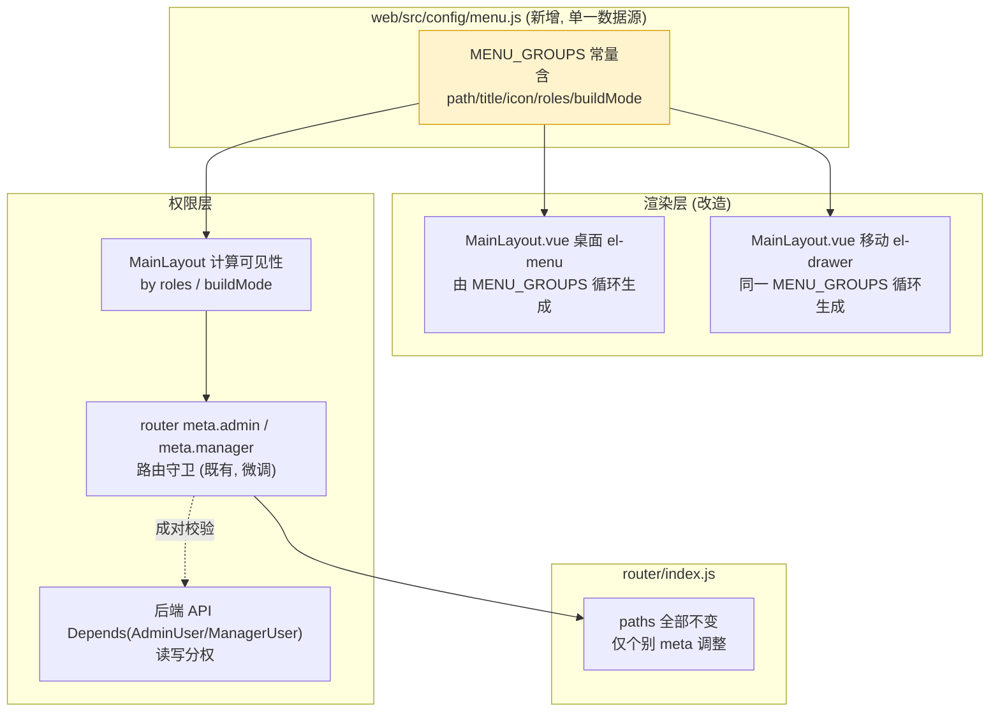

# A-20260910-004 导航信息架构重组

**状态**：LOCKED（v1.0）
**锁定日期**：2026-09-10
**架构师阶段产出**：Architect 阶段（人工终审锁定）
**审查结论**：人工终审通过（2026-09-10）
**关联工单**：`tanzk/csctalon#46`
**关联既有架构**：A-20260910-002（接入中心，需在菜单占位 LOCKED）
**关联审计项**：`A-P2-1`、`C-P2-5`、`FEA-07/08/09`、`U1~U4`（`docs/审查行动项登记.md`）
**范围**：导航层信息架构重组。**零路由 path 变更、零页面删除、零 API 破坏**。

---

## 〇、结论摘要（TL;DR）

1. **纯导航层重构**：只动「菜单怎么摆、谁看得见」，**不动任何 `path`**，历史书签与深链 100% 保留。
2. **两份硬编码 → 一份配置源**：当前桌面侧边栏与移动抽屉是**两份独立的 `<el-menu-item>` 列表**，天然漂移。本单抽出 `web/src/config/menu.js` 单一数据源，两端共用渲染器。
3. **系统管理三层分组**：13 项平铺 → 3 个子分组（组织与权限 / 数据与接入 / 审计与配置），按「功能域 → 权限 → 使用频度」组织。
4. **一级菜单 13 → 7**：把散落单条目收敛进「运营工具」等分组，同步消化审计项 `FEA-09 / U2`。
5. **分析能力开放给 manager（含 API 权限配对调整）**：`分析视图/视图构建器` 从 admin-only 放宽到 manager，**但写操作仍锁 admin**——菜单可见性与 API 权限必须**成对变更**，否则只是「看得见点不动」或更糟「点得动但不该点」。

---

## 一、模块边界图



---

## 二、菜单结构契约

### 2.1 一级菜单（13 → 7）

| # | 分组 | 子项 | 可见角色 | build 档 |
|---|---|---|---|---|
| 1 | 工作台 | 工作台 `/dashboard`、我的待办 `/agenda` | 全员 | debug_only |
| 2 | 运营看板 | 今日看板 `/dashboards/today`、运营看板 `/dashboards/operation` | 全员 | always |
| 3 | 专项分析 | 退款分析、挽回分析、投诉分析、投诉核查、接待分析、绩效分析、专项跟进 | manager | always（前 3 项） |
| 4 | 运营工具 | 事项跟进、专项任务、设备专项标签、发票登记、知识库、策略发布 | 全员/部分 | debug_only |
| 5 | 管理闭环 | 报告索引、周报看板、管理措施、政策措施、影响事件、排班管理、预警中心、跨部门协作、看板模板 | manager | debug_only |
| 6 | 数据分析 | 分析视图、视图构建器、设备流量审计 | **manager**（原 admin） | debug_only |
| 7 | 系统管理 | 见 2.2 | admin | always（分组本身） |

**命名统一（审计项 U1）**：`/dashboards/today` 菜单名统一为「今日看板」（与 `meta.title` 一致），`/dashboards/operation` 为「运营看板」。

**报表中心处理（审计项 U4）**：`/report/center` 为占位空壳，**本期在菜单中隐藏**（`buildMode: 'hidden'`），路由与页面保留以便后续实现导出能力后一键恢复。审计台账同步标注该处置。

### 2.2 系统管理三层分组

```
系统管理 (admin)
├─ ① 组织与权限            低频：改一次用很久
│   ├─ 用户管理            /system/users
│   ├─ 人员管理            /system/persons
│   └─ 分类规则            /system/classification-rules
├─ ② 数据与接入            中频：运维日常
│   ├─ 数据采集            /data/ingest              ← 统一入口(8 tab)，高频，置顶
│   ├─ 设备流量审计        /data/device-flow-audit
│   ├─ 接入中心            /system/access-center     ← #44 新增
│   └─ 缓存管理            /system/cache
└─ ③ 审计与配置            中频
    ├─ 操作日志            /system/operation-logs    ← 高频，置顶
    ├─ 事务通知            /system/system-events     （含未读角标）
    ├─ 视图构建器          /analytics/builder
    └─ 视图清单            /analytics/views
```

> **`数据源管理` / `同步设置` / `数据质量` 说明**：这三项已有路由是 **redirect 到 `/data/ingest?tab=...`**（历史兼容层，`meta.hidden=true`）。本单**不改**这些 redirect，它们不是独立菜单项，无需归组。

> **`看板配置` (`/dashboards/designer`)** 归入「审计与配置」组的视图相关项（与视图构建器同域）。

### 2.3 单一配置源结构

```js
// web/src/config/menu.js 结构约定 (伪代码)
export const MENU_GROUPS = [
  {
    key: 'workbench',
    title: '工作台',
    icon: 'HomeFilled',
    buildMode: 'debug_only',          // always | debug_only | hidden
    roles: null,                       // null=全员; ['admin'] / ['admin','supervisor']
    children: [
      { path: '/dashboard', title: '工作台', icon: 'HomeFilled' },
      { path: '/agenda', title: '我的待办', icon: 'Bell' },
    ],
  },
  // ...
  {
    key: 'system',
    title: '系统管理',
    icon: 'Setting',
    buildMode: 'always',
    roles: ['admin'],
    children: [                        // ← 支持嵌套分组(二级 sub-menu)
      {
        key: 'system-org', title: '组织与权限', icon: 'OfficeBuilding',
        children: [
          { path: '/system/users', title: '用户管理' },
          // ...
        ],
      },
    ],
  },
]
```

**渲染规则**：
- `buildMode`：`always` 恒显 / `debug_only` 仅 debug 构建 / `hidden` 不显示但路由可达
- `roles`：`null` 全员；数组时校验 `authStore.role` 是否命中
- **嵌套一层**：`children` 内若元素含 `children`，渲染为二级 `el-sub-menu`（Element Plus 支持多层嵌套）

---

## 三、数据库变更（ER 增量）

**无。** 纯前端导航层重组。

---

## 四、API 权限配对调整（关键）

菜单放宽可见性时，**必须同步核对后端 API 权限**，否则出现「菜单看得见、点了 403」的体验断裂，或更严重的「越权可写」。

| 端点 | 当前 | 调整后 | 理由 |
|---|---|---|---|
| `GET /analysis-views` | `CurrentUser` | **`ManagerUser`** | 与菜单一致（manager 可见 = 可读）。若不收紧，普通客服仍可经 API 直读主管视角视图 |
| `GET /analysis-views/{id}` | `CurrentUser` | **`ManagerUser`** | 同上 |
| `POST /analysis-views/execute` | `CurrentUser` | **`ManagerUser`** | 同上（执行视图 = 取数，与读同权） |
| `POST/PUT/DELETE /analysis-views` | `CurrentUser` | **`AdminUser`** | 构建器菜单为 admin-only；原为 CurrentUser 属审计项 `A-P1-3`「越权写」范畴，本单顺手配对收紧 |
| `GET /dashboards`（列表/详情） | `ManagerUser` | 不变 | 已一致 |
| `POST/PUT/DELETE /dashboards` | `AdminUser` | 不变 | 看板配置仅 admin |
| `GET /device-flow/usage*` | `CurrentUser` | **不变** | 「设备流量审计」仍在系统管理分组（admin 可见），不走「数据分析」组，故不需要配对调整 |

> **写接口收紧的影响面说明**：原 `create_view/update_view/delete_view` 为 `CurrentUser`，
> 意味着任何登录用户都能建/改/删视图（`_can_modify_view` 只做属主校验，管理员可改任意）。
> 收紧为 `AdminUser` 后，非管理员的视图写操作将被 403 拦截。
> ⚠️ 前端 `ViewList.vue` / `ViewBuilder.vue` **已同步按角色隐藏写操作入口**（见 §四.1），
> 避免"按钮在但点了 403"的体验断裂。

### 4.1 前端按钮配对

| 页面 | 调整 |
|---|---|
| `ViewList.vue` | 非 admin 隐藏「新建视图 / 编辑 / 删除」；保留「查看」与「发布为看板」（发布落 `dashboards` 写接口，已限 admin → 亦隐藏） |
| 路由 `/analytics/builder` | `meta.roles: ['admin']` 保留，非 admin 直达时守卫重定向 |

---

## 五、风险清单

1. **深链与书签断裂**：任何 `path` 改动都会破坏历史链接与外部引用。**缓解**：本单**硬约束零 path 变更**；验收时用 `git diff` 校验 `router/index.js` 中 `path:` 行**仅允许 meta 行变更**。
2. **权限放宽引入越权**：把「数据分析」开放给 manager 时，若遗漏某个写端点，会造成 manager 可改视图定义。**缓解**：菜单变更与 API 权限变更**必须同一 PR**；新增测试断言 `manager` 调写端点返回 403。
3. **移动端与桌面端再次漂移**：即使本单统一了配置源，未来若有人在 `MainLayout.vue` 里直接加 `el-menu-item` 会重新引入漂移。**缓解**：在 `menu.js` 顶部写「**唯一菜单定义处**」注释；审查清单中加入「菜单项必须改 `menu.js`」条目。
4. **`buildMode` 语义混淆**：`hidden` 与 `debug_only` 含义不同（前者任何构建都不显示，后者 debug 构建显示），易误用。**缓解**：`menu.js` 中三个取值加内联注释；`hidden` 仅用于「占位页暂时下线」场景。
5. **审计项范围蔓延**：菜单重组容易顺手做一堆无关治理（如报表中心实现、颜色 token 化）。**缓解**：本单**只做导航层**；报表中心仅「隐藏菜单」，实现能力另开工单；颜色/组件化属 `A-P1-1/A-P1-2`，不在本单。

---

## 六、测试要求

| 用例 | 覆盖 |
|---|---|
| `menu.spec.js: 一级菜单数 ≤ 8` | 收敛目标 |
| `menu.spec.js: 系统管理含 3 个子分组` | 三层结构 |
| `menu.spec.js: buildMode=hidden 不渲染` | 报表中心处置 |
| `menu.spec.js: roles 过滤正确` | manager 可见数据分析、agent 不可见 |
| `menu.spec.js: 所有 path 存在于 router` | **防悬空菜单项**（菜单指向不存在的路由） |
| `router.spec.js: path 集合与基线一致` | **防 path 变更**（快照比对） |
| `test_analysis_views_permission.py` | manager 读 200 / 写 403 |
| `test_device_flow_permission.py` | manager 读 200 |
| `npm run build` 成功 | 构建无回归 |
