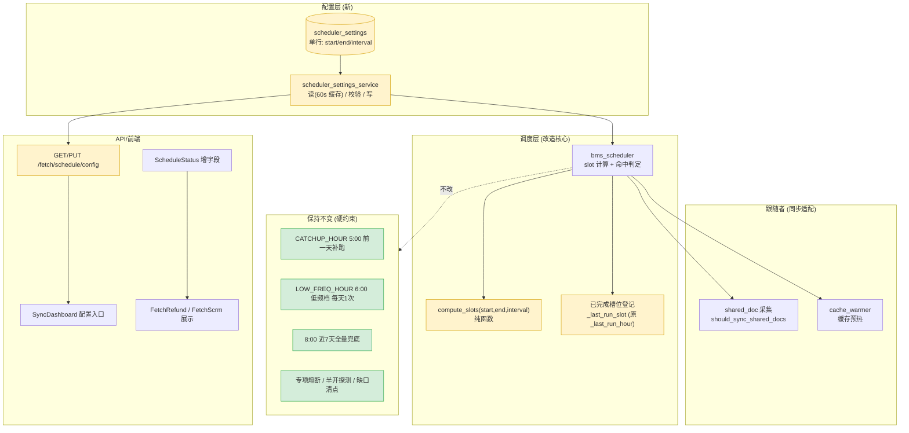

# A-20260910-006 高频采集节拍可配（时段 + 间隔）

**状态**：LOCKED（v1.0）
**锁定日期**：2026-09-10
**架构师阶段产出**：Architect 阶段（人工终审锁定）
**审查结论**：人工终审通过（2026-09-10）
**关联工单**：`tanzk/csctalon#51`
**关联既有架构**：**修订** `A-20260907-001`（BMS 定时采集源读库分频，LOCKED）§三 高频档定义；相关 `A-20260904-002`（采集可靠性治理）、`A-20260907-002`（共享文档接入框架）
**范围**：把高频档的「固定小时集合」升级为「起止时段 + 间隔」并开放配置界面。**低频档、5:00 补跑、8:00 全量、熔断语义全部保持不变。**

---

## 〇、结论摘要（TL;DR）

1. **问题不是"跑得不够"，是"节拍写死在代码里"**。`DAYTIME_HOURS = {8..23, 0}` 是常量，配置界面只能只读展示 → 用户「在配置界面没法调整」的诉求正是这个。
2. **调度模型升级**：`{小时集合}` → `{start_hour, end_hour, interval_minutes}`，以「时间槽（slot）」为调度与防重单位（槽位标识 `"HH:MM"`）。
3. **默认值即目标态**：`start=8 / end=24 / interval=30` → 8:00, 8:30, …, 23:30 共 **32 槽/天**（原 17 次/天）。
4. **可行性有实测支撑**：每轮 5 源实际耗时 **~250 s**（主要是 BMS 强制的 65 s 操作间隔），30 分钟窗口余量充足；用户确认 BMS **无导出次数上限、仅 60 s 冷却**，无外部配额风险。
5. **低阈值防呆是硬要求**：`interval_minutes` 下限 **5 分钟**（低于每轮耗时必然重叠；实测 4.2 分钟，5 分钟是最小安全值且已很紧）。
6. **不改的东西比改的更重要**：低频档每天 1 次、5:00 补跑、8:00 近 7 天全量、专项熔断/半开探测/缺口清点 —— 本单**一个都不动**。

---

## 一、模块边界图



---

## 二、核心模型：从「小时集合」到「时间槽」

### 2.1 概念定义

| 概念 | 定义 |
|---|---|
| **高频时段** | `[start_hour, end_hour)` 左闭右开。默认 `[8, 24)` = 8:00 起至 24:00 前 |
| **间隔** | `interval_minutes`，默认 30 |
| **时间槽（slot）** | 时段内按间隔切分的时间点，标识为 `"HH:MM"`（如 `"08:00"`、`"08:30"`） |
| **槽位命中** | 当前北京时间落在某槽位的触发窗口内 |

### 2.2 `compute_slots` 契约（纯函数）

```
compute_slots(start_hour, end_hour, interval_minutes) -> list[str]
```

- 返回该配置下的全部槽位标识，升序，`"HH:MM"` 格式
- `start=8, end=24, interval=30` → `["08:00","08:30",...,"23:30"]`（32 项）
- `interval=60` → `["08:00",...,"23:00"]`（16 项，与旧行为等价）
- **边界语义（必须用测试锁死）**：
  - `end_hour=24` 时最后一个槽位为 `23:xx`，**不含 `"24:00"`**（24:00 即次日 0:00，归次日）
  - 若 `(end-start)*60` 不被 `interval` 整除 → 尾部残余不足一个间隔则**丢弃**（不产生半槽）
  - 不产生重复槽位

### 2.3 触发窗口

沿用既有「宽容窗口」思路，但粒度改为**槽位**：

- 窗口 = 槽位时刻起 `TRIGGER_WINDOW_MINUTES`（默认 30，**但不得超过 interval**）分钟内
- 即：`now >= slot` 且 `now < slot + min(TRIGGER_WINDOW_MINUTES, interval_minutes)`
- 目的：进程重启/短暂阻塞后仍能补上错过的槽位（沿用现有设计意图）
- **防重复**：同一槽位在 `_last_run_slot[date]` 中登记后不再触发

> ⚠️ 关键取舍：窗口**不超过 interval**，否则一个槽位的窗口会覆盖下一个槽位，
> 造成抖动或漏槽。这是本单新增的硬约束（原实现 interval 隐含 60 分钟、窗口 30 分钟，天然满足）。

### 2.4 槽位防重登记

`_last_run_hour: dict[date, set[int]]` → `_last_run_slot: dict[date, set[str]]`

- 当日已完成槽位集合，元素为 `"HH:MM"`
- 重启回填：从 `bms_sync_logs` 取当日 `trigger_type='scheduled'` 且 `status='success'` 的
  `finished_at`（北京时间），**归一到所属槽位**（向下取整到 interval 边界）
- 低频档（6:00）独立日标记 `_low_freq_done` **保持不变**（不在槽位体系内）

---

## 三、接口契约

### 3.1 调度配置（新）

```
GET  /api/v1/fetch/schedule/config        [ManagerUser]  读当前配置
PUT  /api/v1/fetch/schedule/config        [AdminUser]    改配置
```

**响应 `data`（GET/PUT 同构）**：
```json
{
  "start_hour": 8,
  "end_hour": 24,
  "interval_minutes": 30,
  "slots": ["08:00", "08:30", "..."],
  "slot_count": 32,
  "runs_per_day": 32,
  "estimated_round_seconds": 250,
  "updated_by": "admin",
  "updated_at": "2026-09-10T19:30:00+08:00",
  "notice": "修改后自下一个槽位生效, 无需重启; 低频档(6:00)/5:00补跑/8:00全量不受影响"
}
```

**PUT 请求**：
```json
{ "start_hour": 8, "end_hour": 24, "interval_minutes": 30 }
```

**校验（非法 → 400，不静默取默认）**：

| 规则 | 拒绝条件 | detail 示例 |
|---|---|---|
| 间隔下限 | `interval_minutes < 5` | 间隔下限 5 分钟（每轮实测约 4.2 分钟，低于此必然重叠） |
| 间隔上限 | `interval_minutes > 180` | 间隔上限 180 分钟 |
| 时段合法性 | `not (0 <= start_hour < end_hour <= 24)` | 起止时间非法：需满足 0 ≤ 起 < 止 ≤ 24 |
| 槽位非空 | `compute_slots(...) == []` | 该时段与间隔组合产生 0 个采集点 |

### 3.2 `ScheduleStatus` 扩展（既有端点）

`GET /api/v1/fetch/schedule/status` 增字段（**向后兼容，不删旧字段**）：

| 字段 | 类型 | 说明 |
|---|---|---|
| `start_hour` | int | 高频时段起 |
| `end_hour` | int | 高频时段止（不含） |
| `interval_minutes` | int | 间隔 |
| `slots` | list[str] | 槽位清单（如 `["08:00", "08:30"]`） |
| `next_run` | str | **语义升级**：下一次槽位时刻（原为"下一个整点"） |
| `schedule_hours` | list[int] | **保留**（兼容旧前端），值为 `slots` 中出现的小时去重升序 |

> 兼容性说明：旧前端 `FetchRefund.vue`/`FetchScrm.vue`/`SyncDashboard.vue` 用
> `schedule_hours.map(h => h + ':00')` 渲染。保留该字段可**避免前端与后端必须同时发布**；
> 新前端改用 `slots` 精确展示。

---

## 四、数据库变更（ER 增量）

新表 `scheduler_settings`（**单行表**，`id=1` 恒存在）：

| 字段 | 类型 | 约束 | 说明 |
|---|---|---|---|
| `id` | Integer PK | PK, 固定 1 | 单行约束 |
| `high_freq_start_hour` | Integer | NOT NULL, DEFAULT 8 | 高频时段起（含） |
| `high_freq_end_hour` | Integer | NOT NULL, DEFAULT 24 | 高频时段止（不含） |
| `high_freq_interval_minutes` | Integer | NOT NULL, DEFAULT 30 | 间隔（分钟） |
| `updated_by` | String(64) | NULL | 最后修改人 |
| `created_at` / `updated_at` | timestamptz | NOT NULL | `TimestampMixin` |

**Migration**（单一 head）：
- 建表 + **插入默认行**（`8 / 24 / 30`）
- 幂等：若已存在 `id=1` 则跳过（不覆盖用户改动，遵循审计项 `C-P2-2`）

**为什么用表而不是配置常量/env**：
- 用户明确要求「配置界面能调整」→ 必须可在运行时修改且持久化
- env 改动需重启 + 运维介入，不满足「页面可调」
- 单行表避免"多行配置哪行生效"的歧义

---

## 五、不改的东西（硬约束清单）

| 项 | 现状 | 本单处理 |
|---|---|---|
| 低频档 | `LOW_FREQ_HOUR=6:00`，每天 1 次跑前一天整天 | **完全不动**（用户明确要求） |
| 凌晨补跑 | `CATCHUP_HOUR=5:00` 缺口清点 → 退回前一天全量 | **完全不动** |
| 8:00 全量兜底 | 近 `FULL_WINDOW_DAYS=7` 天 | **完全不动**（8:00 恰是新时段首槽，天然仍会跑） |
| 专项熔断 | 单源失败暂停当日该源 | **完全不动** |
| 半开探测 | 熔断源周期试探 | **完全不动**（触发条件从"白天非整点"改为"白天非槽位窗口"） |
| 缺口清点 | gap_queue 结算补跑 | **完全不动** |
| BMS 操作间隔 | `OPERATION_INTERVAL=65s` | **完全不动**（平台强约束） |

---

## 六、风险清单

1. **槽位重叠导致抖动（最高风险）**
   `interval` 若小于每轮耗时（实测 ~250 s ≈ 4.2 min），上一轮未结束下一槽位已到 →
   任务堆积或频繁「busy 跳过」。**缓解**：硬下限 5 分钟 + 窗口不超过 interval +
   沿用既有 `sync_task_manager` 全局互斥（busy 时顺延而非排队）；`_last_run_slot`
   登记在触发时而非完成时（沿用现有语义，避免 busy 重入）。

2. **BMS 请求量翻倍**
   17 次/天 → 32 次/天。用户已确认**无导出次数上限、仅 60 s 冷却**，故无配额风险。
   但**仍需关注**：若未来源集合扩大（如低频源上调为高频），每轮耗时线性增长，
   需重新评估 interval。**缓解**：配置接口返回 `estimated_round_seconds`，
   前端在"间隔 × 源数"可能超出时给警示。

3. **重启后槽位回填错误**
   旧逻辑按「小时」回填，新逻辑按「槽位」回填。若回填算法把 `08:29` 完成误判为
   `08:30` 槽，会漏掉 `08:30`。**缓解**：回填用**向下取整到 interval 边界**，
   且以 `finished_at` 为准（与旧实现口径一致）；单测覆盖 `08:29`/`08:30`/`08:31` 三个边界。

4. **配置改小 interval 后当日已过槽位语义**
   例如 10:17 把 interval 从 60 改成 30：当日已完成的 `10:00`（小时登记）如何与新槽位对齐？
   **缓解**：改配置时**重置当日槽位登记**（清空 `_last_run_slot[today]`，
   并按新 interval 重新回填），避免"10:30 槽因 10:00 已登记而跳过"。
   **代价**：改配置后可能触发一次补跑，属可接受（管理员主动操作）。

5. **前端与后端发布不同步**
   旧前端读 `schedule_hours`，若后端删该字段会白屏。**缓解**：保留 `schedule_hours`
   兼容字段（见 §3.2），新前端用 `slots`。

6. **共享文档采集节拍脱钩**
   共享文档 #35 并入"白天高频窗口"，若不适配会出现"BMS 30 分钟跑、共享文档仍 1 小时"。
   **缓解**：`should_sync_shared_docs` 改为"命中任一槽位"（复用同一 slot 判定），
   并有单测断言两者同节奏。

---

## 七、测试要求

| 用例 | 覆盖 |
|---|---|
| `test_compute_slots_default_30min` | 8/24/30 → 32 槽，首 `08:00` 尾 `23:30` |
| `test_compute_slots_60min_equals_old_behavior` | 8/24/60 → 16 槽（与旧 `DAYTIME_HOURS` 等价，回归保障） |
| `test_compute_slots_excludes_2400` | 不含 `"24:00"` |
| `test_compute_slots_drops_partial_tail` | `8/24/50` 尾部残余不产生半槽 |
| `test_validation_interval_lower_bound` | `interval=4` → 400；`=5` → 200 |
| `test_validation_interval_upper_bound` | `interval=181` → 400 |
| `test_validation_start_end_order` | `start>=end` / 越界 → 400 |
| `test_slot_not_triggered_twice` | 同槽位重复 tick 只触发一次 |
| `test_trigger_window_not_exceed_interval` | 窗口被 `min(30, interval)` 收敛 |
| `test_restart_backfill_rounds_down` | `08:29` 完成 → 归 `08:00` 槽（不改 `08:30`） |
| `test_config_change_resets_today_slots` | 改配置后当日槽位重算 |
| `test_low_freq_and_catchup_unchanged` | 6:00 低频 / 5:00 补跑语义不变（**防回归**） |
| `test_shared_docs_follows_slots` | 共享文档与 BMS 同槽位节奏 |
| `test_cache_warmer_follows_config` | 缓存预热跟随配置 |
| `test_settings_seed_not_overwrite` | 重复迁移不覆盖用户改动 |

---

## 八、迁移与兼容

| 项 | 处理 |
|---|---|
| 旧常量 `DAYTIME_HOURS` | 保留为**默认值来源**（`DEFAULT_*` 常量），运行时以 DB 配置为准 |
| `A-20260907-001` §三 | **新增 v1.1 修订注记**（顶部），指向本文档；不改原表格内容（保留历史） |
| `docs/standards/数据同步与加工说明.md` L379 | 更新调度常量说明（引用本文档） |
| 回滚路径 | 配置改回 `8/24/60` 即等价旧行为；极端情况可停调度器（既有能力） |
