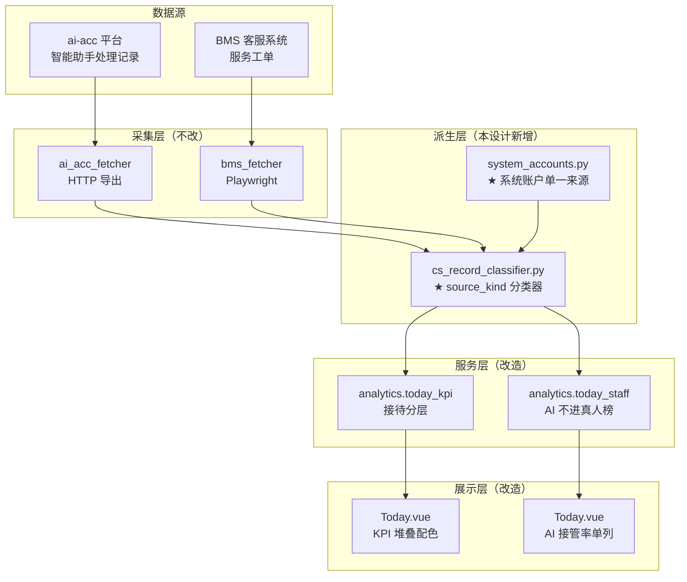

# A-20260913-001-AI接待口径分层

**状态**：LOCKED（v1.0）
**日期**：2026-09-13
**工单**：#78 AI 接待口径分层：区分真人/AI/客户自助，KPI 堆叠配色 + AI 单列
**架构师阶段产出**：GitHub Copilot（Architect 阶段）
**审查结论**：待人工终审

> **性质**：需求（REQ）—— 本设计只约束「接待（`cs_records` / `service_tickets`）域的口径分层」这一个集成，
> 不构成全仓约束。全仓约束条款见 `docs/standards/`（META）。

---

## 〇、设计说明（五要素 · 界面设计说明规范）

| 要素 | 内容 |
|---|---|
| **目的** | 替**运营主管**回答：AI 客服现在接管了多少接待？真人还剩多少工作量？涉及哪些设备 SN、哪些问题类型？ |
| **逻辑** | AI 客服处于迭代期，管理者需要的是「有谁在参与 + 大致量级」，不是逐条归因。故按**来源**四分（真人/AI 全自动/客户自助/系统标记），不做「AI 转人工」细分 |
| **口径** | 唯一判据 = `cs_records` 的 `operator` + `description` 文本模式（平台无 AI 标志列）。详见 §二 |
| **取舍** | ① **不做**「AI 转人工」精细化区分（场景 4）—— BMS 与智能客服仍在迭代，字段不稳定，现在做会返工；② **不删** AI 数据，只分层展示（AI 接管率本身是可控指标）；③ **不引入** 新表/新列，纯查询层派生 |
| **工单** | #78（本设计）；关联 #77（`cs_records` 重复行止损，已闭环） |

---

## 一、模块边界图



**边界**：本设计**只新增派生层**，不触碰采集层与表结构。
唯一的 DDL 变更（`NULLS NOT DISTINCT`）已由 #77 完成。

---

## 二、分类规则（核心契约）

### 2.1 枚举定义

```python
class SourceKind(str, Enum):
    HUMAN         = "human"          # 真人接待（含人工点 AI 助手）
    AI_AUTO       = "ai_auto"        # AI 全自动，全程无人工
    AI_SYSTEM     = "ai_system"      # 系统内部自动化（无人工痕迹的标记/执行）
    CUSTOMER_SELF = "customer_self"  # 客户在公众号自助操作
```

### 2.2 判据表（`cs_records` 侧）

> 平台导出**无 AI 标志列**，AI 与人工只能靠 `operator` + `description` 文本模式区分。

| 优先级 | `operator` | `description` 模式 | → `source_kind` | 对应场景 |
|---|---|---|---|---|
| 1 | 非空且不在系统账户集 | 任意 | `human` | 场景 1 / 2 / 4 |
| 2 | `WeChat` / `wechat` | 任意 | `ai_auto` | 场景 3 |
| 3 | 空 / NULL | `^[A-Za-z0-9_-]{20,}(操作\|发送)`（openid） | `customer_self` | 场景 5 |
| 4 | 空 / NULL | `^系统标记` / `^系统执行` | `ai_system` | — |
| 5 | 空 / NULL | 其他 | `ai_system` | 兜底 |

**判据实现要点**：

1. **顺序敏感**：必须先判 `human`（operator 有值），再判 `ai_auto`，最后按 `description` 细分空 operator。
2. **NULL 安全**：`operator` 为 NULL 与空串等同处理（历史数据两种都存在）。
3. **不做正则匹配 `description` 全文**：只用前缀锚定（`^系统标记`），避免误命中自由文本。

### 2.3 真人名下 AI 记录的处理

实测真人（企微-XXX）名下另有**「系统标记」行**（9/7–13 共 5208 行，占真人 18%）。

**决定**：这类行**保留在 `human`**，不单独拆出。

**理由（取舍）**：
- >50% 的「系统标记」在**同一时间戳**有对应的「企微-XXX操作/发送」行，说明是**人工动作的连带系统记录**
- 单独拆出会让「真人接待量」掉 18%，而实际人工工作量没有变化 → 反而失真
- 用户明确「没必要过于细化」

**但**：在 ⓘ 数据说明中**显式声明**该口径，供使用者知晓。

### 2.4 `service_tickets` 侧（第二套 AI）

| 字段 | 判定 | → `source_kind` |
|---|---|---|
| `registrant = 'AI客服'` | AI 建单 | `ai_auto` |
| `handler = 'AI客服'` | AI 处理 | `ai_auto` |
| `handler IN ('SYS','sys','system','System')` | 系统 | `ai_system` |
| `handler = '客户'` | 客户 | `customer_self` |
| 其他非空 | 真人 | `human` |

**与 `cs_records` 的关系**：两套 AI 来源不同（ai-acc 智能助手 vs BMS 客服系统），
**分开展示、共用同一枚举**，前端用同一图例渲染。

---

## 三、接口契约

### 3.1 `GET /api/v1/analytics/today/kpi`（改造）

**新增字段**（保留原字段不变，向后兼容）：

```jsonc
{
  "code": 0,
  "data": {
    "reception": {
      "value": 15932,                    // 【保持】会话数（= 分层后总和）
      "device_count": 3343,              // 【保持】接待数（SN 去重）
      "yoy_value": 14705,
      "yoy_pct": 8.3,
      "device_count_yoy": 2621,

      // ★ 新增：分层结构（各层之和 == value / device_count）
      "breakdown": {
        "human":         {"sessions": 5337,  "devices": 2411, "events": 5210},
        "ai_auto":       {"sessions": 10328, "devices": 3025, "events": 3651},
        "ai_system":     {"sessions": 0,     "devices": 0,    "events": 0},
        "customer_self": {"sessions": 267,   "devices": 26,   "events": 26}
      },
      // ★ 新增：AI 接管率（可控指标前置）
      "ai_takeover": {
        "session_pct": 65.9,             // AI 会话 / 总会话
        "device_pct": 12.6,              // AI 独有 SN / 总 SN
        "device_shared": 1092            // AI 与真人重叠 SN
      },
      "window_endpoint": "2026-09-13T12:15"  // 【保持】非实时窗口的截止时刻
    }
  }
}
```

**字段说明**：

| 字段 | 单位 | 口径 |
|---|---|---|
| `sessions` | 次（去重后） | 按 `(device_sn, operation_time, operator, solution, consult_time)` 去重 |
| `devices` | 个 | `device_sn` 去重（排除 NULL / 空串） |
| `events` | 次 | 按 `(device_sn, operation_time)` 去重（跨 operator 合并，反映「一次真实接待」） |

> ⚠️ `sessions` 口径在 #77 前是 `count(*)`（含重复行），#77 后自动收敛为去重值。
> 本设计**不再改** `sessions` 定义，只做分层；去重由数据库约束保证。

### 3.2 `GET /api/v1/analytics/today/staff`（改造）

**新增字段**：

```jsonc
{
  "data": [
    {
      "operator": "WeChat",
      "name": "WeChat",
      "is_virtual": true,            // ★ 修正：由 false → true
      "source_kind": "ai_auto",      // ★ 新增
      "rank": null,                  // ★ 虚拟账户 rank = null（排真人之后）
      "work_score": 2764.6,
      "reception_count": 13823
    }
  ]
}
```

**行为变更**：
- `human` 之外的三类**一律 `is_virtual=true`、`rank=null`**，排在真人员工之后
- 新增 `aggregate_by=source_kind` 取值，支持按来源聚合
- 向后兼容：原 `aggregate_by` 取值（person/specialty/group/all）行为不变

### 3.3 错误码

无新增错误码。沿用 `docs/standards/error-code.md`。

---

## 四、数据库变更（ER 增量）

**本设计不新增任何表或列**（纯查询层派生）。

唯一 DDL 变更 `cs_records.uq_cs_record_business` → `UNIQUE NULLS NOT DISTINCT`
已由 **#77** 完成（迁移 `a1c2e3f4d5b6`）。

---

## 五、风险清单

1. **正则误判风险**：`description` 是自由文本，openid 正则 `^[A-Za-z0-9_-]{20,}` 理论上可能命中长代号。
   - **缓解**：只用前缀锚定 + 长度 ≥20 双条件；上线后用生产数据回归比对分类分布（真人量应稳定在 28k 附近，偏差 >5% 即告警）。

2. **口径变更的沟通风险**：KPI「会话数」数字会因 #77 去重而**下降**（9 月约 -47%），
   使用者可能误判为「业务量暴跌」。
   - **缓解**：页面 ⓘ 显式写明「2026-09-13 起会话数按去重口径，与历史不可直接比较」；
     同时保留分层结构让使用者能自行核对。

3. **两套 AI 语义混淆风险**：ai-acc 的 `WeChat` 与 BMS 的 `AI客服` 名字不同、来源不同，
   合并展示时使用者可能以为是同一套。
   - **缓解**：前端图例分组标注来源（「智能助手(ai-acc)」/「AI客服(BMS)」）。

4. **`is_virtual` 白名单漂移风险**：现状 `SYS_OP_BLACKLIST` 与 `SYSTEM_VIRTUAL_EXACT` 两处并存且不一致，
   是本次问题的直接成因。
   - **缓解**：新增 `app/services/system_accounts.py` 作为**唯一来源**，两处均改为 import 该常量；
     新增账号只需改一处。

5. **性能风险**：KPI 接口新增 3 组聚合查询（按 source_kind）。
   - **缓解**：单查询内用 `CASE WHEN` 分桶（不增加查询次数）；沿用现有 90s 缓存。

---

## 六、验收标准

见工单 #78「验收标准 / 关闭条件」（7 项）。

---

## 七、后续（明确不在本期）

| 项 | 原因 | 触发条件 |
|---|---|---|
| AI 转人工细分（场景 4） | BMS / 智能客服字段不稳定，现在做会返工 | 平台提供稳定标记列 |
| 会话级时长/满意度归属 | 同上 | 同上 |
| AI 话术质量评估 | 超出「口径分层」范围 | 另立工单 |
