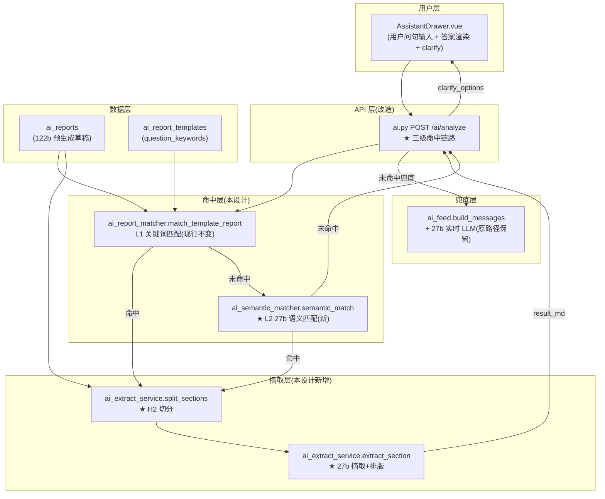
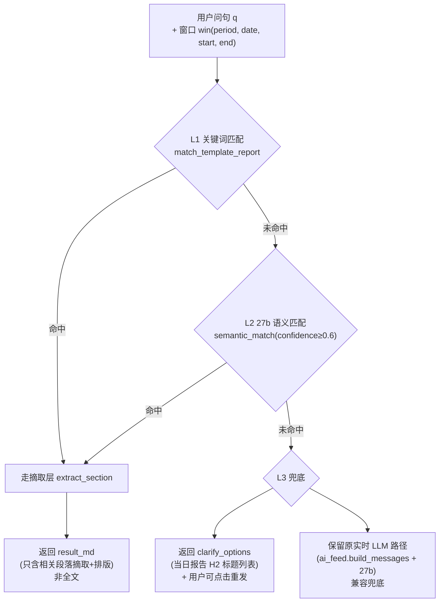
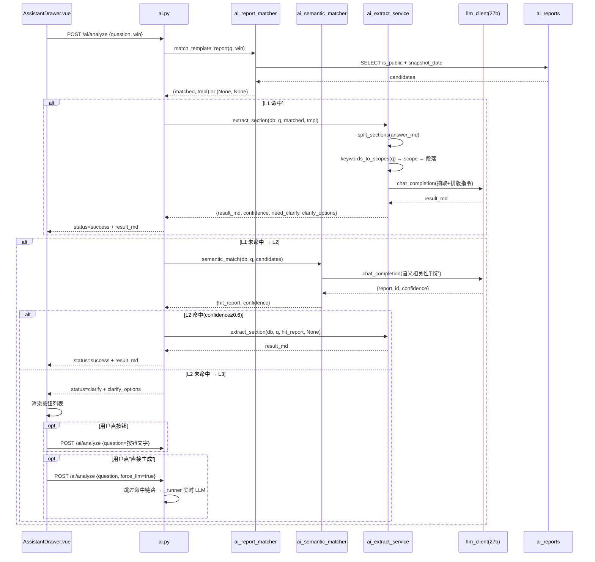

# A-20260917-001-ai报告草稿摘取与三级命中

**状态**：LOCKED（v1.0）
**日期**：2026-09-17
**工单**：#135 摘取层 + 三级语义命中链路（批次 B2）
**架构师阶段产出**：Trae Agent（Architect 阶段）
**审查结论**：待人工终审

> **性质**：需求（REQ）—— 本设计只约束「AI 报告命中链路 + 摘取层 + 语义匹配」这一个集成（即 `ai.py` / `ai_extract_service.py` / `ai_semantic_matcher.py` / `AssistantDrawer.vue` 的 clarify 状态），不构成全仓约束。全仓约束条款见 `docs/standards/`（META）。
> **关联工单**：#135
> **依赖前置**：#132（预生成窗口截止昨天）、#133（凌晨调度就绪）、#134（草稿结构化 H2 锚点）均已闭环

---

## 〇、设计说明（五要素 · 界面设计说明规范）

| 要素 | 内容 |
|---|---|
| **目的** | 替**运营主管 / 客服主管**回答：我问"退款情况"，能否只拿到退款那段（而非整份日报），并保留 122b 预生成草稿的分析质量；我问得模糊时能否被引导澄清而非掉进实时 LLM 路径 |
| **逻辑** | ① 命中预生成不再返回全文——摘取层按 H2 锚点切分草稿，按问句关键词路由到对应段落，再让 27b 按"摘取+排版"指令精简输出（输入是已生成的高质量草稿，输出质量≈122b）<br>② 关键词未命中走 27b 语义匹配判定问句与候选报告整体相关性，confidence≥0.6 视为命中<br>③ 语义也未命中返回 clarify_options（当日报告 H2 标题列表），让用户点击重发，保留原实时 LLM 兜底兼容 |
| **口径** | 摘取层输入 = `ai_reports.answer_md`（#134 已强制周/月报按 5 个 H2 锚点结构化）；切分锚点固定 `## 接待分析` / `## 退款分析` / `## 投诉分析` / `## 趋势对比` / `## 结论建议`；27b 摘取指令严格"基于给定段落内容摘取+排版，禁止编造/外推" |
| **取舍** | ① **不**在摘取层做"跨段落合并"——用户问"退款+投诉"时分两次调 27b 还是合一次？取舍：**单次调 27b 输入多个相关段落**，让模型自己组织输出结构，比双调更省 token 且语义连贯<br>② **不**用 122b 做摘取——122b 在 APU 上 78s 太慢（摘取是实时问答路径，用户在等），用 27b（9.5s）摘取已生成的 122b 草稿段落，质量≈122b 且响应快<br>③ **不**强制走摘取——L3 兜底保留原实时 LLM 路径兼容（避免摘取层故障导致整个 AI 助手不可用）<br>④ **不做**关键词命中前的"问句归一化"——简单 substring 匹配已足够（中文问句关键词密度高），归一化留待后续 |
| **工单** | #135（本设计）；关联 #134（前置已闭环）；方案文件 `.trae/documents/ai-report-optimization-plan.md` 批次 B2 |

---

## 一、模块边界图



**边界**：本设计**只新增命中层 L2 + 摘取层**，不触碰：
- `ai_report_matcher.match_template_report`（L1 关键词匹配，现行不变，仅调用方改走摘取层而非返回全文）
- `ai_feed.build_messages` / `_SYSTEM_PROMPT`（#134 已锁定 H2 锚点）
- `ai_report_worker.generate_for_template`（预生成路径不变）
- 表结构（无 DDL 变更，无 Alembic 迁移）

---

## 二、三级命中链路（核心契约）

### 2.1 链路流程图



### 2.2 各级判定逻辑

| 级别 | 判据 | 命中后动作 | 未命中后动作 |
|---|---|---|---|
| **L1 关键词匹配** | 现行 `match_template_report`（问句含模板 `question_keywords` 之一 AND snapshot_date 当日） | 走摘取层 `extract_section`（**不**返回全文） | 进入 L2 |
| **L2 27b 语义匹配** | `semantic_match(question, candidates)` 返回 `confidence≥0.6` | 走摘取层 `extract_section` | 进入 L3 |
| **L3 兜底** | — | 返回 `clarify_options`（当日报告 H2 标题列表，让用户点击重发）；**保留**原实时 LLM 路径兼容（同时返回 `status=clarify` + `clarify_options`，前端展示按钮 + 仍可走实时 LLM 兜底输入框） |

### 2.3 候选报告选取规则

`ai.py` 调 `match_template_report` 时已传入 `win_period` 与 `win_date`，候选集 = 当日 `is_public=True` 报告按 `(snapshot_period=win_period) DESC, created_at DESC` 排序。L2 语义匹配复用同一候选集（不再重新查库）。

---

## 三、摘取层 `ai_extract_service.py` 接口契约

### 3.1 模块路径

`backend/app/services/ai_extract_service.py`（新建）

### 3.2 函数签名

```python
def split_sections(answer_md: str) -> dict[str, str]:
    """按 ## H2 锚点切分草稿。

    切分锚点(与 #134 _SYSTEM_PROMPT 第 3 条一致):
      ## 接待分析 / ## 退款分析 / ## 投诉分析 / ## 趋势对比 / ## 结论建议

    返回: {section_title: section_body} 如 {"## 退款分析": "...", "## 投诉分析": "..."}
    兜底: 若 answer_md 不含 ## H2(日报), 按 \\n\\n 段落分, key 用段落首行前 20 字。
    空草稿返回 {}。
    """


def extract_section(db: Session, question: str, report: AiReport,
                    template: AiReportTemplate | None = None) -> dict:
    """从命中预生成报告按问句摘取相关段落+按问句排版输出。

    流程:
      1. split_sections(report.answer_md) 切分草稿
      2. 关键词路由: keywords_to_scopes(question) → scope 列表(复用 ai_focus_service)
         scope 到段落的映射(全树统一, 与 ai_feed._select_feed_sections 同款逻辑):
           reception → ## 接待分析
           refund    → ## 退款分析
           complaint → ## 投诉分析
           *         → 全部段落(用户问"今日总览"等泛问)
      3. 取命中段落 body 拼成 input_md(若多 scope 命中, 多段拼接)
      4. 调 27b(provider_code=None 走 default 链, timeout_s=30, max_tokens=1200):
         "从下面段落中摘取与问句相关的部分, 按问句排版输出, 禁止编造/外推"
      5. 输出 JSON {result_md, confidence, need_clarify, clarify_options}

    参数:
      db: Session
      question: 用户问句(用于路由 + LLM 摘取指令)
      report: AiReport ORM 实例(answer_md 是切分源)
      template: 模板(用于拿 question_keywords 优化路由; None 时跳过)

    返回:
      {
        "result_md": str,        # 摘取+排版后的输出(可空, 当 need_clarify=True 时为空)
        "confidence": float,     # 摘取置信度(0.0-1.0), 默认 0.7(基于段落命中)
        "need_clarify": bool,    # 是否需要澄清(段落全空或多义)
        "clarify_options": list[str]  # 当 need_clarify=True, 返回草稿 H2 标题列表
                                      # 如 ["## 接待分析", "## 退款分析", ...]
      }

    失败处理: LLM 调用失败(超时/异常) → 返回 {"result_md": "", "confidence": 0.0,
        "need_clarify": True, "clarify_options": <草稿 H2 标题列表>},
        让 ai.py 走原实时 LLM 兜底, 不抛异常。
    """
```

### 3.3 LLM 调用约束

- `provider_code=None`（走 default 链 = 27b 主力，**不**走 122b）
- `timeout_s=30`（前台实时问答用户在等，超时返回 clarify 兜底）
- `max_tokens=1200`（摘取输出比生成全文短，1200 足够；超长会被截断，但摘取本身不应超长）
- LLM 指令铁律：基于给定段落内容摘取+排版，**禁止**编造/外推/添加未在段落中出现的数据

---

## 四、语义匹配 `ai_semantic_matcher.py` 接口契约

### 4.1 模块路径

`backend/app/services/ai_semantic_matcher.py`（新建）

### 4.2 函数签名

```python
def semantic_match(db: Session, question: str,
                   candidates: list[AiReport]) -> dict:
    """27b 判定问句与候选报告的整体语义相关性。

    流程:
      1. 候选报告按 created_at DESC 取前 5 条(避免 LLM 输入过长)
      2. 每条候选取 question(原模板问题) + answer_md 前 200 字摘要
      3. 调 27b(provider_code=None, timeout_s=30, max_tokens=200):
         "判定问句与下面每个候选报告的语义相关性, 输出 JSON
          [{report_id, confidence, reason}], confidence∈[0,1]"
      4. 取 confidence 最大者, 若 ≥0.6 视为命中

    参数:
      db: Session
      question: 用户问句
      candidates: 候选报告列表(L1 未命中时的当日 is_public 报告集)

    返回:
      {
        "hit_report": AiReport | None,  # 命中报告(无则 None)
        "confidence": float,            # 命中置信度(无命中=0.0)
        "all_confidences": list[dict]   # 全部候选的 confidence(调试用)
      }

    失败处理: LLM 调用失败 → 返回 {"hit_report": None, "confidence": 0.0,
        "all_confidences": []}, 让 ai.py 走 L3 clarify 兜底, 不抛异常。
    """
```

### 4.3 confidence 阈值

`0.6` 阈值设计依据：
- `<0.6` 视为"问句与候选报告语义关联弱"，走 clarify 兜底（让用户重新表述或选 H2 段落）
- `≥0.6` 视为"问句与某份预生成报告语义对得上"，走摘取层
- 阈值可通过 `settings.AI_SEMANTIC_MATCH_THRESHOLD` 配置（默认 0.6），便于线上调参

---

## 五、`ai.py` L272-299 改造前后对比

### 5.1 改造前（现行 #134 后状态）

```python
# ai.py L272-299
from app.services.ai_report_matcher import match_template_report
_match_db = SessionLocal()
try:
    _matched, _tmpl = match_template_report(_match_db, q, eff["period"], eff["date"])
finally:
    _match_db.close()
if _matched is not None:
    # 命中: 直接返回全文(问题所在)
    return R(data={"task_id": None, "status": "success",
                   "result_md": _matched.answer_md,  # ← 全文
                   ...})
# 未命中: 走原实时 LLM 路径
async def _runner(task): ...
```

### 5.2 改造后（#135 三级链路）

```python
# ai.py L272-XXX(改造后)
from app.services.ai_report_matcher import match_template_report
from app.services.ai_semantic_matcher import semantic_match
from app.services.ai_extract_service import extract_section

_match_db = SessionLocal()
try:
    _matched, _tmpl = match_template_report(_match_db, q, eff["period"], eff["date"])
    # L1 命中: 走摘取层(不返回全文)
    if _matched is not None:
        _ext = extract_section(_match_db, q, _matched, _tmpl)
        if _ext["result_md"]:
            return R(data={"task_id": None, "status": "success",
                           "result_md": _ext["result_md"],  # ← 摘取段
                           "report_id": _matched.id,
                           "matched_template": _tmpl.code if _tmpl else None,
                           "extract_confidence": _ext["confidence"],
                           **window_info})
        # 摘取层失败/need_clarify → 落到 L2/L3
        _clarify = _ext.get("clarify_options", [])

    # L2 27b 语义匹配(若 L1 未命中或摘取层 need_clarify)
    if _matched is None or _ext.get("need_clarify"):
        _cands = _list_candidates(_match_db, eff["period"], eff["date"])
        _sem = semantic_match(_match_db, q, _cands)
        if _sem["hit_report"] is not None:
            _ext2 = extract_section(_match_db, q, _sem["hit_report"], None)
            if _ext2["result_md"]:
                return R(data={"task_id": None, "status": "success",
                               "result_md": _ext2["result_md"],
                               "report_id": _sem["hit_report"].id,
                               "extract_confidence": _ext2["confidence"],
                               "semantic_confidence": _sem["confidence"],
                               **window_info})
            _clarify = _ext2.get("clarify_options", [])

    # L3 兜底: clarify_options + 保留原实时 LLM 路径(用户可走兜底输入)
    if _clarify:
        return R(data={"task_id": None, "status": "clarify",
                       "clarify_options": _clarify,
                       "message": "未命中明确段落, 请选择您关心的部分或换种表述",
                       **window_info})
finally:
    _match_db.close()

# L3 兜底: 走原实时 LLM 路径(保留兼容)
async def _runner(task): ...
```

### 5.3 改造要点

1. **L1 命中不再返回全文** → 走 `extract_section` 摘取相关段落
2. **L1 未命中或摘取 need_clarify** → 走 L2 `semantic_match` 判定语义相关性
3. **L2 命中** → 走摘取层
4. **L2 未命中或摘取 need_clarify** → L3 返回 `clarify_options` + `status=clarify`
5. **L3 兜底** → 仍保留原实时 LLM 路径（用户在 clarify 界面也可选择"直接生成"按钮触发实时 LLM）

### 5.4 新增辅助函数 `_list_candidates`

```python
def _list_candidates(db, win_period, win_date) -> list[AiReport]:
    """取当日 is_public=True 报告(供 L2 语义匹配用, 复用 matcher SQL 逻辑)。"""
    # 复用 ai_report_matcher 的查询逻辑(抽出为公共函数或直接调)
    ...
```

---

## 六、`AssistantDrawer.vue` clarify 状态规范

### 6.1 新增状态

`status` 字段新增枚举值 `"clarify"`（现行有 `success` / `processing` / `error`）。

### 6.2 渲染规范

当 `status === "clarify"` 时：
- **不**渲染答案 markdown
- **渲染** `clarify_options` 为可点按钮列表（每个按钮显示一个 H2 标题，如"## 退款分析"）
- 按钮点击后：将按钮文字作为新问句重新发 `POST /ai/analyze`（如点击"## 退款分析" → 问句变"退款分析"）
- 在按钮列表下方**保留**一个"直接生成"按钮 → 触发原实时 LLM 路径（status 退回 `processing`，走 `_runner`）
- 顶部展示 `message` 字段（"未命中明确段落, 请选择您关心的部分或换种表述"）

### 6.3 状态流转

```
用户问句 → processing(后台跑 ai.py 三级链路)
  → status=success + result_md → 渲染答案
  → status=clarify + clarify_options → 渲染按钮列表
       → 用户点按钮 → 重新发 /ai/analyze → processing
       → 用户点"直接生成" → 走原实时 LLM 兜底
  → status=error → 渲染错误
```

---

## 七、数据流图



---

## 八、关键设计决策

### 8.1 为何用 27b 摘取而非 122b

- **122b 太慢**：在 APU 上 78s 生成一份完整日报（#131 实测），摘取是前台实时路径用户在等
- **27b 摘取已生成的高质量草稿**：摘取本质是"从已生成的 122b 草稿段落里选+排版"，输入是高质量文本，27b 完全胜任（且 9.5s 响应）
- **质量近似**：摘取不引入新数据，只是从草稿段落重组，输出质量≈草稿本身≈122b

### 8.2 为何 L2 走整体语义匹配而非段落级

- **段落级匹配要先切分**：要先 split_sections → 对每个段落算与问句的语义相关性 → 多次 LLM 调用
- **整体级更省 token**：一次 LLM 调用判定问句与整份报告的相关性，candidates 取前 5 条，每条 question + answer_md 前 200 字摘要，输入可控
- **摘取层负责切分**：L2 整体命中后，摘取层再做段落切分+关键词路由，职责清晰

### 8.3 为何保留原实时 LLM 兜底

- **摘取层可能失败**：LLM 超时/异常时摘取层返回空 result_md
- **clarify 不是死路**：用户在 clarify 界面仍可点"直接生成"触发原实时 LLM 路径
- **不破坏现行**：原 `ai_feed.build_messages` + 27b 实时路径完整保留，作为最后兜底

### 8.4 为何不做问句归一化

- **关键词密度足够**：中文问句"退款情况"/"昨天投诉"等关键词 substring 匹配命中率已高
- **L2 兜底**：关键词未命中走 L2 27b 语义匹配，等价于"软归一化"
- **避免过度工程**：归一化层增加维护成本且未带来本质提升

---

## 九、验收点（对应 #135 验收标准）

| # | 验收点 | 核验方式 |
|---|---|---|
| 1 | 架构文档 LOCKED + git tag | `git tag -l arch/A-20260917-001` 输出存在; `head docs/arch/A-20260917-001-*.md` 含 `状态：LOCKED` |
| 2 | 文档性质索引登记 | `grep "A-20260917-001" docs/README.md` 输出存在 |
| 3 | 用户人工审核通过 | issue #135 评论证据 |
| 4 | ruff 通过 | `ruff check backend/app/services/ai_extract_service.py backend/app/services/ai_semantic_matcher.py backend/app/api/v1/ai.py` |
| 5 | 摘取层单测通过 | `pytest tests/test_ai_extract_service.py -v` |
| 6 | 语义匹配单测通过 | `pytest tests/test_ai_semantic_matcher.py -v` |
| 7 | ai 全回归通过 | `pytest tests/test_ai_*.py -q` |
| 8 | 生产实测:摘取命中 | 容器内调 `/ai/analyze` 问"退款情况" → 返回非全文 + 含 `extract_confidence` 字段 |
| 9 | 生产实测:clarify 兜底 | 问"上周表现如何" → 返回 `status=clarify` + `clarify_options` 含 H2 标题列表 |
| 10 | git commit 携带 #135 | `git log --oneline | grep #135` |
| 11 | 凭证评论 | issue #135 `## 关闭凭证核验 (2026-09-17)` 评论 + 表格逐条对应 |

---

## 十、关联

- **依赖前置**：#132（预生成窗口截止昨天）、#133（凌晨调度）、#134（草稿结构化 H2 锚点）均已闭环
- **后续**：#136（月报逐天小时粒度，独立）、#137（AI 管理页面，独立）、#138（数据维度扩充，独立）
- **方案文件**：`.trae/documents/ai-report-optimization-plan.md` 批次 B2
- **现行参考**：
  - `ai.py` L272-299（改造前命中链路）
  - `ai_report_matcher.py`（L1 关键词匹配，不变）
  - `ai_feed.py` `_SYSTEM_PROMPT` L36-64（H2 锚点定义，#134）
  - `ai_report_worker.py` `generate_for_template`（预生成路径，不变）
