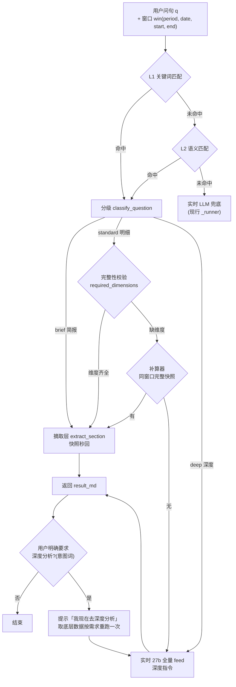

# A-20260919-001-ai回答模式分级框架

**状态**：DRAFT（v0.1，待人工终审后 LOCKED）
**日期**：2026-09-19
**工单**：#152 AI 回答模式分级框架（简报/明细/深度 + 完整性校验 + 同窗口快照补算）
**架构师阶段产出**：Trae Agent（Architect 阶段）
**审查结论**：待人工终审

> **性质**：需求（REQ）—— 本设计只约束「AI 问答分级链路 + 完整性校验 + 补算 + 深度兜底」这一个集成（即 `ai.py` / `ai_mode_service.py` / `ai_completeness_service.py` / `ai_recompute_service.py` / `ai_report_templates` 模板配置扩展），不构成全仓约束。全仓约束条款见 `docs/standards/`（META）。
> **关联工单**：#152
> **依赖前置**：#150（闲聊闸门）、#151（窗口对齐）已闭环；#135（摘取层 + 三级命中）现行

---

## 〇、设计说明（五要素 · 界面设计说明规范）

| 要素 | 内容 |
|---|---|
| **目的** | 替**运营主管 / 客服主管**回答：我按维度细问（如"昨天退款明细分析"）时，能否拿到**维度齐全**的回答，而不是因预生成时点快照缺维度（坏缓存/空 routes 导致四路「未提供」）而拿到过简答案；我问得深（为什么/对比/根因）时能否自动升级到深度分析；所有维度追加只改模板配置、不写业务代码 |
| **逻辑** | ① 回答按问句意图**自动分级**：简报 Brief（泛问→快照摘取秒回）/ 明细 Standard（维度词→快照优先，缺维度补算）/ 深度 Deep（为什么/对比/根因→实时 27b 全量 feed）<br>② **完整性校验器**按模板 `required_dimensions` 校验快照 `answer_md` 的维度覆盖，缺维度 → 补算器先找**同窗口**维度完整的快照，无则实时 27b 按窗口+required_dimensions 生成<br>③ **层层兜底**：简报 → 明细(补算) → 深度(自动) → **用户明确要求深度分析**（对答案不满意时，提示「我现在去深度分析」并按需求取底层数据重跑一次）<br>④ 维度清单**模板可配置**（`required_dimensions` JSONB），预生成 LLM 按维度生成，加维度只改配置 |
| **口径** | 数据源 = `ai_feed._build_feed`（内部 service 直连聚合，与 external /brief 同底层同缓存）；窗口 = #151 三态对齐（区间按报告内容窗口[start,end]重叠 / 单日按 snapshot_date / 无窗口取当日）；维度覆盖判定 = `required_dimensions` 关键词在快照 `answer_md` 中是否出现（全树统一口径，复用 `_count_keyword_hits` 判定法） |
| **取舍** | ① **不做**逐案打补丁（如只修退款四路）——维度是模板配置，退款/投诉/接待/趋势等**每个业务分块共用同一框架**，加维度只改配置<br>② **不**做"系统自动判定回答不达标才降级"——快照缺维度由**完整性校验器**自动触发补算（这是规则，不是主观判定）；而**深度分析兜底**只在**用户明确要求**时触发（用户拍板），不自动越级<br>③ **不**做历史快照回补——已生成快照不回填（`#152` 背景确认），用户要完整维度走补算/深度分析实时路径<br>④ **不**改动 `ai_feed` 口径与 `_SYSTEM_PROMPT` 铁律——补算/深度分析复用 `build_messages`，口径与全站一致 |
| **工单** | #152（本设计）；关联 #150/#151（前置已闭环）、#135（摘取层现行） |

---

## 一、模块边界图

```mermaid
graph TB
  subgraph 用户层
    U1["AssistantDrawer.vue<br/>(问句输入 + 答案渲染 + clarify/深度分析提示)"]
  end

  subgraph API层["API 层(改造)"]
    A1["ai.py POST /ai/analyze<br/>★ 命中快照→分级→校验→摘取/补算"]
  end

  subgraph 分级层["分级层(本设计新增)"]
    G1["ai_mode_service.classify_question<br/>★ 意图分级: brief/standard/deep"]
  end

  subgraph 校验层["校验层(本设计新增)"]
    C1["ai_completeness_service.check_dimensions<br/>★ 维度覆盖校验"]
  end

  subgraph 补算层["补算层(本设计新增)"]
    R1["ai_recompute_service.recompute<br/>★ 同窗口快照优先 → 实时 27b"]
  end

  subgraph 命中层["命中层(现行, 调用方改造)"]
    M1["ai_report_matcher.match_template_report<br/>L1 关键词匹配(现行)"]
    M2["ai_semantic_matcher.semantic_match<br/>L2 语义匹配(现行)"]
    E1["ai_extract_service.extract_section<br/>摘取层(现行)"]
  end

  subgraph 数据层
    D1["ai_reports<br/>(预生成快照)"]
    D2["ai_report_templates<br/>★ detail_level + required_dimensions(新列)"]
    D3["ai_feed._build_feed<br/>(底层聚合, 实时)"]
  end

  U1 --> A1
  A1 --> M1
  M1 -->|命中| G1
  M1 -->|未命中| M2
  M2 -->|命中| G1
  M2 -->|未命中| D3
  G1 -->|brief| E1
  G1 -->|standard| C1
  G1 -->|deep| D3
  C1 -->|维度齐全| E1
  C1 -->|缺维度| R1
  R1 -->|同窗口完整快照| E1
  R1 -->|无 → 实时 27b| D3
  D1 --> M1
  D2 --> M1
  D1 --> C1
  D1 --> R1
  D1 --> E1
```



**边界**：本设计**只新增分级层 + 校验层 + 补算层**，不触碰：
- `ai_feed.build_messages` / `_SYSTEM_PROMPT`（#134 锁定 H2 锚点，不变）
- `ai_report_matcher.match_template_report`（L1，不变）
- `ai_semantic_matcher.semantic_match`（L2，不变）
- `ai_extract_service`（摘取层，不变，仅调用方新增分级/校验前置）
- `ai_reports` 表结构（无 DDL 变更）

---

## 二、回答模式分级框架（核心契约）

### 2.1 四级链路（含层层兜底）



### 2.2 各级判定逻辑

| 级别 | 判据 | 数据来源 | 命中后动作 | 未达标后动作 |
|---|---|---|---|---|
| **简报 Brief** | 泛问/无维度词（如"今天怎么样"） | 预生成快照 | 摘取层 `extract_section` 秒回（快照即最终，时点口径） | — |
| **明细 Standard** | 含维度词（明细/分布/涉诉/挽回/四路/各专项 等） | 快照优先 → 缺维度补算 | 完整性校验：维度齐全 → 摘取层；缺维度 → 补算器 | 补算器无同窗口完整快照 → 实时 27b 按窗口+required_dimensions 生成 |
| **深度 Deep** | 为什么/对比/根因/建议/分析 等深度意图 | 实时 27b 全量 feed | `build_messages`（完整 feed）+ 深度指令生成 | LLM 失败 → 走现行错误兜底 |
| **兜底 Deep-Req** | **用户明确要求**（对答案不满意：如"太简单/再详细/详细点/这不对/重新分析/深度分析"） | 实时 27b 全量 feed | 先提示「我现在去深度分析（取底层数据按您的需求重新跑一次分析）」→ 按窗口+required_dimensions 实时生成 | LLM 失败 → 现行错误兜底 |

### 2.3 兜底层（#152 用户补充，2026-09-19 拍板）

- **触发**：`用户明确要求`——问句命中深度分析意图词，或前端标记"对本次回答不满意"重发时，**不做自动越级**。
- **动作**：响应中先回显提示「我现在去深度分析：取底层数据，按您的需求重新跑一次分析」（`status=deep_analyzing` 或 `result_md` 前缀），随后按问句窗口 + 模板 `required_dimensions` 实时组装 feed 调 27b。
- **与 Deep 的区别**：Deep 是问句意图**自动分级**的结果；兜底层是**用户主动不满意**后的强制重算。两者共享实时 27b 路径，仅触发条件与交互提示不同。
- **本质**：把现行 L3 clarify（"请选择段落"）升级为**主动告知 + 直接重算**，不把用户晾在选择清单上。

---

## 三、模板配置扩展（DDL）

`ai_report_templates` 新增两列（Alembic 迁移，单 head）：

| 列 | 类型 | 说明 |
|---|---|---|
| `detail_level` | `VARCHAR(16) NOT NULL DEFAULT 'standard'` | 模板期望的回答详细级别：`brief` / `standard` / `deep`。预生成按此级别组织输出密度 |
| `required_dimensions` | `JSONB NULL` | 该模板对应的**业务维度清单**（框架无关业务，退款/投诉/接待各自配置）。如 refund 类：`["总金额", "笔数", "四路分布", "涉诉率", "挽回率"]`。NULL=不做完整性校验（简报类） |

种子回填（现有 3 模板）：
- `daily_general_morning`（tpl=1）：`detail_level=standard`，`required_dimensions` 按当期日报维度（总览级：接待/退款/投诉/趋势/结论）
- `weekly_compare_last`（tpl=2）：`detail_level=deep`（周报带对比/归因），`required_dimensions` 同日报维度加「对比」
- `monthly_overview`（tpl=3）：`detail_level=deep`，`required_dimensions` 同周报

> 预生成 LLM 的 prompt 注入 `required_dimensions`：`_SYSTEM_PROMPT` 不动，在 `build_messages` 的 business_ctx 追加「本次报告必须覆盖维度：{list}」，缺失维度写"暂无"不得省略（与 #134 H2 锚点同纪律）。

---

## 四、意图分级器 `ai_mode_service.py` 接口契约

### 4.1 模块路径

`backend/app/services/ai_mode_service.py`（新建）

### 4.2 函数签名

```python
def classify_question(question: str) -> dict:
    """问句意图分级: brief / standard / deep。

    规则优先(毫秒级, 零 LLM):
      - deep: 命中深度意图词(为什么/为何/原因/对比/分析/建议/根因/趋势/环比/同比/怎么样变...)
        → "deep"
      - standard: 命中维度词(明细/分布/涉诉/挽回/四路/各专项/笔数/金额/多少/几个...)
        → "standard"
      - 其余 → "brief"

    规则未命中(无任何意图词) → LLM 兜底(轻量 7b, 复用 _EXTRACT_PROVIDER_CODE 链,
    timeout_s=10): "判定问句意图级别, 输出 JSON {\"mode\":\"brief|standard|deep\"}"。
    LLM 失败 → 兜底 "standard"(宁可校验补算, 不让缺维度回答直接流出)。

    返回: {"mode": "brief|standard|deep", "source": "rule|llm"}
    """
```

### 4.3 判定优先级

**deep > standard > brief**。问句"为什么昨天退款四路这么少，明细呢" → 含"为什么" + "明细" → 取 **deep**（深度意图优先，允许深度回答覆盖明细）。

---

## 五、完整性校验器 `ai_completeness_service.py` 接口契约

### 5.1 模块路径

`backend/app/services/ai_completeness_service.py`（新建）

### 5.2 函数签名

```python
def check_dimensions(db: Session, report, template) -> dict:
    """按模板 required_dimensions 校验快照 answer_md 的维度覆盖。

    判定(全树统一, 复用 ai_report_matcher._count_keyword_hits 关键词法):
      - 对每个 required_dimension, 在 answer_md 中查该维度关键词(维度配置是关键词数组)
      - 全部命中 → complete=True; 任一缺失 → complete=False + missing=list

    参数:
      db: Session
      report: AiReport(命中快照, answer_md 是校验对象)
      template: AiReportTemplate(required_dimensions 来源; None/空 → complete=True)

    返回:
      {
        "complete": bool,       # 是否维度齐全
        "missing": list[str],   # 缺失维度列表(complete=True 时为空)
        "required": list[str]   # 校验的维度清单(调试用)
      }

    失败处理: required_dimensions 为空/异常 → complete=True(不阻塞摘取秒回)。
    """
```

---

## 六、补算器 `ai_recompute_service.py` 接口契约

### 6.1 模块路径

`backend/app/services/ai_recompute_service.py`（新建）

### 6.2 函数签名

```python
async def recompute(db: Session, question: str, win: dict,
                    template: AiReportTemplate | None) -> dict:
    """补算: 同窗口完整快照优先 → 无则实时 27b 按窗口+required_dimensions 生成。

    流程(#152 已拍板"同窗口快照优先"):
      1. 查同窗口 is_public=True 快照(窗口定义与 matcher 三态一致:
         区间[start,end]重叠 / 单日 snapshot_date / 无窗口当日),
         按 created_at DESC 排序
      2. 对每份快照调 check_dimensions(required_dimensions 用模板配置;
         模板 None → 用问句维度词临时清单, 仅提示用)
      3. 找到 complete=True 的第一份 → 摘取层 extract_section 秒回
      4. 无 → 实时 LLM: build_messages(win + required_dimensions 注入)
         + 27b 生成(timeout_s=60, max_tokens=AI_MAX_TOKENS)

    返回:
      {
        "result_md": str,
        "source": "snapshot_reuse" | "live_llm",  # 补算数据来源
        "confidence": float,
        "report_id": int | None,                   # snapshot_reuse 时填快照 id
      }

    失败处理: LLM 失败 → 抛 LLMError(调用方走现行错误兜底)。
    """
```

---

## 七、`ai.py` 路由改造

### 7.1 改造后伪代码（L354-L436 命中链路段）

```python
if not payload.force_llm:
    _match_db = SessionLocal()
    try:
        _matched, _tmpl = match_template_report(...)
        # L1 命中
        if _matched is not None:
            _mode = classify_question(q)["mode"]
            if _mode == "brief":
                _ext = await extract_section(_match_db, q, _matched, _tmpl)   # 秒回
            else:
                _ck = check_dimensions(_match_db, _matched, _tmpl)
                if _ck["complete"]:
                    _ext = await extract_section(_match_db, q, _matched, _tmpl)
                else:
                    _rc = await recompute(_match_db, q, {**eff, "date": _win_date}, _tmpl)
                    return R(data={...result_md=_rc, "mode": "standard",
                                   "source": _rc["source"]...})
            # _ext 出结果 → 返回(带 mode/source 标记)
        # L1 未命中 → L2 语义匹配(同款分级/校验/补算, template=None 时跳过校验)
        ...
        # L2 未命中 → 现行 L3 clarify / _runner 兜底
    finally:
        _match_db.close()

# 深度意图(问句含为什么/对比等)即使 L1/L2 命中, 也应走实时 27b:
#   命中快照 → classify=deep → 不摘取, 直接 _runner(完整 feed + 深度指令)
```

### 7.2 兜底层接入（用户明确要求）

```python
# 问句含"深度分析意图词"(太简单/再详细/详细点/这不对/重新分析/深度分析/深挖...)
# → 跳过命中链路, 直接走实时 27b, 且 result_md 前缀提示:
#   "> 我现在去深度分析：取底层数据，按您的需求重新跑一次分析。\n\n"
_DEEP_REQ_WORDS = ("太简单", "再详细", "详细点", "这不对", "不够详细",
                   "重新分析", "深度分析", "深挖", "更细", "详细一点")
if any(w in q for w in _DEEP_REQ_WORDS):
    # 不走命中链路, 直接 _runner; 结果前缀已含"深度分析"提示
    return _submit_runner(...)
```

### 7.3 响应字段

命中/补算/深度路径统一新增：`mode`（brief/standard/deep/deep_req）、`source`（snapshot/extract/snapshot_reuse/live_llm）。前端据此渲染来源标记（快照/补算/实时，见 §八）。

---

## 八、前端来源标记（无强制 UI 改动）

`AssistantDrawer.vue` 答案底部追加小字来源标记（**只读展示，不新增交互**）：
- `source=snapshot/extract` → 「来源：预生成快照」
- `source=snapshot_reuse` → 「来源：同窗口快照补算」
- `source=live_llm` → 「来源：实时深度分析」
- 深度兜底响应 `status=deep_analyzing` → 渲染提示「我现在去深度分析…」后再渲染答案

---

## 九、关键设计决策

### 9.1 为何补算「同窗口快照优先」而非直接实时 LLM

- 快照是 122b 预生成的高质量草稿，`answer_md` 结构完整、H2 齐全，摘取秒回（<1s）
- 实时 27b 每次 10s+，且受冷加载/抢占影响；能复用就复用（#152 拍板）
- 完整性校验兜住"快照缺维度"：缺才补，不缺不动

### 9.2 为何维度清单放模板而非代码

- 用户明确要求**框架通用**：退款/投诉/接待等每个业务分块共用同一框架，维度差异是业务配置不是代码差异
- 加维度只改 `ai_report_templates.required_dimensions` 配置，不动 `ai.py` / 校验器 / 补算器

### 9.3 为何深度兜底只在用户明确要求时触发

- 用户拍板：触发方式 = 用户明确要求，不做自动越级（自动降级只发生在完整性校验的规则层面）
- 避免"回答被系统反复打断重算"的体验，把升级决定权交给提问者

### 9.4 为何分类器规则优先 + LLM 兜底

- 规则毫秒级、零成本，覆盖 95% 意图（为什么/明细/泛问）；LLM 兜底只处理规则歧义
- LLM 失败兜底 standard：宁可触发补算校验，不让缺维度回答直接流出

---

## 十、验收点（对应 #152 验收标准）

| # | 验收点 | 核验方式 |
|---|---|---|
| 1 | 问「昨天退款明细分析」→ 命中同窗口完整快照（四路齐全），无「未提供」 | 生产容器调 `/ai/analyze`，问句同上，断言 `result_md` 含四路分布关键词、`source` 非缺失 |
| 2 | 同窗口无完整快照 → 实时补算并按 required_dimensions 输出 | 构造缺维度场景（删当日完整快照或校验 missing），断言补算 `source=live_llm` 且含 required_dimensions 全部维度 |
| 3 | 问「今天怎么样」→ 简报秒回，不触发补算 | 断言 `mode=brief`、`source=snapshot`，响应 <1s 且不调 LLM 补算 |
| 4 | 问「本月投诉对比上月」→ 深度模式走 27b | 断言 `mode=deep`、`source=live_llm` |
| 5 | 新增维度只改模板配置，不改业务代码 | 修改某模板 `required_dimensions`（如 refund 加「均单价」），重发问句断言新维度被校验/输出 |
| 6 | 兜底层：问「太简单，再详细分析」→ 提示「我现在去深度分析」+ 实时生成 | 断言响应含深度分析提示前缀 + `source=live_llm` |
| 7 | 架构文档 LOCKED + 性质登记 | `head docs/arch/A-20260919-001-*.md` 含 `状态：LOCKED`；`grep "A-20260919-001" docs/README.md` |
| 8 | ruff + 单测 + 全回归通过 | `ruff check` 三个新服务 + `ai.py`；`pytest tests/test_ai_mode_service.py tests/test_ai_completeness_service.py tests/test_ai_recompute_service.py -v`；`pytest tests/test_ai_*.py -q` |
| 9 | git commit 携带 #152 | `git log --oneline | grep #152` |
| 10 | 凭证评论 | issue #152 `## 关闭凭证核验 (2026-09-XX)` 评论 + 表格逐条对应 |

---

## 十一、关联

- **依赖前置**：#150（闲聊闸门）、#151（窗口对齐）已闭环；#135（摘取层 + 三级命中）现行
- **后续**：维度配置管理界面（admin 模板编辑已支持，`required_dimensions` 走 JSONB 编辑）；各业务分块（投诉/接待）的 `required_dimensions` 配置按需补
- **现行参考**：
  - `ai.py` L354-L436（命中链路改造点）
  - `ai_extract_service.py`（摘取层，不变）
  - `ai_report_matcher.py`（L1 匹配 + `_count_keyword_hits` 复用）
  - `ai_feed.py` `build_messages`（实时路径，不变）
  - `ai_report_worker.py` `generate_for_template`（预生成注入 required_dimensions）
