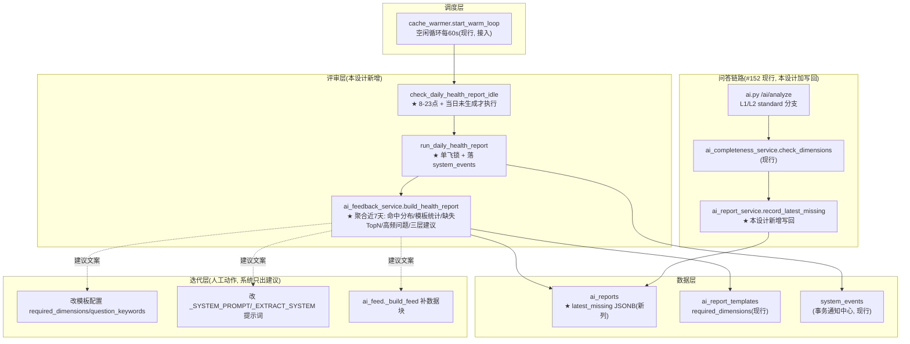

# A-20260919-002-ai提示词反馈闭环

**状态**：DRAFT（v0.1，待人工终审后 LOCKED）
**日期**：2026-09-19
**工单**：#153 AI 提示词反馈闭环（收集→评审→人工迭代，补 latest_missing + 周期健康报告）
**架构师阶段产出**：Trae Agent（Architect 阶段）
**审查结论**：待人工终审（实现已随 #153 落地并生产实测，见 §七）

> **性质**：需求（REQ）—— 本设计只约束「AI 问答结果收集 + 周期健康报告 + 迭代建议」这一个闭环（即 `ai_reports.latest_missing` 列、`ai_feedback_service.py`、`ai.py` standard 校验写回、`cache_warmer` 空闲循环接入），不构成全仓约束。全仓约束条款见 `docs/standards/`（META）。
> **关联工单**：#153（实现与生产实测已随该工单完成）；#152（分级框架，本闭环的前置单向链路）
> **依赖前置**：#152 已闭环（分级→快照→校验→补算单向链路现行）；本工单补「回看与迭代」反馈回路

---

## 〇、设计说明（五要素 · 界面设计说明规范）

| 要素 | 内容 |
|---|---|
| **目的** | 替**运营/客服主管**回答：预生成报告质量好不好、哪里差？——每次问答的命中/缺失/兜底结果不再流失，周期聚合为「提示词健康报告」（命中率 / live 兜底占比 / 缺失维度 TopN / 高频未答好问题），并给出**模板 / 提示词 / feed 供给**三层迭代建议，让提示词与数据供给随真实使用数据**自我发现、自我建议**（迭代动作人工拍板，不自动改） |
| **逻辑** | ① **收集层**：standard 校验（#152 `check_dimensions`）的缺失清单写回 `ai_reports.latest_missing`（每次校验实时落库）<br>② **评审层**：周期任务每日聚合近 7 天数据生成健康报告 → 落 `system_events`（事务通知中心可见）<br>③ **迭代层**：报告只出「建议人工…」三层建议（模板层改配置 / 提示词层改 `_SYSTEM_PROMPT`/`_EXTRACT_SYSTEM` / feed 层补 `_build_feed` 数据块），**系统绝不自动改提示词**（`_SYSTEM_PROMPT` 铁律是全树根） |
| **口径** | 数据 = `ai_reports`（私有问答行 hit_mode + 公共快照 template_id/matched_count/latest_missing）；窗口 = 近 7 天北京时间当日 0 点起（`AT TIME ZONE 'Asia/Shanghai'`）；缺失判定 = #152 完整性校验器 `check_dimensions`（模板 `required_dimensions` 驱动，全树统一）；「已校验」= `latest_missing` 为 JSONB **数组**（空数组=齐全），未校验（NULL / JSON null）由评审时**按模板维度重算兜底** |
| **取舍** | ① **不做**提示词自动迭代——LLM 自动改自己的提示词=灾难，只出建议<br>② **不做**用户满意度模型——无点踩数据，不硬造<br>③ **历史快照不回补生成**（沿用 #152 补算兜底）——仅评审时对缺失判断重算，不重跑生成<br>④ 报告**每日一次**（白天 8-23 点 + 当日未生成才执行），夜间省计算 |
| **工单** | #153（本设计）；关联 #152（前置已闭环） |

---

## 一、模块边界图



**边界**：本设计**只新增**收集写回 + 评审服务 + 调度接入，不触碰：
- `ai_feed.build_messages` / `_SYSTEM_PROMPT` / `_EXTRACT_SYSTEM`（提示词铁律根，只建议不改）
- `ai_completeness_service` / `ai_mode_service` / `ai_recompute_service`（#152 分层，校验器仅被调用）
- `ai_report_worker` 预生成链路（快照生成不动，缺失判断评审时重算）

---

## 二、三层闭环核心契约

### 2.1 收集层：standard 校验写回

`ai.py` L1/L2 standard 分支在 `check_dimensions` 后追加写回（两处同规）：

```python
_ck = check_dimensions(_match_db, _matched, _tmpl)   # 返回 {"complete", "missing", "required"}
record_latest_missing(_match_db, _matched.id, _ck["missing"])
```

```python
def record_latest_missing(db: Session, report_id: int, missing: list) -> None:
    """记录某报告最近一次 standard 维度校验的缺失清单。

    missing=[] → 已校验且齐全(空数组); NULL/JSON-null → 从未被校验(评审时重算兜底)。
    ⚠️ 直接 commit: 校验发生在命中链 standard 分支, 若缺维度走实时补算路径,
    命中会话(_match_db)最终不 commit —— 不在此提交则 missing 永不落库。
    失败仅 log, 不阻塞主流程。
    """
```

### 2.2 评审层：健康报告聚合

```python
def build_health_report(db: Session, days: int = 7) -> dict:
    """聚合近 days 天 ai_reports 生成提示词健康报告数据。

    输出(五段):
      window     {start, end, days, generated_at}
      overall    {questions, by_mode(full/section/live/rule), hits, hit_rate, live_ratio}
      templates  [{code, name_cn, period, detail_level, has_dims,
                   snapshots, matched, checked_count, with_missing}, ...]
      missing_top  [{dim, count}, ...]   缺失维度 TopN(含历史快照重算兜底)
      top_live_qs  [{question, start, end, count}, ...]   高频未答好问题(同问句+同窗口 live≥2)
      suggestions  [str, ...]   三层建议(feed 供给/模板层/提示词层, 只出建议)
    """
```

**口径要点**：
- `hit_rate = (full+section) / 私有问答数`；`live_ratio = live / 私有问答数`（≥50% → 提示词层告警）
- `matched_count` 为快照累计值，模板统计取**窗口内创建快照**的复用合计（横向比较热度，口径近似）
- 缺失维度 TopN = 已校验（`jsonb_typeof='array'`）聚合 + **历史快照重算兜底**（`latest_missing` 为 SQL NULL 或 JSON null 且模板带 `required_dimensions` → `check_dimensions` 对历史 `answer_md` 重算，单条失败跳过）

### 2.3 周期调度与落库

```python
def run_daily_health_report(db: Session | None = None) -> dict | None:
    """生成一次健康报告并落 system_events(进程级单飞锁, 挡住并发重叠)。

    status: 有缺失维度/高频问题/live占比偏高 → partial+warning, 否则 success+info。
    detail  = _to_markdown(data)(含「## AI 提示词健康报告」「### 三、缺失维度 TopN」
             「### 五、迭代建议」等锚点, 事务通知中心可见)。
    """

def check_daily_health_report_idle() -> None:
    """周期入口(挂 cache_warmer 空闲循环, 每60s调): 北京时间 8-23 点
    且当日(action=ai_feedback_health_report, 当日北京时间)未生成 → 生成一次。
    失败仅 log, 不影响主循环。
    """
```

调度接入点：`cache_warmer.start_warm_loop._loop` 每 60s 空闲循环末尾追加 `check_daily_health_report_idle`（与 `ai_warm_idle` 并列，`asyncio.to_thread` 线程桥，不占事件循环）。

---

## 三、数据模型（DDL）

`ai_reports` 新增一列（Alembic 迁移 `e4f5a6b7c8d9`，单 head）：

| 列 | 类型 | 说明 |
|---|---|---|
| `latest_missing` | `JSONB NULL` | 最近一次 standard 维度校验的缺失清单。**数组**=已校验（空数组=维度齐全）；NULL/JSON-null=尚未校验（历史快照，评审时按模板维度重算兜底）。语义与 `matched_count`/`hit_mode` 并列，均不覆盖 `answer_md` 大字段 |

> ⚠️ **SQLAlchemy JSONB 陷阱**：Python `None` 存入 JSONB 列落的是 **JSON null 而非 SQL NULL**（`jsonb_typeof='null'`）。因此聚合 SQL 一律用 `jsonb_typeof(latest_missing)='array'` 守卫「已校验」，否则 `jsonb_array_length('null')` 报 scalar 错、`IS NULL` 也查不到未校验行。

---

## 四、关键设计决策

### 4.1 为何「只出建议、绝不自动改提示词」
`_SYSTEM_PROMPT` 是全树根（#134 锁定 H2 锚点纪律）。LLM 自动迭代自己的提示词=灾难（改错一次影响全部生成）。系统闭环止于「建议」，模板/提示词/feed 改动一律人工落地——这是本闭环与「完全自动化」的明确边界。

### 4.2 为何历史快照「评审时重算缺失判断」而非回补生成
回补生成 = 用 122b 重跑所有历史快照，成本高且时点口径已过期；评审重算只对 `answer_md` 做纯文本维度判定（毫秒级），既能覆盖存量快照的缺失统计，又不改动生成链路。与 #152「历史快照不回补」边界一致。

### 4.3 为何写回直接 commit
standard 校验若命中缺维度 → 走实时补算路径，命中会话 `_match_db` 最终**不 commit**。若 `record_latest_missing` 不直接提交，missing 永不落库（补算路径下会话关闭即丢弃）。直接 commit 的代价是 ORM expire（PK `id` 不受影响），与 #128 命中 bump 行为一致。

### 4.4 为何单飞锁 + 当日幂等
进程级 `threading.Lock(blocking=False)` 挡并发重叠生成；`system_events` 当日 action 存在性检查挡同日重复（idle 每 60s 调一次，无幂等会每小时生成 60 份）。

---

## 五、验收点（对应 #153 验收标准，已生产实测 ✅）

| # | 验收点 | 核验方式（已执行） |
|---|---|---|
| 1 | 每次 standard 校验的 missing 落库 latest_missing | 生产容器对真实月报快照 report_id=311 走 `check_dimensions → record_latest_missing`，SQL 核验 `SELECT latest_missing FROM ai_reports WHERE id=311` → `['四路','挽回','趋势','同比']`；容器内 grep `ai.py` 487/583 两处写回 |
| 2 | 周期任务生成健康报告落 system_events | `check_daily_health_report_idle()` 生成 system_events id=3916（partial/warning，北京时间当日）；二次调用幂等（before=1 after=1）；markdown 含命中率/live占比/缺失TopN/高频问题四段 |
| 3 | 报告指出高频缺失维度 + 三层建议 | 生产实测 missing_top 8 项（四路129/结论117/挽回98/涉诉68/…）；suggestions 含【feed 供给】【模板层】【提示词层】三类文案 |
| 4 | 改模板配置后下期报告相应变化 | 缺失判断完全由模板 `required_dimensions` 驱动（实测 report 311 的 9 维 required 来自模板配置、missing 4 维与其一致）；单测 `test_backfill_recompute_for_null_latest_missing` 覆盖 |
| 5 | 提示词与 feed 改动均为人工落地 | 代码审查：`ai_feedback_service` 只读聚合 + 建议字符串，无任何对 `_SYSTEM_PROMPT`/`_build_feed` 的写入 |
| 6 | 提交携带工单号 + 凭证关单 | commit `b66f037` 含 #153；凭证评论 id=1226 逐条核验后关闭 |

---

## 六、关联

- **依赖前置**：#152（分级→快照→校验→补算单向链路）已闭环，本闭环在其上加反馈回路
- **实现**：#153 已落地（commit `b66f037`，8 文件 +657 行：迁移 `e4f5a6b7c8d9`、`ai_feedback_service.py`、`ai.py` 两处写回、`cache_warmer` 接入、单测 `tests/test_ai_feedback_service.py`），生产部署 git-20260919162538
- **后续**：① 前端事务通知中心展示健康报告 detail（system_events 已可见，UI 不强改）；② 维度配置管理界面按需补各业务分块 `required_dimensions`；③ 「某维度高频缺失但被频繁问」的 feed 供给建议 → 人工在 `_build_feed` 补数据块（半自动迭代）
- **现行参考**：
  - `ai.py` standard 分支（写回点，L1 ~L487 / L2 ~L583）
  - `ai_report_service.py` `record_latest_missing`
  - `ai_completeness_service.py` `check_dimensions`（#152 现行，缺失判定唯一来源）
  - `cache_warmer.py` `start_warm_loop._loop`（调度挂载点）
  - `system_event_service.py` `record_system_event`（事务通知中心落库）
