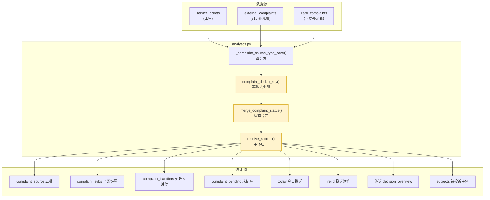

# A-20260910-005 投诉统计口径重构：四分类 / 卡商独立 / 实体级去重 / 主体归一 / 状态合并

**状态**：PENDING（待人工审核）
**提交日期**：2026-09-10
**架构师阶段产出**：Architect 阶段
**关联工单**：`tanzk/csctalon#47`
**关联既有架构**：
- A-20260902-016（投诉与专项改进，**LOCKED**）— 其规定
  `complaint_external_handlers = 外部投诉 + 卡商群投诉` **合并展示**；本单改为**卡商独立**，
  **需人工审核后修改该 LOCKED 文档**
- A-20260901-001（投诉趋势归并回归测试，**LOCKED**）
**范围**：投诉统计口径层。**零表结构删除、零 API 破坏**（新增字段为增量）。

---

## 〇、结论摘要（TL;DR）

1. **投诉判据修正**：工单"投诉"判据由 `service_category ILIKE '%投诉%'`
   改为 **`service_category` 为空白**（用户 2026-09-10 业务澄清；实测交叉验证 100% 成立）。
2. **四分类 + 卡商**：内部投诉 / 商户号投诉 / 外部投诉 / **其他** / **(外)卡商**。
3. **卡商独立**：`card_complaints` 在任何统计口都**单列**，不再并入外部投诉。
4. **实体级去重**：`SN + 手机`（**两者都命中**）+ **30 天窗**；
   两侧数据**都保留**，统计时只算一次；**同一笔多渠道算 1 笔**。
5. **状态合并**：**任一为完成态即视为已处理**（标注依据来源）。
6. **被投诉主体归一**：315 `company_entity` + 卡商 `complaint_group`（过滤内部群）
   + 工单 `submit_params.complaintCompany`，只读映射，**不加表列**。

---

## 一、实证依据（2026-09-10 生产数据）

### 1.1 投诉判据：`service_category` 空白

全表 265,449 行分布：

| `service_category` | 行数 | 性质 |
|---|---|---|
| 套餐疑问 | 81,638 | 售后 |
| 退款 | 65,488 | 售后 |
| 其他 | 33,943 | 其他 |
| 网络故障 | 32,701 | 故障 |
| **（空白）** | **32,058** | **★ 投诉** |
| 换货 | 11,320 | 售后 |
| 设备故障 | 8,284 | 故障 |
| 退货 | 12 | 售后 |
| 投诉 | 5 | 历史遗留 |

**交叉验证**：投诉类 `service_item`（商品投诉/服务投诉/微信投诉/工信部投诉/
全国12315平台/公共服务平台/消费者协会）**100% 落在空白 category 下**，无一例外。

### 1.2 空白 category 构成

| `service_item` | 行数 | 桶 |
|---|---|---|
| 商品投诉 | 17,148 | 内部投诉 |
| 服务投诉 | 9,696 | 内部投诉 |
| 微信投诉 | 4,384 | 商户号投诉 |
| 工信部投诉 | 320 | 外部投诉 |
| 全国12315平台 | 278 | 外部投诉 |
| 公共服务平台 | 87 | 外部投诉 |
| 消费者协会 | 50 | 外部投诉 |
| （空白） | 81 | 其他 |
| 套餐扣费申诉 | 14 | 其他 |

### 1.3 需匹配的两个桶

| 桶 | 工单侧 | 补充表 | 去重前合计 |
|---|---|---|---|
| 外部投诉 | 735 | 2,655（315） | 3,390 |
| (外)卡商 | — | 873 | 873 |

### 1.4 匹配覆盖率（30 天窗，仅匹配空白 category 工单）

| 补充表 | 总数 | SN | 手机 | **SN+手机**（都命中） | 任一 |
|---|---|---|---|---|---|
| 315 | 2,655 | 778 | 694 | **660** | 809 |
| 卡商 | 873 | 109 | 104 | **85** | 126 |

> **69.5% / 85.6% 无工单对应** → 补充表是**独立登记渠道**
> （已办结记录中 61% 无工单）。

### 1.5 ★工单侧无客户姓名字段（去重键约束）

| 表 | 字段 | 实际语义 | 可用 |
|---|---|---|---|
| 工单 | `registrant` | **内部/系统**（`wechat` 26755、`企微-洪佳`） | ❌ |
| 工单 | `handler` | **处理人**（`企微-董梦玲`） | ❌ |
| 工单 | `contact_person` | **100% 空** | ❌ |
| 工单 | `submit_params.username` | 客户名，但**填充 1.2%** | ⚠️ |
| 315/卡商 | `complainant` | 客户姓名 | ✅ |

**实测**：`SN+手机+姓名` 三者都命中 → **0 匹配**（姓名侧缺失）
→ 去重键定为 **`SN + 手机`**。

### 1.6 重复计算

| 重叠 | 行数 |
|---|---|
| 315 ∩ 工单 | 809（任一）/ 660（SN+手机） |
| 卡商 ∩ 工单 | 126（任一）/ 85（SN+手机） |
| 315 ∩ 卡商 | 54（按 SN） |

### 1.7 状态不同步（结构性）

| 项 | 值 |
|---|---|
| 315 已办结 | 2,558 |
| 其中无工单 | **1,566（61%）** |
| 已办结但工单非完成态 | **224（24.9%）** |
| **315 无 `handle_time`** | **2,122 / 2,655 = 79.9%** |

> 根因：补充表 **80% 无处理时间戳**、61% 已办结记录无工单
> → **无法通过同步工单对齐**，故采用**状态合并**（任一完成即已处理）。

---

## 二、目标口径契约

### 2.1 五桶分类

```
投诉总量
├─ 内部投诉     工单: category 空白 AND item ∈ {商品投诉, 服务投诉}
├─ 商户号投诉   工单: category 空白 AND item 含「微信」
├─ 外部投诉     工单: category 空白 AND item ∈ {工信部, 12315, 公共服务平台, 消费者协会}
│               + external_complaints（315 补充表，去重后）
├─ (外)卡商     card_complaints（独立桶，**不并入外部**）
└─ 其他         工单: category 空白 AND item 不在上述集合
```

判定优先级：
```
外部平台关键词 > 微信(商户号) > 商品/服务(内部) > 其他
```
> 外部平台关键词**最优先**（如"12315微信投诉"归外部，监管渠道更重）。

### 2.2 投诉判据（兼容 BMS 未来修复）

```python
def _is_complaint_ticket_cond():
    """工单是否为投诉：
       - 当前: service_category 为 NULL/空白
       - BMS 修复后正式输出"投诉"时: 追加 OR service_category = '投诉'
       - 内部/商户号/外部 由 service_item 决定
    """
    return or_(
        ServiceTicket.service_category.is_(None),
        func.btrim(ServiceTicket.service_category) == "",
        ServiceTicket.service_category == "投诉",   # 向前兼容 BMS 修复
    )
```

### 2.3 实体级去重

```python
def complaint_dedup_key(sn: str|None, phone: str|None) -> tuple|None:
    """实体级去重键（用户拍板）
    - 键 = (SN, 手机)，**两者都必须有值且都相同**才算同一笔
    - 任一缺失 → None（不参与去重，避免误合并）
    - 时间窗 30 天由调用方在 SQL 层施加
    """
```

**语义**：
- 两侧数据**都保留**（不物理删除）
- 统计时按 `(SN, 手机)` + 30 天窗去重 → 同一笔只算一次
- **同一笔多渠道算 1 笔**（保留渠道明细，标 `dedup_of`）

### 2.4 状态合并

```python
def merge_complaint_status(ticket_status, external_result, card_result) -> str:
    """合并状态：**任一为完成态即已处理**（返回 已处理/未处理）

    工单完成态（精确匹配，对齐 complaints._BACKLOG_DONE_SET）:
        已结案/已完成/完成/已解决/已回复/已反馈/已关闭/终止/已终止
    315 完成态（精确匹配，11 项）:
        和解结案/撤销结案/暂行办结/调解结案/调节结案/投诉无效/重复投诉/
        终止调节/退回消委会/未达成一致方案/暂行办理
    卡商完成态（**前缀锚定**，见 2.4.2）:
        已退款*/已退余*/已退差*/已退升级*/退款*/退货退款*/退了*/
        已解决/已电话*/已告知/已短信*/已联系*/已沟通/电话加V*/
        已注销/注销*/已开通/开通直充/已全额*/已补*/已赠*/补偿*/
        同意代充/店铺同意/商家已同意/客服同意/已分发*/已劝退*
    """
```

#### 2.4.1 ★315 办结集合：既有口径**漏判 98 行**（本次实测发现）

| 口径 | 判定已办结 |
|---|---|
| 既有 `complaints._EXTERNAL_DONE_RESULTS`（9 项） | 2,460 |
| **修正后（11 项）** | **2,558** |

遗漏的 `未达成一致方案`(53)、`暂行办理`(45) **都在上游合法枚举**
`ingest_validator._EXTERNAL_RESULT_SET` 里，且语义就是"办结"。
→ **两套既有集合（`complaints.py` 与 `analytics.py` 内联版）都在漏，不能照抄。**

315 `result` 全量实测仅 4 类非办结：`NULL`(77)、`需跟进`(16)、`不予受理`(4)。

#### 2.4.2 ★卡商 `result` 是**混合语义字段**（既有口径过度保守）

实测 873 行 / **117 种**取值，由两类内容混杂：

| 类别 | 行数 | 样例 |
|---|---|---|
| 短状态枚举 | ~546（62.5%） | `已退款完成`189 / `已解决`171 / `已电话告知`71 |
| **自由文本** | ~207 | `跟商家多次沟通无果` / `退套餐，退设备，不接受` / `我向客服申请了退款…` |

后者是"消费者要什么 / 沟通过程"，**不是**处理结果。

- 既有注解"卡商无办结集合，保持不进 handled" → **过保守**：603 行（69.1%）
  明确已处理被全部丢弃。
- 但**也不能用子串包含**：`赔偿损失…但设备费用商家**拒绝了**退货退款申请`
  含"退款"二字 → 会被误判为已解决。
- **正解 = 前缀锚定**：取值必须以明确**完成动作**开头。

**刻意剔除**（逐条核对全部 117 种取值后确认）：

| 剔除项 | 行数 | 理由 |
|---|---|---|
| `已上传凭证` / `已提交服告` / `已报交报告说明` | 6/6/3 | 只是提交/上报，**未办结** |
| `已解释说明` | 1 | 只是解释，**未解决** |
| `退套餐，退设备(，不接受)` / `换货` / `换设备` | 2/5/1 | 消费者**诉求**，非处理结果 |
| 自由文本（无前缀可锚定） | ~207 | 无法判定 |

**三态结果**（用户拍板保留"未标注"独立态）：

| 态 | 行数 | 占比 |
|---|---|---|
| 已处理 | **603** | 69.1% |
| 未处理 | 143 | 16.4% |
| 未标注 | 127 | 14.5% |

> 用户拍板（2026-09-10）：**卡商单列为独立桶，且计入 handled**（不再沿用
> "完全不进 handled"的既有做法）；`已短信告知，未回复` 与 `已短信告知` 同族，
> **算已处理**（客服已输出结论，实测仅 1 行，差异可忽略）。

### 2.5 被投诉主体归一

```python
def resolve_subject(source_bucket, company_entity, complaint_shop,
                    complaint_group, submit_params) -> str|None:
    """315  → company_entity（首选）→ complaint_shop（回退）
       卡商 → complaint_group（内部群→None；监督/受理渠道→独立标签）
       工单 → submit_params.complaintCompany（填充率 1.2%，尽力而为）
    """
```

**实测覆盖率**：`company_entity` 1,349/2,655（50.8%）→ 回退 `complaint_shop`
后 **1,353/2,655（51.0%）**；其余 1,302 行两者皆空 → 显式记 **`未标注`**
（不静默丢弃，见用户决策）。

**★占位脏值必须清洗**：`complaint_shop` 有 **540 行为 `/`**、`company_entity`
3 行为 `/` → 不清洗会出现"被投诉主体 = `/`"的脏排行。

**★卡商 `complaint_group` 语义不纯**（实测 20 种含"群"取值）：

| 归类 | 取值（行数） | 处置 |
|---|---|---|
| 处理方**内部群** | `投诉处理内部群`(149)、`航城投诉处理内部群`(20) | → `None`（未标注） |
| **监督/受理渠道** | `消费者委员会`(23)、`市监局投诉群`(2)、`监局投诉处理群`(1) | → **独立分类 `监督/受理渠道`** |
| **真实卡商** | `云骏售后`(66)、`小皮丘`(39+36)、`金斗云`(30)、`云骏售后群`(11)、`橙果群`(3)、`亿联群`(3) | 保留为被投诉主体 |

> **用户拍板**：监督/受理渠道归入**独立的"监督/受理渠道"分类**，不计入
> 被投诉主体排行 —— 既不混入主体排行，又保留"经消委会转办"这一事实。
>
> ⚠️ **反例防护**：`云骏售后群`/`橙果群`/`亿联群` 含"群"字但**是真实卡商**
> → 不能用"含群字即噪声"的粗暴规则（初版设计会误杀它们）。

> **已验证一致性**：工单 `submit_params.complaintCompany` = 315 `company_entity`
> （样本双方均为 `云客猫`）

---

## 三、模块边界图



---

## 四、接口契约（增量字段，向后兼容）

```json
{
  "complaint_source": {
    "内部投诉": 0, "商户号投诉": 0, "外部投诉": 0,
    "(外)卡商": 0, "其他": 0
  },
  "complaint_dedup": {
    "enabled": true, "key": "sn+phone", "window_days": 30,
    "within_external": 143, "within_card": 81, "cross_table": 53
  },
  "complaint_status_merged": {
    "rule": "任一完成即为已处理",
    "external": {"已处理": 2558, "未处理": 97},
    "card": {"已处理": 603, "未处理": 143, "未标注": 127}
  },
  "complaint_subjects": [
    {"subject": "云客猫", "total": 0, "external": 0, "card": 0, "ticket": 0}
  ],
  "complaint_subject_supervisor": 0
}
```

---

## 五、改造清单

| # | 位置 | 改造 | 风险 |
|---|---|---|---|
| 1 | `analytics.py` `_complaint_source_type_case` | 四分类（+"其他"桶） | **高**（19 处引用） |
| 2 | `analytics.py` `_ticket_category_case` | 判据改 `category` 空白 | **高** |
| 3 | 新增 `complaint_dedup_key` / `merge_complaint_status` / `resolve_subject` | 新函数 | 低 |
| 4 | `analytics.py:3630` 三源计数 | → 五桶 | 中 |
| 5 | `analytics.py:3818+` 卡商 C 层 | 独立成桶 | 中 |
| 6 | `analytics.py:4001` 处理人排行 | 卡商独立表 | 中（**锁 016**） |
| 7 | `analytics.py:4243` 未闭环 | 卡商独立 + 状态合并 | 中 |
| 8 | `analytics.py:3033/3563` 今日投诉 | 卡商单列 | 低 |
| 9 | `analytics.py:7061/7574` 涉诉 SQL | 同步四分类 | 中 |
| 10 | `complaints.py:1089` `_EXTERNAL_DONE_RESULTS` | **补 `未达成一致方案`/`暂行办理`（+98 行）** | 低 |
| 10b | `complaints.py` 其余 8 处 | 逐一核对 | **高** |
| 11 | `external.py`（2 处） | 同上 | 中 |
| 12 | `metric_registry_service.py` | 指标口径同步 | 中 |
| 13 | `complaint_sync.py` | `_sn_to_ticket_map` 返回 `(ticket_no, register_time)`; 新增 `_pick_nearest_ticket()` 按**登记时间最接近投诉日期**选代表（修错配） | 中 |
| 14 | 前端 `Today.vue` / 投诉分析 / 运营看板 | 卡商单列 + 主体 | 中 |
| 15 | `docs/arch/A-20260902-016` | **拆分外部+卡商合并展示**（需人工审核） | — |
| 16 | 已完成: `services/complaint_scope.py` + `tests/test_complaint_scope.py`（51 用例） | 新口径核心模块 | — |
| 17 | 已完成: `analytics.py` 判据切换 + 四桶 + 卡商独立 + `_complaint_subitem_case` 优先级修复 | 口径落地 | — |

---

## 六、技术风险

| 风险 | 说明 | 缓解 |
|---|---|---|
| **口径变更面大** | 19 处引用 + 前端多处 | 分阶段：先加新桶（不删旧），验证后切 |
| **`_ticket_category_case` 判据变更** | 影响所有投诉统计 | 新旧对照，差异应为 0（实测同值 31,968 vs 32,058 中 31,968 为投诉类 item） |
| **去重误合并** | `SN+手机` 同期不同投诉会被合并 | 30 天窗可配；明细标 `dedup_of` 可回溯 |
| **关联错配（已修复）** | `sn_ticket_map[sn][0]` 取**最早登记**工单, 与投诉日期无关; 同 SN 多工单时错配（>60 天差异的 112 对里 **93 对**该 SN 有多张工单） | 改 `_pick_nearest_ticket()` 取**登记时间最接近投诉日期**的一张。实测平均差 **21 天 → 4 天**, >30 天错配 **4 → 0** 条 |
| ⚠️ **不要用硬时间窗** | 我曾拟加 30 天硬窗, 实测会**误杀真实补录工单** —— 6 个被窗排除的 SN 是合法投诉（item = 全国12315平台/消费者协会/公共服务平台）, 集中补录于 `2026-02-03 23:40~23:45`（5 分钟内）, 而投诉日期在 2025-12 | 只做"就近选代表", 不做硬过滤 |
| **子类优先级（已修复）** | `_complaint_subitem_case` 中 `%服务%` 排在 `%公共%` 之前 → `公共服务平台`(87 行) 被错标为"服务投诉" | 外部平台关键词上移到"商品/服务"之前 |
| **卡商群语义不纯** | `complaint_group` 混内部群 + 监督渠道 | 内部群→未标注；监督渠道→独立分类；**保护真实卡商群名**（`云骏售后群`等） |
| **卡商 `result` 混合语义** | 117 种取值，自由文本占比 24% | 前缀锚定 + 三态（未标注独立） |
| **LOCKED 文档冲突** | A-20260902-016 规定合并展示 | **必须先人工审核** |

---

## 八、★去重效应实测（2026-09-10）

| 项 | 结果 |
|---|---|
| 315 组内重复 | **143 笔**（1,600 有键 → 1,457 唯一） |
| 卡商组内重复 | **81 笔**（523 有键 → 442 唯一） |
| **跨表同键（315 ∩ 卡商）** | **53 组** |
| 315 已 matched 工单 | 918/2,655 |

- **跨表 53 组** = 用户所述"一个投诉分多渠道（不同日期）" → 当前被**重复计算**。
- 315 内部 143 笔重复 = 同一 `(SN,手机)` 在同一表内多次登记（可能是跨平台重复推送）。
- 卡商 81 笔同理。

> 去重后 315 计入 1,457 + 卡商 442，两者交集 53 组算 1 笔。

---

## 九、待人工审核确认（用户已拍板 2026-09-10）

| # | 事项 | 用户决策 |
|---|---|---|
| 1 | LOCKED `A-20260902-016` 规定"外部+卡商合并展示" | **卡商单列为独立桶，且计入 handled（603 行）** → 需走人工审核修订该 LOCKED 文档 |
| 2 | 315 主体 `company_entity` 覆盖仅 51% | **company_entity 为主 + `complaint_shop` 回退**，占位值归"未标注" |
| 3 | 卡商表内监督方（消委会/市监局） | **归入"监督/受理渠道"独立分类**，不计入被投诉主体排行 |
| 4 | `已短信告知，未回复`（1 行） | **算已处理**（与 `已短信告知` 同族） |

**仍需人工完成的动作**（`AGENTS.md` 规则 4：LOCKED 文档修改须先走人工审核）：

- [ ] 审核本 PENDING 文档，确认 §2.4.1 / §2.4.2 / §2.5 的口径修正
- [ ] 修订 `docs/arch/A-20260902-016`：`complaint_external_handlers` 由
      "外部投诉 + 卡商群投诉"合并 → **卡商独立表**
- [ ] 修订 `docs/arch/A-20260902-016` §问题4 记载的
      "`_INCLUDE_COMPLAINT_FILES = False` 影响 complaint_sub/roots 聚合"
      → **本单已改为 `True`**（见下）
- [ ] 锁定本文件（`scripts/lock-arch-docs.sh`）

### 9.1 ★`_INCLUDE_COMPLAINT_FILES` 由 False 改为 True（用户拍板 2026-09-10）

原值 `False`（2026-08-14 临时决定，注释写"暂不纳入…如需恢复改为 True"）
导致**卡商在任何来源桶里恒为 0** → 用户需求「(外)卡商 各统计口单列」
**无法实现**。

**实测证据（发现问题的方式）**：同一接口响应内自相矛盾 ——

| 字段 | 值 | 口径 |
|---|---|---|
| `complaint_by_source['(外)卡商']` | **0** | 受开关控制，只查 `service_tickets` |
| `complaint_card_handlers` | **4 人 / 69 笔** | 不受开关影响，直查三表 |

**量化影响**（窗口 2026-07-01~09-11，实测）：

| 桶 | False | True |
|---|---|---|
| 内部投诉 | 9,162 | 9,162 |
| 商户号投诉 | 1,509 | 1,509 |
| 外部投诉 | 343 | **855**（并入 315，+512） |
| **(外)卡商** | **0** | **69**（单列，从无到有） |
| 其他 | 16 | 16 |
| 合计 | 11,030 | **11,611** |

**影响范围说明**：开关只控制**部分**聚合。以下查询**一直是直查三表**、不受影响：
- `complaint_pending`（未闭环列表）
- `complaint_*_handlers`（三张处理人表，含 `complaint_card_handlers`）

这正是长期口径分叉的根源 —— **同一个看板上两个数字不同口径**。

---

## 十、验证

1. **回归**：`pytest tests/test_complaint_trend_merge*.py`（LOCKED A-20260901-001 回归锁）
2. **口径自洽**：断言"五桶之和 = 投诉总量"
3. **判据切换等价**：新旧 `_ticket_category_case` 差异核对
4. **去重正确**：315 组内 143 + 卡商组内 81 + 跨表 53
5. **状态合并**：任一完成 → 已处理；卡商前缀锚定三态 603/143/127
6. **主体归一**：无内部群混入；占位 `/` 归"未标注"；监督渠道独立
7. **前端**：各统计口卡商独立可见
