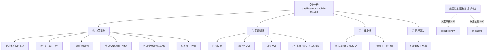
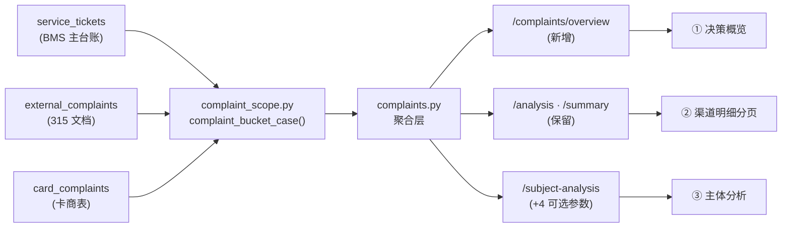

# A-20260911-001 投诉分析整体重构：决策概览 / 渠道同构 / 主体可筛 / 治理外迁

**状态**：PENDING（待人工审核）
**日期**：2026-09-11
**架构师阶段产出**：Architect 阶段
**关联工单**：`tanzk/csctalon#67`
**关联既有架构**：
- A-20260902-016（投诉与专项改进，**LOCKED**）— 其规定投诉子类分布/处理人排行的展示方式；
  本单改为**渠道同构 + 概览瘦身**，**需人工审核后修订该 LOCKED 文档**
- A-20260910-004（导航信息架构重组，**LOCKED**）— 本单涉及菜单项调整（治理外迁），
  **需人工审核**
- A-20260910-005（投诉统计口径重构，**PENDING**）— 本单**不修改口径**，仅消费其成果
- A-20260901-001（投诉趋势归并回归测试，**LOCKED**）
**范围**：投诉分析的**信息架构与展示层**。**零表结构变更、零口径变更、零 API 破坏**（仅新增接口与可选参数）。

---

## 〇、结论摘要（TL;DR）

1. **概览瘦身**：`决策概览` 从 12+ 图收敛为 **4 个趋势块 + 1 张积压明细**，一屏看完。
2. **渠道同构**：内/商/外/卡 四个子页由**同一组件**渲染，消除"外/商各写一套、内/卡缺失"。
3. **主体可筛**：`/subject-analysis` 增加 4 个**可选**参数（滞后兼容），主体页可筛选。
4. **治理外迁**：`人工审核`(#55) / `采集质量`(#60) 移出投诉分析，迁入 `系统管理`。
5. **结论条**：新增自动归因文案（环比/超期/升级率/涉诉金额），把数字翻译成"该干什么"。
6. **时间条统一**：一个控件管全页；周期 日/周/月/自定义 + 快捷 本周/上周/本月/上月/近 N 天。
7. **阈值口径**：报警按 **周 / 月** 对齐（日粒度噪声过大），**不做日环比报警**。
8. **比率指标留空**：接口预留 `ratios: null` 占位，**本期不实现**（数据完整度不足）。
9. **措施时间轴不做**：依赖 `measures` 数据采集，**另开工单**。

---

## 一、模块边界图

### 1.1 页面信息架构（重构后）



### 1.2 数据流（消费既有口径内核，不新增口径）



---

## 二、接口契约

### 2.1 新增：`GET /api/v1/complaints/overview`

决策概览**专用聚合接口**（一次请求出一屏，避免现有 8 个请求并发）。

| 参数 | 类型 | 必填 | 默认 | 说明 |
|---|---|---|---|---|
| `start` | date | 否 | — | 起始日（含） |
| `end` | date | 否 | — | 结束日（含） |
| `grain` | enum | 否 | 自动 | `day` / `week` / `month`；**不传时按跨度自动推导** |
| `compare` | enum | 否 | `prev` | `none` / `prev`(环比) / `year`(同比) |

**自动粒度规则**（`grain` 缺省时）：

| 跨度 | 粒度 | 理由 |
|---|---|---|
| ≤ 31 天 | `day` | 日线可读 |
| 32 ~ 120 天 | `week` | 避免点过密 |
| > 120 天 | `month` | 趋势优先 |

**响应**（金额单位一律**分**，见 `AGENTS.md` 铁律）：

```jsonc
{
  "range": {
    "start": "2026-08-12", "end": "2026-09-11",
    "grain": "week", "compare": "prev",
    "prev_start": "2026-07-12", "prev_end": "2026-08-11"   // 对比期，用于前端标注
  },
  "kpi": [
    { "key": "total",         "label": "投诉总量",   "value": 1378, "prev": 1201, "delta_pct": 14.7, "unit": "条" },
    { "key": "registered",    "label": "新登记",     "value": 1402, "prev": 1188, "delta_pct": 18.0, "unit": "条" },
    { "key": "handled",       "label": "已处理",     "value": 1290, "prev": 1150, "delta_pct": 12.2, "unit": "条" },
    { "key": "backlog",       "label": "总积压",     "value": 214,  "prev": 102,  "delta_pct": 109.8, "unit": "条" },
    { "key": "refund_amount", "label": "涉诉退款金额", "value": 1842000, "prev": 1620000, "delta_pct": 13.7, "unit": "分" }
  ],
  // ★ 结论条: 后端生成(口径统一 + 可单测), 前端只渲染
  "conclusions": [
    { "level": "danger", "text": "外部投诉环比 +38%（14→19），主因「航城监所」+5",
      "drill": { "tab": "external", "platform": "航城监所" } },
    { "level": "warn",   "text": "积压超期 12 条（>7 天），最旧 9 天",
      "drill": { "tab": "backlog", "overdue": true } },
    { "level": "ok",     "text": "内部投诉环比 −12%，连续 3 周下降" }
  ],
  // ① 总量(分项堆积) —— 三源堆叠; 卡商独立, 不并入
  "trend_stacked": [
    { "bucket": "2026-08-12", "label": "08-12~08-18",
      "内部投诉": 120, "商户号投诉": 30, "外部投诉": 8 }
  ],
  "card_trend": [                       // ★ (外)卡商独立序列(不进 trend_stacked)
    { "bucket": "2026-08-12", "label": "08-12~08-18", "registered": 12, "handled": 9 }
  ],
  // ② 登记 vs 处理 (水位, 口径沿用 v2: 出水⊂进水)
  "trend_reg_handled": [
    { "bucket": "2026-08-12", "label": "08-12~08-18",
      "registered": 142, "handled": 130, "net": 12, "cum_net": 12 }
  ],
  // ③ 涉诉金额趋势 (新增聚合: 投诉 SN → 线上退款)
  "trend_refund": [
    { "bucket": "2026-08-12", "label": "08-12~08-18", "count": 12, "amount": 184200 }
  ],
  // ④ 总积压 + 明细
  "backlog": {
    "total": 214, "overdue": 12, "unassigned": 38, "max_aging": 9,
    "by_source":   [ { "name": "内部投诉", "count": 180 } ],
    "by_aging":    [ { "name": "1-3天", "count": 60 } ],
    "items":       [ { "source": "外部投诉", "ticket_no": "…", "device_sn": "…", "aging_days": 9 } ]
  },
  // ★ 比率指标: 预留占位, 本期恒为 null(数据完整度不足, 见 §四风险3)
  "ratios": null
}
```

> **口径一致性**：`trend_stacked` / `trend_reg_handled` 的**分桶口径沿用**
> `complaint_bucket_case()`；`trend_refund` 复用 `subject-analysis` 现有的
> SN→退款关联逻辑，仅改为**按时间分桶**。

### 2.2 改造：`GET /api/v1/complaints/subject-analysis`（**向后兼容**）

新增 4 个**可选**参数，全部缺省时行为与现状**完全一致**：

| 参数 | 类型 | 默认 | 取值 | 说明 |
|---|---|---|---|---|
| `source_type` | enum | `all` | `all` / `merchant` / `external` / `both` | `both` = 两源都有（**升级主体**） |
| `sort_by` | enum | `total` | `total` / `external_ratio` / `refund_amount` / `delta` | 排序键 |
| `top_n` | int | `0` | `10` / `20` / `50` / `0` | `0` = 全部 |
| `compare` | enum | `none` | `none` / `prev` | 是否输出环比 |

新增响应字段（**不删旧字段**）：

```jsonc
{
  "subject_ranking": [
    { "name": "…", "merchant_count": 12, "external_count": 5, "total": 17,
      "refund_count": 3, "refund_amount": 42000,
      "escalated": true,
      "delta_pct": 21.4,          // ★ compare=prev 时才有
      "prev_total": 14            // ★ compare=prev 时才有
    }
  ],
  "filters": { "source_type": "all", "sort_by": "total", "top_n": 0, "compare": "none" }
}
```

### 2.3 前端新增组件

| 组件 | 职责 | 说明 |
|---|---|---|
| `ComplaintTimeBar.vue` | 统一时间条（周期 + 快捷 + 对比 + 应用） | **替换**现 5 个独立 `*Grain` ref |
| `ComplaintConclusionBar.vue` | 渲染 `conclusions[]`，点击 `drill` 跳转 | 纯展示组件 |
| `ComplaintChannelPanel.vue` | 渠道同构面板（KPI + 结构 + 趋势 + 明细） | 由 `source` prop 驱动，渲染 4 次 |

---

## 三、数据库变更（ER 增量）

**无。零表结构变更。**

理由：本单为**展示层重构**，全部数据由既有三表（`service_tickets` /
`external_complaints` / `card_complaints`）+ 既有退款表聚合得出。
`measures` / `policies` 联动**不在本期范围**（见 §五）。

---

## 四、风险清单

1. **时间过滤口径不一致（高）**
   `/analysis` 的 `_action_filter` **只看 `register_time`**，而 `/summary` 是
   `register_time OR finish_time`。重构后概览与新接口必须**统一为同一口径**，
   否则同一页面数字互相打架。**统一后历史数字会变化**，需业务确认后放行。
   → 处置：新接口 `/overview` 明确采用 `register_time OR finish_time`（与 `/summary` 一致），
   并在文档标注 `/analysis` 为**遗留口径**、随渠道页改造逐步收敛。

2. **LOCKED 架构文档冲突（中）**
   `A-20260902-016`（投诉与专项改进）规定投诉子类分布为**三张并排饼图**、处理人排行
   单列外部投诉表；本单改为**渠道同构面板**。属**架构级变更**，
   必须走人工审核并修订该 LOCKED 文档版本。

3. **比率指标口径未定（中）**
   用户明确「比率暂时无意义（数据不完整），留空后续做专项研究」。
   → 处置：接口 `ratios: null` **占位**，前端**不渲染**相关卡片；
   分母口径（投诉/接待、投诉/总客户数、投诉工单/全部工单）**待专项研究单**确定。

4. **治理页外迁破坏既有深链（低）**
   `dedup-review` / `sn-backfill` 目前挂在投诉分析 tab 内；外迁后**路由 path 不变**，
   仅菜单归属变化 → 书签**不受影响**（沿用 A-20260910-004「零 path 变更」原则）。

5. **单文件过大重构回归（中）**
   `ComplaintAnalysis.vue` 现 2134 行、8 tab 强耦合。拆分组件 + tab 重排
   可能引入回归 → 需**页面级冒烟清单**（见 §六验收）。

6. **结论条阈值误报（低）**
   报警按周/月对齐（不做日环比），但仍可能出现"小基数百分比放大"
   （如 3→6 显示 +100%）。→ 处置：**最小基数护栏**（绝对值 < 5 条不触发百分比结论）。

7. **(外)卡商不入总量的一致性（低）**
   概览新增 `card_trend` 独立序列，须确保**不被 `trend_stacked` 合并**，
   否则复现 #53 之前的混桶问题。→ 单测守护。

---

## 四点五、发挥项清单（建议 · 待用户挑选）

用户指示「其他的你发挥一下」。以下为从既有数据**可直接算出、且有决策价值**的增强项，
按「性价比」排序。**未列入 §二 契约的为待定项**，选定后补契约。

| # | 发挥项 | 决策价值 | 实现成本 | 建议期次 |
|---|---|---|---|---|
| A1 | **升级率**（内部→外部占比） | ★★★ 唯一 100% 可控指标；直接量化「内部没处理好」 | 低（`escalation_funnel` 已有） | **P1**（进结论条） |
| A2 | **反复投诉**（同 SN/电话 ≥3 次） | ★★★ 说明「第一次没解决好」，比总量更接近真相 | 中（需新聚合） | P2 |
| A3 | **主体集中度**（Top3 占比） | ★★ 集中度高 → 可定点治理；分散 → 需系统方案 | 低 | P2 |
| A4 | **首次响应时长**（登记→首次处理） | ★★ 现有 `timeliness` 是「处理总时长」，非响应时长 | 中 | P2 |
| A5 | **投诉登记时段热力**（小时×星期） | ★★ 直接服务**排班决策**（高峰期不要减人） | 低 | P2 |
| A6 | **SLA 达标率**（≤N 天办结占比） | ★★ 比「平均时长」更抗异常值 | 低（`timeliness` 分桶已有） | P2 |
| A7 | **同主体环比异动榜**（谁涨得最凶） | ★★ 主动发现苗头，而非事后复盘 | 中（依赖 2.2 `compare`） | P3 |
| A8 | **投诉→退款转化率**（每 100 投诉烧多少钱） | ★★ 投诉的「代价单价」 | 低（涉诉金额 ÷ 总量） | P3 |

> **P1 只取 A1**（成本低 + 已在契约的结论条内），其余 P2/P3 视用户挑选补入。

---

## 五、明确不做（Out of Scope）

| 项 | 原因 | 归属 |
|---|---|---|
| 措施/政策时间轴叠加 | `measures` 数据未采集完整 | **另开工单** |
| 比率指标体系 | 数据完整度不足 | **另开专项研究单** |
| 日粒度阈值报警 | 波动过大（用户决策） | 不做 |
| 口径变更 | 本单只消费不修改 | A-20260910-005 负责 |
| 自定义拖拽看板 | `analytics/builder` 已有 | 不做 |
| 发挥项 A2~A8 | 待用户挑选（见 §四点五） | 待定 |

---

## 六、验收标准

| # | 验收项 | 判据 |
|---|---|---|
| 1 | 概览一屏 | 1920×1080 下 `决策概览` 无需滚动可见 4 个趋势块 + 积压明细 |
| 2 | 时间条唯一 | 页面中**仅存在一个**时间粒度控件；`*Grain` 独立 ref 清零 |
| 3 | 周期快捷 | 「本周 / 上周 / 本月 / 上月 / 近7 / 近30 / 近90 / 自定义」全部可用且口径正确（ISO 周） |
| 4 | 环比可用 | `compare=prev` 时 KPI 卡显示环比箭头，对比期起止在页面标注 |
| 5 | 卡商独立 | `card_trend` 不出现在 `trend_stacked`；单测断言三源堆叠总和 == 投诉总量 |
| 6 | 主体可筛 | 4 个筛选（来源/排序/TopN/对比）生效；**不传参时结果与重构前逐项一致**（回归断言） |
| 7 | 治理外迁 | 投诉分析内**无**「人工审核」「采集质量」入口；系统管理内**有**且 path 不变 |
| 8 | 涉诉金额 | `trend_refund` 按时间分桶；金额单位为**分**；与 `subject-analysis` 总额可对账 |
| 9 | 比率占位 | 响应含 `ratios: null`；前端无比率卡片 |
| 10 | 回归 | `ruff` 通过；相关 pytest 全绿；接口**向后兼容**（旧调用方式结果不变） |

---

## 七、分期实施

| 期 | 内容 | 依赖 | 风险 |
|---|---|---|---|
| **P1** | 时间条统一 + 概览瘦身 + 结论条 + `/overview` 接口 | 无 | 低（前端为主） |
| **P2** | 渠道四子页同构 + 卡商独立页 + 主体筛选参数 | P1 | 中（后端加参） |
| **P3** | 治理页外迁 + 菜单调整 + 文档修订 | P2 | 低 |
