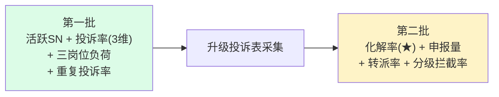

# A-20260914-001 投诉升级链路指标体系设计

**性质**：需求（REQ）—— 设计文档，待评审后实现
**工单**：#84（待定口径：投诉升级率 + 人均负荷）
**版本**：v1.0
**日期**：2026-09-14
**状态**：待人工评审

**关联文档**：
- `docs/standards/投诉渠道口径与对账说明.md`（三源分桶口径，本设计沿用）
- `docs/standards/人均效率算法说明.md`（现有 `work_score` 口径）
- `docs/standards/看板卡片数据说明与下钻规范.md`（卡片双强制）
- 工单 #53（卡商独立）、#81（口径统一）、#82（可控指标）、#85（趋势登记/处理拆分）

---

## 〇、一句话

> **把「投诉升级」的完整链路口径定死，并明确"组长化解"这一当前完全不可见的贡献。**

---

## 一、业务链路（用户 2026-09-14 口述，本文档的**权威依据**）

```
① 客户进线
     ↓
② 普通客服接待，判断「客户可能要投诉」→ 申报【升级投诉】
     ↓
③ 组长处理
     ├─ 化解成功 ──────────────→ 结束    ★ 当前【完全无记录】
     └─ 化解失败 → 登记（数据表未采集）→ 投诉专员逐一联系处理
```

### 1.1 ★ 三个数据缺口（本设计的核心问题）

| 环节 | 现状 | 可否统计 |
|---|---|---|
| ① 客服**申报**升级 | ❌ 无字段 | ❌ 不能 |
| ② 组长**化解成功** | ❌ **完全无记录** | ❌ **不能** ← 最关键 |
| ③ 组长登记 → 专员处理 | 部分在 `service_tickets` | ⚠️ 部分可识别 |

### 1.2 为什么「② 化解成功无记录」是最要命的

> **组长化解掉的投诉根本不进任何表** → 现在**看不到"组长拦住了多少"**。
>
> 而只看「登记了多少投诉」会**惩罚成功化解**：
> 化解了 = 没记录 = 看起来没干活。**这是激励机制的方向性错误。**

→ 故本设计把 **`化解率`** 列为**首要指标**（而非升级率）。

---

## 二、已确认的口径决策（用户 2026-09-14 拍板）

| # | 问题 | 决策 |
|---|---|---|
| 1 | 「升级」识别键 | **按 SN** |
| 2 | 时间窗口 | **30 天**（固定，不随看板筛选变化） |
| 3 | 多次如何处理 | **拆两个指标**：`升级率`（去重，比率）+ `升级次数`（不重，负荷） |
| 4 | 分母维度 | **三个**：外部投诉 SN / 内部投诉 SN / **窗口内活跃 SN** |
| 5 | 人均负荷 | 用「量 ÷ 在岗人数」看**趋势**，不依赖外部基准 |
| 6 | 岗位口径 | 按岗位分组（**实测修正见 §3.1**） |
| 7 | 分子（分岗位） | **专员/组长用投诉结案数**，普通客服用接待数 |
| 8 | 步调 | **分两步**：表到位前做第一批，表到位后补全链路 |

---

## 三、★ 实测结论

### 3.1 ★ 岗位体系：**「投诉专员」存在，但不在 `position` 而在 `specialty`**

> ⚠️ **本人曾一度误判（记录备查，见 §3.1.3）**：
> 只查 `position` 得出「没有投诉专员」的**错结论**，**用户纠正后重查才发现**
> 投诉专员在 **`specialty`（专项）** 字段。

#### 3.1.1 两个字段的分工（架构事实）

| 字段 | 含义 | 实际取值 |
|---|---|---|
| `position` | **岗位（组织层级）** | 客服 / 组长 / 副主管 / 主管 |
| `specialty`（专项） | **干什么（职能）** | 咨询接待 / **投诉接待** / 退款挽回 / 套餐专项 |

→ **投诉专员 = `position=客服` + `specialty=投诉接待`**
→ 当前在岗 **4 人**：陈玉红、苏紫依、洪佳、刘景山

#### 3.1.2 ★ 近 30 天实际分工（投诉 5,069 条）

| 岗位 × 专项 | 数量 | 占比 |
|---|---:|---:|
| 组长 — | 2,595 | **51%** |
| 副主管 — | 825 | 16% |
| 客服 / **投诉接待**（★投诉专员） | **701** | **13%** |
| (handler = NULL，无法归属) | 335 | 6% |
| 客服 / 退款挽回 | 314 | 6% |
| 客服 / 咨询接待 | 298 | 5% |

- **覆盖率 93.4%**（不可归属仅 335 条 = 6%，均为 `handler` 为 NULL）
- **组长 + 副主管 = 67%** → **投诉主体在组长环节**（印证用户流程描述）
- **投诉专员仅 13%** → 专员是「**升级后的末端处理者**」，非一线主力

#### 3.1.3 ⚠️ 两个 JOIN 陷阱（本人已踩）

1. **`handler` 前缀不一致**：同一人存在 `企微-陈玉红` 与 `陈玉红` 两种写法
   → 必须用 `regexp_replace(handler, '^企微-', '')` 匹配。
   **只按 `'企微-' || display_name` 匹配会把 6% 误判为「无任职记录」。**
2. **岗位真身在 `staff_assignments`（SCD Type 2），`Person.position` 只是镜像**
   → 必须过滤 `is_current = true`；写入必须走 `staff_assignment_service`，
   **禁止直接改 `Person.position`**（会被下次同步覆盖）。
   ⚠️ 注意：`staff_assignments.total = 131` 但 `current = 38` ——
   **用 `total` 会重复计数历史岗位**。

### 3.2 假设修正二：`handle_node` **无区分度**

实测：投诉类工单 `handle_node` **全部 = 「运营部门」**（14,509/14,509）→ 不可用于分层。

### 3.3 数据可得性结论

| 数据 | 状态 |
|---|---|
| `staff_assignments.position`（岗位） | ✅ 可用（**需 `is_current=true`**） |
| `staff_assignments.specialty`（专项） | ✅ 可用（**「投诉接待」= 投诉专员**） |
| 投诉处理人（`ticket.handler`） | ✅ 可用（覆盖 93.4%） |
| `handle_node` | ❌ 恒为「运营部门」，无区分度 |
| 「升级」在 `service_item` | ❌ 2,137 条全是**「设备升级」**（业务类型，与投诉无关）→ **不可作判据** |
| 升级投诉数据表 | ❌ **未采集**（用户确认"接下来会采集"） |

### 3.4 ★ 实测数据基线（2026-06-01 ~ 09-14，可直接复核）

| 项 | 实测值 | 说明 |
|---|---:|---|
| 投诉工单 | 14,509 | 判据 = `service_category` 空白或 `='投诉'` |
| 投诉 SN（去重） | 12,081 | 人均 **1.20 单 / SN** |
| 活跃 SN（去重） | 92,865 | 来自 `cs_records.device_sn` |
| **投诉率** | **13.01%** | 12,081 / 92,865 |
| **30 天内同 SN 重复投诉** | **2,243 条 = 15.5%** | ★ 见 §4.4，是当前唯一可用信号 |
| 投诉 SN 数据质量 | ✅ 0 个 NULL / 0 个空串 | 长度以 14–15 位为主，最高频 SN 仅 6 次 → 无脏值 |

**重复投诉次数分布**（同 SN，30 天窗口内）：

| 重复次数 | SN 数 |
|---|---:|
| 0 次 | 10,112 |
| 1 次 | 1,745 |
| 2 次 | 180 |
| 3 次 | 38 |
| 4 次 | 6 |

> ⚠️ **口径陷阱（本人已踩，记录备查）**：
> 用 `service_category LIKE '%投诉%'` 只能匹配到 **5 条**
>（因客服登记投诉时**不选类别 → 导出为空白**），会得出「重复投诉 = 0」的**假结论**。
> **必须**调用 `is_complaint_ticket_cond()`（**空白 OR '投诉'**）。

---

## 四、指标体系设计

### 4.1 第一批（**数据表到位前可实现**）

> 原则：只用**已验证可得**的数据，不依赖未采集的表。

| # | 指标 | 公式 | 回答的问题 |
|---|---|---|---|
| 1 | **活跃 SN 基数** | 窗口内 `cs_records` 去重设备 SN | 总客户量（所有投诉率的分母基底） |
| 2 | **投诉率(全站)** | 投诉 SN / 活跃 SN | 整体客户不满率（**新增维度**，见 §4.3） |
| 3 | **投诉率(对外)** | 外部投诉 SN / 活跃 SN | 走到外部监管的比例 |
| 4 | **投诉率(对内)** | 内部投诉 SN / 活跃 SN | 内部可拦截的比例 |
| 5 | **组长投诉负荷** | 投诉**结案**数 / 在岗组长数 | 组长工作饱和度（实测承担 51%） |
| 6 | **投诉专员负荷** | 投诉**结案**数 / 在岗**投诉专员**数 | ★ 已确认：分子=结案数（实测 13%，4 人） |
| 7 | **客服接待负荷** | **接待数** / 在岗客服数 | ★ 已确认：客服分子用**接待数**（非投诉数） |
| 8 | **重复投诉率** | 30 天内同 SN 投诉 ≥2 次的条数 / 投诉工单数 | ★ **升级的代理信号**（实测 15.5%，见 §4.4） |
| 9 | 重复投诉 SN 数 | 30 天内投诉 ≥2 次的去重 SN 数 | 定位「反复投诉」的客户（可下钻） |

> **已确认（用户 2026-09-14）**：
> - 组长负荷分子 = **投诉结案数**
> - 重复投诉率 **上板**，但**必须叫「重复投诉率」**（禁叫升级率）
> - 活跃 SN = **窗口内有接待记录的去重 SN**（实测 92,865）
> - 分母分层 = **外部投诉 / 内部投诉 / 活跃 SN** 三个维度

### 4.2 第二批（**升级投诉表采集后**）

| # | 指标 | 公式 | 优先级 |
|---|---|---|---|
| 10 | **组长化解率** | 化解数 / 申报升级数 | ★★★ **首要**（当前完全不可见的贡献） |
| 11 | 升级申报量 | 客服申报升级数（绝对量） | ★★ |
| 12 | 转派率 | 转专员登记数 / 申报升级数 | ★★ |
| 13 | 分级拦截率 | 1 − 转派数 / 申报数 | ★★ （客服+组长的联合拦截能力） |

> **已确认（用户 2026-09-14）**：化解率的「申报」起点 = **只统计新产生的申报**
> （历史无表，**不补采**）。
> **注**：原「专员人均负荷」已上提到第一批第 6 项（因岗位数据已可得）。

### 4.3 ★ 为什么「活跃 SN」维度最有价值

**它解决一个经典误判**：

> 「这个月投诉少了，是服务水平提升了，还是客户流失了？」

只看投诉绝对值**无法区分**这两种情况。加入 `投诉 / 活跃SN` 后：
- 投诉↓ + 活跃↓ → 可能是**客户流失**（危险信号）
- 投诉↓ + 活跃→ → **真实改善**（值得表扬）

> 这正是工单 #68（比率指标体系研究）想做的事，本设计**提前覆盖**其中一项。

### 4.4 ★ 「无法严格算升级率」→ 用重复投诉作**可实现的代理**

**现状无法严格计算升级率**，因为：
- 升级申报**无字段**
- 组长化解**无记录**

**但实测发现一个可用代理信号**：

> **30 天内同 SN 重复投诉 = 2,243 条（15.5%）**
>
> 业务含义：**同一台设备在 30 天内被投诉两次以上** —— 这几乎必然是
>「第一次没解决 / 客户不满意」→ 即**实质性升级**。

| 指标 | 公式 | 可得性 | 性质 |
|---|---|---:|---|
| **重复投诉率** | 重复投诉数 / 投诉工单数 | ✅ 现在 | ★ **代理指标** |
| **重复投诉 SN 数** | 30 天内投诉 ≥2 次的 SN 数 | ✅ 现在 | 负荷/归因 |

**约束（强制）**：

1. 卡片标题**必须**叫「**重复投诉率**」，**禁止**叫「升级率」——
   两者不同源，混用会重演 #81/#83 的口径错误。
2. ⓘ 中**必须**写明：本指标是**「同 SN 30 天内重复投诉」**，
   是升级的**代理信号**，非真实升级申报率。
3. 真实升级率**留到第二批**（表到位后，用申报数/化解数严格计算）。

---

## 五、升级投诉表 —— 字段需求（供采集设计）

> 本节是**给数据采集方的需求**，不是实现代码。

### 5.1 必需字段

| 字段 | 类型 | 说明 | 为何必需 |
|---|---|---|---|
| `appeal_no` | string | 升级单号（唯一键） | 去重/追溯 |
| `device_sn` | string | 设备 SN | ★ 与投诉按 SN 关联（用户决策 1） |
| `customer_phone` | string | 客户电话 | 弱指纹归并（见 #61） |
| `apply_time` | timestamptz | **客服申报时刻** | ★ 分母起点 |
| `apply_by` | string | **申报客服** | 考核"发现并上报"能力 |
| `resolve_time` | timestamptz | **组长化解时刻** | ★ 分子（化解率） |
| `resolve_by` | string | **处理组长** | 考核组长能力 |
| `resolve_result` | enum | **`化解成功` / `转登记` / `待处理`** | ★★ **最关键字段** |
| `register_time` | timestamptz | 转专员登记时刻 | 转派率 |
| `register_by` | string | 登记人（组长） | —— |
| `handle_time` | timestamptz | 专员处理时刻 | 专员时效 |
| `handler` | string | 专员 | 专员负荷 |
| `handle_result` | enum | 处理结果 | 结案口径 |
| `problem` | text | 诉求原文 | 分类归因 |

### 5.2 ★ `resolve_result` 为什么最关键

它决定**能不能区分「化解成功」与「转派」** —— 没有它，
第 7/9/11 项指标**全部无法计算**，整套设计退回"只看登记量"的老问题。

> **采集方请务必保留该字段**（哪怕是自由文本，也比没有强 —— 可后续归一）。

### 5.3 去重键建议（供采集方参考）

复用既有规范（`docs/standards/数据采集合并去重机制说明.md`）：
- **强指纹**：`(device_sn, apply_time)` 同日同时刻
- **弱指纹**：`(device_sn, 归一化电话, 日期, 问题签名)`（见 #61 残影归并经验）

---

## 六、展示设计（看板落点）

| 指标 | 落点 | 理由 |
|---|---|---|
| 活跃 SN 基数 | 运营分析看板「核心指标」 | 是所有比率的分母基底，应最显眼 |
| 投诉率(全站/对外/对内) | 运营分析看板「投诉专项」 | 与三源四卡同区，便于对照 |
| **重复投诉率** | 运营分析看板「投诉专项」（四卡旁） | 与投诉数同区，一眼看出「反复投诉」占比 |
| 组长投诉负荷 | 运营分析看板「工作效率值排名」加列 | 与现有人效表同区 |
| **投诉专员负荷** | 运营分析看板「工作效率值排名」加列 | 与组长负荷同区，便于横向对比 |
| **客服接待负荷** | 运营分析看板「工作效率值排名」加列 | 与专员/组长同区，构成完整岗位谱 |
| **重复投诉率** | 运营分析看板「投诉专项」（四卡旁） | 与投诉数同区，一眼看出「反复投诉」占比 |
| **化解率**（第二批） | **今日值班看板 + 运营分析看板**（两端都要） | ★ 最高价值指标，日常与复盘都要看 |

**落地要求**（`看板卡片数据说明与下钻规范.md` 双强制）：
- 每张卡有 ⓘ（来源/口径/时点/「空」的含义/**取舍**）
- 每张卡可下钻（带当前时间窗口 + 筛选条件）
- 不可下钻的须显式声明理由

---

## 七、取舍（明确不做什么及原因）

| 不做什么 | 原因 |
|---|---|
| ❌ 不用 `service_item` 含「升级」作判据 | 实测 2,137 条全是**「设备升级」**（业务类型），会引入大量假阳性 |
| ❌ 不用 `handle_node` 分层 | 实测恒为「运营部门」，无区分度 |
| ❌ 第一批**不硬造**"升级率" | 数据缺口明确，硬造会重演 #81/#83 的口径错误 |
| ❌ **不直接改 `Person.position`** | 它只是**镜像**，真身在 `staff_assignments`；直改会被下次同步覆盖 → 必须走 `staff_assignment_service` |
| ❌ **不用 `staff_assignments` 的 `total` 计数** | 实测 `total=131` 但 `current=38`，用 `total` 会**重复计入历史岗位** |
| ❌ **不用 `'企微-' \|\| display_name` 单式匹配** | 实测同人存在有无前缀两种写法，会误判 6% 为「无任职」→ 需 `regexp_replace` |
| ❌ 不改现有 `work_score` 算法 | 本设计**新增**指标，不动既有口径（避免数字变动争议） |
| ⏸ 不基于「印象」定岗位口径 | 已用 14,509 条（长窗口）+ 5,069 条（近30天）实测验证 |

---

## 八、实施路线



| 阶段 | 内容 | 前置条件 |
|---|---|---|
| **第一批** | 活跃 SN + 投诉率(3维) + **三岗位负荷** + 重复投诉率 | ✅ **无**（数据已验证可得，落点=**只做运营分析看板**） |
| **第二批** | 化解率(★) + 申报量 + 转派率 + 分级拦截率 | 升级投诉表采集完成 |

> **已确认（用户 2026-09-14）**：第一批**只做「运营分析看板」**，
> 第二批再两端同步（避免一次性铺开风险）。

---

## 九、已确认决策（用户 2026-09-14 拍板，**无需再确认**）

| # | 问题 | ✅ 最终决策 |
|---|---|---|
| **1** | **活跃 SN 定义** | 用「窗口内有**接待记录**的去重 SN」= **92,865** |
| **2** | **组长负荷的分子** | 用「投诉**结案**数」（非登记数） |
| **3** | **重复投诉率是否上板** | ✅ **上板**，但**必须叫「重复投诉率」**，禁叫「升级率」 |
| **4** | **化解率的「申报」起点** | ✅ 只统计**新产生的**申报（历史无表，**不补采**） |
| **5** | **看板落点优先级** | 第一批**只做「运营分析看板」**，第二批再两端同步 |
| **6** | **投诉专员是否独立岗位** | ✅ **是独立岗位**，但**不需补建** —— 实测已在 `specialty=投诉接待` |

### 9.1 ★ 已修正的错误结论（本人 2026-09-14 中途误判，记录备查）

> ❌ **我曾错误写成**：「岗位表里没有『投诉专员』，投诉主要由组长处理，
> 故把『投诉专员人均负荷』改为『组长投诉负荷』。」
>
> ✅ **用户纠正后重查，真相是**：
> - 岗位体系有**两个维度**：`position`（层级）+ **`specialty`（职能）**
> - **投诉专员 = `position=客服` + `specialty=投诉接待`** → 当前在岗 **4 人**
> - **无需新建岗位**，现有数据已完整支持
>
> **我的错因**：只查了 `position` 一个字段就下结论，**没查 `specialty`**。
> 且 JOIN 时漏了 `'企微-'` 前缀不一致问题，把 6% 误判为「无任职记录」。
>
> → **结论**：第一批指标**保留「投诉专员负荷」**（分子=结案数），
> 与「组长投诉负荷」「客服接待负荷」**并列展示**，构成完整岗位谱。

---

## 十、评审通过后的下一步

1. **建工单**（`docs/standards/issue-workflow.md`：先建工单再动手）
2. **实现第一批**（落点：运营分析看板）
   - 新增 `analytics.today_*` 或 `dashboard_*` 服务函数
   - 岗位归属统一用 `staff_assignments` + `is_current=true` + `regexp_replace` 匹配
   - 每张卡按 `看板卡片数据说明与下钻规范.md` 做**双强制**（ⓘ + 下钻）
3. **清缓存**：改动后必须失效 `today:kpi:*` 与 `complaint:summary:*`
   （口径变更必须清缓存，否则看板仍显示旧口径数字）
4. **第二批** 待升级投诉表采集完成后再启动
